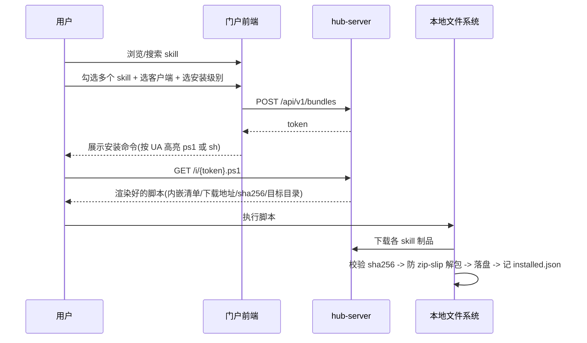
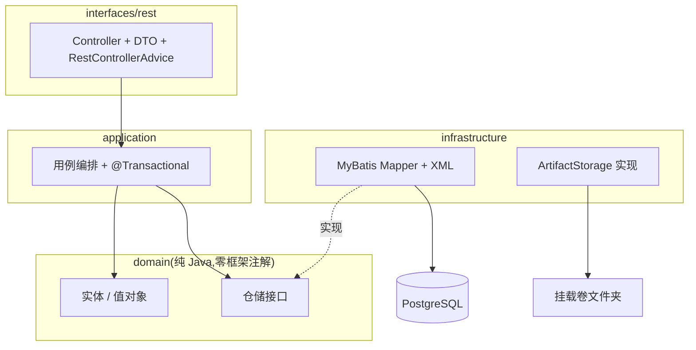
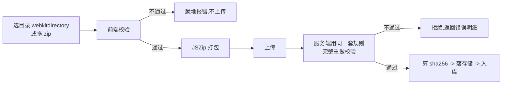

# skill-hub 设计方案

日期:2026-08-02 | 状态:已确认,进入实施

## 一、结论摘要

**skill-hub 是团队内部的 Agent Skill 分发平台**,解决 skill 在团队内的流通问题。

一句话链路:**门户网站选 skill -> 服务端渲染安装脚本 -> 本地一条命令装进 Claude Code / Codex / WorkBuddy 的 skills 目录**。

| 层 | 选型 |
| --- | --- |
| JDK | 21 |
| 后端 | Spring Boot 4.1.x + MyBatis(`mybatis-spring-boot-starter` 4.0.1)+ Flyway |
| 数据库 | PostgreSQL |
| 前端 | React 18 + TypeScript strict + Vite + Tailwind CSS |
| 前端状态 | TanStack Query(服务端数据)+ Zustand(客户端状态) |
| 架构 | 轻量 DDD 锁代码形态,TDD + ArchUnit 锁质量 |
| 交付 | monorepo + Docker Compose,dev / prod 两环境 |

**明确不用**:本地 CLI / 常驻程序、MyBatis-Plus、Nginx、UI 组件库、根目录 pnpm workspace。

## 二、背景与问题

团队内部已经积累了一批 Agent Skill,但流通完全靠人传人:发给同事一个压缩包,同事再自己找目录解压。问题是:

1. **不知道有什么**。没有目录、没有搜索,好的 skill 只在作者的电脑上。
2. **不知道装哪儿**。Claude Code、Codex、WorkBuddy 三家的 skills 目录各不相同,全局级和项目级又是两回事。
3. **版本失控**。谁手上是哪个版本没人清楚,作者改了没人知道。

一个关键的利好:**三家客户端的 skill 包格式完全一致**,都是 Anthropic Agent Skills 规范(`SKILL.md` + 可选 `references/` `scripts/` `assets/`),差异只在落盘根目录。所以分发内容可以统一,客户端支持做成一张适配表。

| 客户端 | 全局 | 项目级 |
| --- | --- | --- |
| Claude Code | `~/.claude/skills/` | `<项目>/.claude/skills/` |
| Codex | `~/.codex/skills/` | `<项目>/.codex/skills/` |
| WorkBuddy | `~/.workbuddy/skills/` | 待验证,见第十一节 |

## 三、核心链路



项目级安装不需要服务端知道用户的项目路径:**用户 cd 到项目目录再跑脚本**,脚本按当前工作目录落盘,写入前打印目标路径要求确认。

## 四、关键决策与取舍

### 4.1 不做本地常驻程序

**背景**:要实现"在网页上点一下就装到本地",而浏览器 JS 碰不到文件系统。

**备选方案**:

| 方案 | 做法 | 代价 |
| --- | --- | --- |
| A. 本地 CLI + daemon | 装一个常驻程序监听 127.0.0.1,网页 fetch 它 | 要写 CLI、编译三平台二进制、做代码签名、管自动更新;非研发要先装程序 |
| B. 官方 plugin marketplace | 复用 Claude Code 的 `/plugin marketplace add` | 只覆盖 Claude Code,Codex / WorkBuddy 用不了,项目级也覆盖不到 |
| C. 服务端渲染安装脚本 | 网页生成一条命令,用户本地执行 | 网页不能真正"点一下就好",要复制一条命令 |

**选 C**。理由:C 直接消掉整个本地端工程——不用写 CLI、不用编译跨平台二进制、不用代码签名、不用管自动更新。本地那一侧退化成一段服务端渲染的文本,零安装零运行时依赖。付出的代价只是"研发要复制一条命令",而使用者以研发为主,这个代价接近于零。

**放弃了什么**:非研发用户无法做到零终端操作。兜底方案是网站提供"直接下载 zip"按钮 + 目标路径一键复制的图文说明。

**连带结论**:正因为放弃了本地程序,"零运行时依赖"这条约束就落在脚本身上而不是服务端上,**服务端因此可以自由选型**,这直接解锁了 4.2。

### 4.2 服务端用 Java

**背景**:团队以 Java 为主、也有前端,当前只有一个人开发。

**备选方案**:

| 方案 | 优势 | 代价 |
| --- | --- | --- |
| A. 全 TypeScript | 一人开发最快,校验逻辑三处复用 | Java 同事接手要学 TS |
| B. Go 本地端 + TS 服务端 | 本地端体验最好 | 两种语言,团队 Go 储备为零 |
| C. Java 服务端 | 团队交接阻力最小,运维熟悉 JVM | 开发速度慢于 TS |

**选 C**。4.1 定了不做本地程序之后,B 方案的前提就不存在了;A 和 C 之间,交接阻力压倒开发速度——这个平台是要长期在团队里活下去的,不是一次性交付。

**放弃了什么**:前后端同语言带来的类型共享与逻辑复用。代价是 skill 包校验规则要在 TS(前端)和 Java(服务端)各写一份。这份重复是有意为之,见 4.3。

### 4.3 skill 包校验故意写两遍

前端和服务端各有一份完整的校验实现。**这不是重复代码,是两个不同性质的东西**:

- 前端那份是**用户体验**:作者上传前就看到问题,不用等服务器往返。
- 服务端那份是**安全边界**:防的是绕过前端直接打 API 的恶意上传。

**前端校验不可信,服务端必须完整重做一遍。** 任何"前端已经校验过了,服务端可以略过"的想法都是错的,这类代码不合并。

### 4.4 HTTP 方法只用 GET / POST

查询走 GET,一切写操作走 POST。更新 `POST /{id}/update`,删除 `POST /{id}/delete`,禁止 PUT / PATCH / DELETE。

**理由**:降低约定的心智负担,避免"这个操作到底算 PUT 还是 PATCH"这类无产出的讨论;也让 curl / PowerShell 调用侧更统一。

**放弃了什么**:REST 语义的完整性。这是有意识的取舍,不是不懂。

### 4.5 轻量 DDD,轻量体现在三条取舍

分层 `interfaces -> application -> domain <- infrastructure`,`domain` 不依赖任何外层、不含任何框架注解。

"轻量"不是"做一半",是明确放弃三样东西:

1. **不强制聚合根 / 领域事件 / CQRS**。业务复杂到真需要时再引,并补决策记录。
2. **简单 CRUD 允许 application 直接调仓储**,不为了"符合 DDD"造一个只有一行转发的领域服务。
3. **不搞 DTO / DO / PO 三层转换**,只保留 DTO + 领域模型两层。只有表结构确实跟领域模型对不上时才引入 PO。

第三条是关键。三层转换在这个体量的项目里纯属自我消耗。

**这些规矩由 ArchUnit 强制执行,不靠自觉。** 文字约束拦不住"某天有人图省事在 Controller 里注入 Mapper",一条会失败的测试可以。

### 4.6 dev 不连 prod 的数据库

**背景**:曾考虑在内网服务器上起一套 PG,dev 和 prod 共用同一实例、只做库名区分,省掉本地基座。

**否决**。四个理由,第一个是决定性的:

1. **Flyway 会要命**。迁移在应用启动时自动执行 DDL。共用实例时,配置写错一次(连接串指错、profile 没切、环境变量没覆盖)就直接改了生产库结构。而 Flyway 铁律是"已执行的脚本不能改",污染 `flyway_schema_history` 后清理极其痛苦。这是**迟早会发生一次**的事故,不是靠小心能避免的。
2. **资源不隔离**。dev 灌测试数据或跑全表扫描会影响 prod。
3. **对象存储更糟**。bucket 区分比库名区分脆弱得多,误配 endpoint 就是生产数据没了。
4. **断网即停摆**。服务器挂了或没 VPN 时连本地调试都做不了。

而且这个方案想省的成本本来就不存在:已定用 Testcontainers 测 Mapper,本地必须有 Docker;Docker 既然在,多起一个 PG 容器的边际成本接近零(空闲 30-50MB)。

**采纳的做法**:一份 compose 定义 dev / prod 共用(保证环境一致),但**各跑各的实例**。具体的文件组织见 4.8。

### 4.7 制品存储推迟选型

当前用 `LocalFsArtifactStorage`(挂载卷的文件夹)。skill zip 是几十 KB 到几 MB,几百个,总量几百 MB —— 这个量级不需要对象存储。

真需要时:**只写 S3 标准 API**(AWS SDK for Java),不碰厂商特有接口,换存储只是改一行 endpoint。

选型对比(留给将来):

- **RustFS**:Apache 2.0、Rust 无 GC 无停顿抖动、内存占用低、声称可 drop-in 替换 MinIO。但截至 2026-08 仍是 `1.0.0-beta.12`,原计划 2026-07 的 GA 已跳票,分布式模式未正式发布。
- **MinIO**:成熟,但社区版 README 已声明不再接受新变更(团队转向商业版),且是 AGPL v3。

**结论**:到时候看 RustFS GA 到了没。到了用 RustFS,没到用 MinIO 撑着。存储存的是数据不是无状态服务,不拿数据安全换那几十 MB 内存。

### 4.8 Compose 单文件 + profiles,PG 数据卷声明为 external

**背景**:4.6 定了 dev / prod 各跑各的实例后,曾拆成 `docker-compose.infra.yml` + `docker-compose.app.yml` 两个文件,理由是"prod 重建应用时操作面碰不到数据库"。

**这个理由被复核推翻了一半,又引出了更好的方案。** 记录完整过程,因为结论本身不如推导过程有价值:

查 Compose 官方文档确认了三条行为:

1. `down -v` 删的是"**当前 Compose 文件 `volumes` 段声明的**命名卷" —— 所以 profiles **拦不住它**。profiles 只控制 service 的启停选择,不影响顶层 `volumes:` 段的作用域。单文件方案下 `--profile full down -v` 会连 PG 卷一起删。
2. `down` 只移除"**当前 Compose 文件中定义的服务**的容器" —— 所以拆文件的隔离比原先设想的更强,`-f app.yml down` 连 PG 容器都不会停。
3. **"external 的网络和卷永不被移除"** —— 这条才是关键。

**结论**:拆文件的保护是"恰好不在作用域内",哪天顺手 `-f infra.yml -f app.yml down -v` 就全没了;把卷声明成 `external` 则是**规范层面禁止删除**,想删必须手动 `docker volume rm`。后者更硬,且不依赖文件怎么拆。

**采纳**:单文件 + profiles(拿到简洁),PG 数据卷 `external: true`(拿到比拆文件更强的保护)。

**放弃了什么**:首次部署多一步 `docker volume create skillhub_pgdata`。这一步是一次性的,而正因为它一次性,后面所有 `down -v` 才安全。**不许为省这一步改成普通卷。**

参考:[docker compose down](https://docs.docker.com/reference/cli/docker/compose/down/)

### 4.9 根目录不用 pnpm workspace

pnpm 只待在 `frontend/`。根目录**不放 package.json**。

**理由**:workspace 的价值在多个 JS 包之间依赖提升与互相引用,而这里只有一个前端包,且**永远不会有第二个**(校验逻辑前端是 TS、后端是 Java,天然复用不了)。为聚合两条命令而在一个 Java 为主的项目根上摆个 package.json,会误导后来人。

**采纳的做法**:`scripts/*.mjs`,只用 Node 内置模块,`node scripts/dev.mjs` 直接跑,零依赖零 node_modules。

## 五、架构

### 5.1 monorepo 结构

```
l-skill-hup/
├── .claude/CLAUDE.md               全项目宪法
├── backend/                        Spring Boot,自带 CLAUDE.md
├── frontend/                       React + Vite,自带 CLAUDE.md;pnpm 只待这里
├── scripts/*.mjs                   统一入口,零依赖
├── docker/
│   ├── Dockerfile                  多阶段:node 构建前端 -> maven 构建后端 -> jre 运行
│   └── docker-compose.yml          单文件,profiles 区分 infra / full
└── docs/                           归集规范见 docs/README.md
```

前端产物直接打进后端 jar 同源托管,**不需要 Nginx**。应用挂 `server.servlet.context-path: /skillhub`,前端 `vite.config.ts` 的 `base` 同步为 `/skillhub/`。

### 5.2 后端分层



依赖方向单向,`domain` 是被依赖方,不依赖任何人。由 ArchUnit 强制:

1. `domain` 不许依赖 `application` / `infrastructure` / `interfaces`
2. `domain` 不许依赖 `org.springframework..` / `org.apache.ibatis..` / `tools.jackson..`
3. `@Transactional` 只许声明在 `..application..`
4. `Mapper` 结尾的类型只许被 `..infrastructure..` 依赖
5. `layeredArchitecture()` 整体校验

### 5.3 前端结构

```
frontend/src/
├── api/            fetch 封装 + 请求函数 + 后端 DTO 的 TS 类型
├── pages/          路由级页面,只做组合
├── components/     纯 UI,不发请求
├── hooks/          业务逻辑与状态
├── lib/            纯函数(skill 包校验、frontmatter 解析、zip 打包)
└── styles/         全局样式与 Tailwind 入口
```

状态三层分工:服务端数据归 **TanStack Query**;跨组件的客户端状态(安装购物车)归 **Zustand**;单组件局部状态用 `useState`。**服务端数据不许塞进 Zustand**,判断标准是"这份数据的真相在服务器上吗"。

## 六、数据模型

- **skill** —— `name`(kebab-case 唯一)、`display_name`、`description`、`tags`、`owner`、`latest_version`
- **skill_version** —— `skill_id`、`version`、`artifact_key`、`sha256`、`size`、`allowed_tools`、`changelog`、`published_at`
- **install_bundle** —— `token`(短随机串)、`items`(skill + version 列表)、`client`、`scope`、`expires_at`

`install_bundle` 是"网页上选一堆 -> 变成一条命令"的载体,选 5 个 skill 也只是一条命令。token 设有效期,防止旧命令在群里流传半年后还在装过期版本。

搜索用 PostgreSQL 的 `to_tsvector` 全文检索,`tags` 用 `text[]`。

## 七、核心流程

### 7.1 发布



校验规则(两侧同一套):

- 必须有 `SKILL.md`,frontmatter 能解析出 `name` / `description`
- 目录白名单 `references/` `scripts/` `assets/`,其余拒绝
- 路径安全:拒绝 `..`、绝对路径、控制字符、符号链接
- 体积:单文件 / 解压后总大小 / 文件数 / 嵌套深度均有上限

### 7.2 安装

脚本执行顺序:**打印目标目录 -> 等确认(`-y` 可跳过)-> 逐个下载 -> 校验 sha256 -> 防 zip-slip 解包 -> 落盘 -> 记 `~/.skillhub/installed.json`**。同名 skill 已存在时,先备份成 `<name>.bak.<时间戳>` 再覆盖。

网站同时给三条路,避免单点失效:

1. 一键命令(`irm ... | iex` / `curl ... | bash`)
2. 下载 `.ps1` 后本地执行 —— 应对 EDR / 杀软拦截"下载即执行"
3. 纯 zip 手动解压 + 目标路径一键复制 —— 给非研发用户

**PowerShell 是一等公民**,`.ps1` 与 `.sh` 两份都要写、都要测。

## 八、安全底线

skill-hub 分发的是**会被 Agent 执行的内容**,没有"内部工具所以无所谓"这一说。

1. 前端校验不是安全边界,服务端必须完整重做。
2. 解包防 **zip-slip**:拒绝 `..`、绝对路径、控制字符、符号链接。
3. 防 **zip 炸弹**:解压后总大小、文件数、嵌套深度上限。
4. 制品 **sha256** 在渲染脚本时内嵌,下载后当场校验,不匹配立即中止。
5. 安装脚本只写既定 skills 目录,不碰其他路径。
6. `install_bundle` token 有有效期。

对应的失败用例必须有测试,**只写正常路径不算写完**。其中"绕过前端直接打 API 上传恶意包"这条专门验证第 1 点。

## 九、环境与部署

只有 dev 和 prod 两个环境,对应 Spring Profile,没有 test / staging。

| | dev | prod |
| --- | --- | --- |
| 位置 | 本机 | 内网服务器 |
| 基座 | 本地 Docker 起 PG | 服务器 Docker 起 PG |
| 应用 | IDE 或 `mvn spring-boot:run`,热重载 | 容器内跑 jar |
| 前端 | Vite dev server + proxy | 已打进 jar,同源托管 |

连接信息一律走环境变量。生产走多阶段 Dockerfile,宿主机不需要装 JDK / Node / Maven。

```
首次部署 docker volume create skillhub_pgdata
起基座   docker compose -f docker/docker-compose.yml --profile infra up -d
开发     node scripts/dev.mjs
自查     node scripts/check.mjs
生产     docker compose -f docker/docker-compose.yml --profile full up -d --build
```

## 十、分期

**P0 主链路** —— skill 列表 / 搜索 / 详情;Web 目录上传发布(前端校验 + 服务端二次校验);选择安装 -> 生成 `.ps1` / `.sh` -> 装到 Claude Code 全局与项目级。存储用本地文件夹,不做登录。

**P1** —— Codex / WorkBuddy 适配;版本管理与更新;zip 下载 + 图文说明页;登录与发布者归属。

**P2** —— 对象存储切换;卸载与已安装列表(基于 `~/.skillhub/installed.json`);安装量统计;审核流。

## 十一、待验证项

**WorkBuddy 的项目级 skills 目录**。已确认全局是 `~/.workbuddy/skills/`,但项目级是否支持、路径是什么,公开资料没查到。

- **验证方法**:本地装 WorkBuddy,在一个项目目录下建 `.workbuddy/skills/<name>/SKILL.md`,看它能否识别。
- **验证时机**:P1 做 WorkBuddy 适配前。
- **在此之前不许猜路径写进适配表。**

## 参考

- [MyBatis Spring Boot Starter](https://github.com/mybatis/spring-boot-starter) —— 4.0.x 支持 Spring Boot 4.0 + Java 17+
- [Spring Boot 4.0 Release Notes](https://github.com/spring-projects/spring-boot/wiki/Spring-Boot-4.0-Release-Notes) —— Jackson 3、自动配置 JAR 拆分
- [WorkBuddy Skills 上手指南](https://www.xmsumi.com/detail/2691) —— `~/.workbuddy/skills/` 与 SKILL.md frontmatter
- [RustFS Releases](https://github.com/rustfs/rustfs/releases) —— 截至 2026-08 为 `1.0.0-beta.12`
