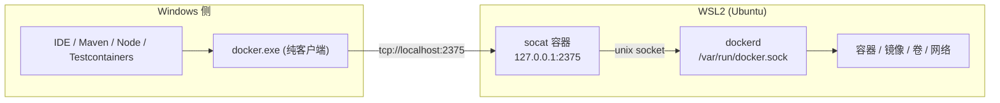

# Windows 下 WSL2 + Docker 开发环境实践

日期:2026-08-02 | 性质:通用经验,不绑定具体项目

## 一、结论摘要

**在 WSL2 里装原生 Docker Engine,Windows 侧只装一个静态 docker CLI,用 `docker context` 指过去。** 这样既拿到完整的 Docker 能力,又不用装 Docker Desktop(避开商业授权与资源占用)。



**一句话原理**:Docker 是 client-server 架构,CLI 只是个 HTTP 客户端。只要能连上 daemon 的 API,CLI 装在哪都一样。

## 二、背景:Windows 上用 Docker 的三条路

| 路线 | 优点 | 代价 |
| --- | --- | --- |
| Docker Desktop | 开箱即用,有 GUI,Windows 容器也支持 | **商业授权**(员工 250+ 或年营收 1000 万美元以上的组织需付费);常驻后台占资源;强制更新 |
| **WSL2 内装原生 Docker Engine** | 免授权、轻量、跟 Linux 生产环境一致 | Windows 侧默认没有 docker 命令,需要额外打通 |
| 远程 Docker 主机 | 本机零负担 | 依赖网络,构建上下文传输慢 |

本文讲第二条路怎么打通到"跟第一条路日常体验等同"。

**什么时候不该选这条路**:需要 Windows 容器(本方案只有 Linux 容器);需要 GUI 管理面板;团队要求环境完全标准化统一。

## 三、原理:为什么这条路走得通

### 3.1 Docker 的 client-server 架构

`docker` 命令本身**不管理任何容器**。它把命令翻译成 HTTP 请求发给 daemon(`dockerd`),daemon 才是真正持有容器、镜像、卷、网络的一方。

通信通道有三种:unix socket(Linux 默认)、npipe(Windows 默认)、TCP。

**推论**:CLI 与 daemon 可以在不同操作系统上。Windows 的 `docker.exe` 连 Linux 的 `dockerd` 是完全正常的用法,不是 hack。

### 3.2 WSL2 的两个关键特性

1. **localhost 转发**:WSL2 内监听 `127.0.0.1` 的端口,Windows 侧可以直接用 `localhost` 访问。
   **注意方向性**:这条是 WSL -> Windows 可见。反过来 Windows 上监听的服务,WSL 内要用宿主 IP 访问(默认 NAT 模式下)。Windows 11 22H2+ 可以开 mirrored networking 模式让两边共享网络栈,localhost 双向通。
2. **interop**:Windows 侧可以 `wsl.exe -d <发行版> -- <命令>` 直接执行 WSL 内的命令,无需 SSH。

### 3.3 把 daemon 暴露成 TCP 的两种方式

**方式 A:改 dockerd 启动参数**

```bash
# /etc/docker/daemon.json
{ "hosts": ["unix:///var/run/docker.sock", "tcp://127.0.0.1:2375"] }
```

改系统配置,systemd 环境下还要处理 `-H` 与 unit 文件的冲突(需要 drop-in 覆盖 `ExecStart`),比较折腾。

**方式 B(推荐):跑一个 socat 容器做转发**

```bash
docker run -d --name docker-tcp --restart always \
  -p 127.0.0.1:2375:2375 \
  -v /var/run/docker.sock:/var/run/docker.sock \
  alpine/socat \
  tcp-listen:2375,fork,reuseaddr unix-connect:/var/run/docker.sock
```

**不动任何系统配置**,`--restart always` 保证 daemon 起来后它自动跟上。整个方案的可恢复性靠这一条。

配合 `systemctl enable docker` 与 `/etc/wsl.conf` 里的 `[boot] systemd=true`,链路就是全自动的:WSL 启动 -> dockerd 起 -> socat 容器起 -> 2375 可用。

### 3.4 安全:这一步必须看

**`tcp://...:2375` 是无 TLS、无认证的 Docker API。能访问它的进程等价于拥有宿主 root 权限** —— 因为可以:

```bash
docker run -v /:/host -it alpine chroot /host
```

因此:

- **必须绑 `127.0.0.1`,绝不能绑 `0.0.0.0`。** 上面命令里的 `-p 127.0.0.1:2375:2375` 前缀不是可选项。绑 `0.0.0.0` 等于把 root 权限开放给整个局域网。
- WSL2 的 localhost 转发只作用于本机,所以绑 127.0.0.1 时局域网访问不到,风险可控。
- 但**同一台机器上的任何进程**(包括恶意软件、被投毒的 npm/pip 包)都能用这个端口。如果机器上会跑不可信代码,应改用 TLS 双向认证(`2376` + 证书)或退回 unix socket 方案。
- 对个人开发机 + 内网环境,127.0.0.1:2375 是可接受的权衡;对共享机器或高敏感环境不是。

## 四、安装(可直接复制)

### 4.1 WSL 侧(一次性)

```bash
# 装 Docker Engine(官方脚本或按发行版文档)
curl -fsSL https://get.docker.com | sh

# 开机自启
sudo systemctl enable docker

# 暴露 TCP(见 3.3 方式 B)
docker run -d --name docker-tcp --restart always \
  -p 127.0.0.1:2375:2375 \
  -v /var/run/docker.sock:/var/run/docker.sock \
  alpine/socat \
  tcp-listen:2375,fork,reuseaddr unix-connect:/var/run/docker.sock
```

`/etc/wsl.conf` 建议:

```ini
[boot]
systemd=true

[interop]
enabled = true
appendWindowsPath = false
```

`appendWindowsPath = false` 是**推荐配置**:不把 Windows 的 PATH 拼进 WSL,避免 `python`/`node` 等命令意外命中 Windows 版本,也减少每次补全时扫描 `/mnt/c` 带来的卡顿。

### 4.2 Windows 侧(一次性)

**docker CLI**(静态二进制,不是 Docker Desktop):

```bash
# 版本与 WSL 里的 daemon 对齐最省心
curl -sL -o docker.zip https://download.docker.com/win/static/stable/x86_64/docker-<版本>.zip
# 解压后只取 docker/docker.exe,放进任意已在 PATH 的目录
# dockerd.exe 用不到,不要拷
```

**compose 插件**(compose 现在是 CLI 插件,CLI 本体不含它):

```bash
mkdir -p ~/.docker/cli-plugins
curl -sL -o ~/.docker/cli-plugins/docker-compose.exe \
  https://github.com/docker/compose/releases/latest/download/docker-compose-windows-x86_64.exe
```

**建 context**:

```bash
docker context create wsl --docker host=tcp://localhost:2375
docker context use wsl
```

### 4.3 验证清单

```bash
docker context ls                                          # wsl 带 * 号
docker version --format "client={{.Client.Version}} server={{.Server.Version}}"
docker compose version
docker ps                                                  # 能看到 WSL 里的容器
docker run --rm alpine echo ok                             # 能拉镜像能跑
```

## 五、关键经验

### 5.1 路径由 daemon 侧解释,不由 CLI 侧解释(最大的坑)

daemon 在 Linux 里,所以**所有传给 daemon 的路径都必须是 Linux 路径**。

```bash
docker run -v D:\data:/app ...      # [FAIL] daemon 把 D:\data 当 Linux 路径解析
docker run -v /mnt/d/data:/app ...  # [PASS]
```

**这条对 compose 同样成立,而且更隐蔽**:compose 文件里写相对路径 `./data:/var/lib/postgresql/data`,CLI 会先把它展开成绝对路径再发给 daemon —— 在 Windows 侧展开出来是 `D:\...`,daemon 一样解析失败。

**最佳实践:一律用命名卷,不用绑定挂载。**

```yaml
services:
  postgres:
    volumes:
      - pgdata:/var/lib/postgresql/data   # [PASS] 命名卷,daemon 自己管
      # - ./data:/var/lib/postgresql/data # [FAIL] 绑定挂载,路径解析失败
volumes:
  pgdata:
```

命名卷由 daemon 在 WSL 内部管理,完全绕开路径转换问题,顺带性能也更好(不走 9P 跨文件系统)。

确实必须挂载宿主文件时,写 `/mnt/<盘符小写>/...`,并接受跨文件系统的性能损失。

### 5.2 build context 恰好相反,由 CLI 侧打包

`docker build` 时 CLI 会把 context 目录**打包成 tar 发给 daemon**,所以:

- Windows 路径的 context 完全正常,`docker build -f docker/Dockerfile .` 在 `D:\project` 下直接可用。
- 性能反而**比在 WSL 里读 `/mnt/d` 更好** —— CLI 走 Windows 原生文件系统读取,而 WSL 读 `/mnt/d` 要过 9P 协议,慢一个数量级。
- Dockerfile 里的 `COPY` 相对 context,不受影响。

**5.1 和 5.2 方向相反,是最容易混淆的地方**:挂载路径给 daemon 解释(要 Linux 路径),构建上下文由 CLI 读取(用 Windows 路径)。

### 5.3 用 docker context,不要用 DOCKER_HOST 环境变量

| | `DOCKER_HOST` 环境变量 | `docker context` |
| --- | --- | --- |
| 持久化 | 要写进 `.bashrc` / 系统环境变量 | 存在 `~/.docker/contexts/`,天然持久 |
| 多环境切换 | 改变量值,容易漏 | `docker context use <名>` |
| 被工具识别 | 部分工具不读 | **Testcontainers、IDE 插件等会自动识别** |

Testcontainers 能自动发现当前 docker context,所以配好 context 之后 **Testcontainers 零配置可用**,不需要再设 `DOCKER_HOST`。

### 5.4 WSL 是按需启动的

WSL 发行版没运行时,`localhost:2375` 不通,所有 docker 命令报连接失败。这是最常见的"昨天还好好的今天连不上"。

**不要让使用者自己排查**,在项目脚本里做探测与唤醒:

```javascript
// scripts/ensure-docker.mjs 片段
import { execFileSync } from 'node:child_process'

async function reachable() {
  try {
    const res = await fetch('http://localhost:2375/_ping', { signal: AbortSignal.timeout(2000) })
    return res.ok
  } catch { return false }
}

if (!(await reachable())) {
  console.log('[INFO] WSL 未运行,正在唤醒...')
  execFileSync('wsl.exe', ['-d', 'Ubuntu-20.04', '--', 'true'], { stdio: 'ignore' })
  // socat 容器 restart=always,dockerd 起来后会自动跟上,轮询等待即可
}
```

### 5.5 工具链分工要清晰

**代码和开发工具链全部留在 Windows 侧,WSL 只负责跑 Docker。**

理由是文件系统性能:WSL2 访问 `/mnt/c`、`/mnt/d` 走 9P 协议,比原生慢一个数量级。三种组合的实际效果:

| 代码位置 | 编译工具位置 | 结果 |
| --- | --- | --- |
| Windows 盘 | Windows | **快**(本方案) |
| Windows 盘 | WSL | 慢,每次读源码都过 9P |
| WSL 内 `~/` | WSL | 快,但 Windows IDE 访问 `\\wsl$` 慢,且备份/同步工具照顾不到 |

本方案之所以成立,正是因为 5.2 —— build context 由 Windows 侧的 CLI 打包,不需要 WSL 去读 Windows 盘。

### 5.6 Testcontainers 的额外注意

- 配好 context 即可用,无需 `DOCKER_HOST`。
- **禁用 `withFileSystemBind`**,原因同 5.1。需要往容器里放文件用 classpath 复制(如 PostgreSQL 的 `withInitScript`)。
- Testcontainers 会起一个 Ryuk 容器做资源清理,TCP 模式下正常工作。
- 容器映射的随机端口在 WSL 侧,Windows 侧测试进程通过 localhost 转发访问,可行。

### 5.7 端口规划

WSL 里往往同时跑着多个项目的容器。**默认端口是最容易撞的**:5432(PostgreSQL)、3306(MySQL)、6379(Redis)、8080(应用)。

**实践**:各项目的宿主映射端口统一加前缀区分,如 `15432` / `13306` / `16379` / `18080`,容器内端口不变。撞端口时 compose 的报错信息不够直观,提前避开比事后排查划算。

## 六、最佳实践清单

**环境侧**

1. WSL 开 systemd(`/etc/wsl.conf` 的 `[boot] systemd=true`),`systemctl enable docker`。
2. TCP 暴露用 socat 容器 + `--restart always`,不改系统配置。
3. **socat 端口必须绑 `127.0.0.1`**,绝不绑 `0.0.0.0`。
4. `appendWindowsPath = false`,避免 PATH 污染与补全卡顿。
5. Windows CLI 版本与 WSL daemon 版本对齐。
6. 用 `docker context`,不用 `DOCKER_HOST`。

**项目侧**

7. **compose 一律用命名卷,禁止绑定挂载。**
8. 端口加前缀避开默认端口。
9. 项目脚本自带 WSL 探测与唤醒,不让人肉排查。
10. Testcontainers 禁用 `withFileSystemBind`。
11. 代码与工具链留在 Windows 侧,不要为了"环境统一"把开发挪进 WSL。

## 七、故障排查

| 症状 | 原因 | 处理 |
| --- | --- | --- |
| `error during connect ... localhost:2375` | WSL 未运行 | `wsl.exe -d <发行版> -- true` 唤醒,等几秒 |
| WSL 起着但仍连不上 | socat 容器没起来 | `wsl -- docker ps -a`,确认 `docker-tcp` 状态与 `restart=always` |
| `invalid mount config ... D:\...` | 用了绑定挂载,Windows 路径 | 改命名卷,或改写 `/mnt/d/...` |
| compose 起容器报路径错误 | compose 里的相对路径被展开成 Windows 绝对路径 | 同上,改命名卷 |
| `docker compose` 提示不是 docker 命令 | 只装了 CLI,没装 compose 插件 | 下载 `docker-compose-windows-x86_64.exe` 放 `~/.docker/cli-plugins/` |
| Testcontainers 找不到 Docker | context 未设为当前 | `docker context use <名>`;或临时设 `DOCKER_HOST` 排除干扰 |
| 端口已被占用 | 其他项目容器占了默认端口 | `docker ps --format "{{.Names}}\t{{.Ports}}"` 查,改用带前缀的端口 |
| 构建极慢 | 在 WSL 内构建且代码在 `/mnt/` 上 | 改用 Windows 侧 CLI 构建(context 由 CLI 打包),或把代码移进 WSL 原生文件系统 |

## 八、参考

- [docker context](https://docs.docker.com/engine/manage-resources/contexts/)
- [Docker daemon socket 安全](https://docs.docker.com/engine/security/protect-access/)
- [WSL 网络与 localhost 转发](https://learn.microsoft.com/windows/wsl/networking)
- [Docker Desktop 订阅条款](https://www.docker.com/pricing/faq/)
