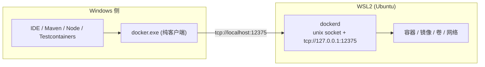

# Windows 下 WSL2 + Docker 开发环境实践与 CLI 完整教程

日期:2026-08-02 | 性质:通用经验,不绑定具体项目

## 一、结论摘要

**Docker Engine 装在 WSL2 里,让 dockerd 原生监听 `127.0.0.1:12375`;Windows 侧只装一个静态 docker CLI,用 `docker context` 指过去。** 这样既拿到完整的 Docker 能力,又不用装 Docker Desktop(避开商业授权与资源占用)。



**一句话原理**:Docker 是 client-server 架构,CLI 只是个 HTTP 客户端。只要能连上 daemon 的 API,CLI 装在哪、什么系统都一样。

## 二、背景:Windows 上用 Docker 的三条路

| 路线 | 优点 | 代价 |
| --- | --- | --- |
| Docker Desktop | 开箱即用,有 GUI,支持 Windows 容器 | **商业授权**(员工 250+ 或年营收 1000 万美元以上的组织需付费);常驻后台占资源;强制更新 |
| **WSL2 内装原生 Docker Engine** | 免授权、轻量、与 Linux 生产环境一致 | Windows 侧默认没有 docker 命令,需要额外打通 |
| 远程 Docker 主机 | 本机零负担 | 依赖网络,构建上下文传输慢 |

本文讲第二条路怎么打通到"日常体验与 Docker Desktop 等同"。

**什么时候不该选这条路**:需要 Windows 容器(本方案只有 Linux 容器);需要 GUI 管理面板;团队要求环境完全标准化统一。

## 三、原理

### 3.1 Docker 的 client-server 架构

`docker` 命令本身**不管理任何容器**。它把命令翻译成 HTTP 请求发给 daemon(`dockerd`),daemon 才是真正持有容器、镜像、卷、网络的一方。

通信通道有三种:unix socket(Linux 默认)、npipe(Windows 默认)、TCP。

**推论**:CLI 与 daemon 可以在不同操作系统上。Windows 的 `docker.exe` 连 Linux 的 `dockerd` 是完全正常的用法,不是 hack。

### 3.2 WSL2 的两个关键特性

1. **localhost 转发**:WSL2 内监听 `127.0.0.1` 的端口,Windows 侧可以直接用 `localhost` 访问。
   **注意方向性**:这条是 WSL -> Windows 可见。反过来 Windows 上监听的服务,WSL 内要用宿主 IP 访问(默认 NAT 模式下)。Windows 11 22H2+ 可开 mirrored networking 模式让两边共享网络栈,localhost 双向通。
2. **interop**:Windows 侧可以 `wsl.exe -d <发行版> -- <命令>` 直接执行 WSL 内的命令,无需 SSH。

### 3.3 暴露 daemon 的两种方式,以及为什么选原生监听

**方式 A(推荐,本文采用):dockerd 原生监听 TCP**

改 `daemon.json` 的 `hosts` + 一个 systemd drop-in,dockerd 直接监听。

**方式 B:跑一个 socat 容器转发**

```bash
docker run -d --name docker-tcp --restart always \
  -p 127.0.0.1:2375:2375 \
  -v /var/run/docker.sock:/var/run/docker.sock \
  alpine/socat \
  tcp-listen:2375,fork,reuseaddr unix-connect:/var/run/docker.sock
```

**选 A 的理由**:

1. **少一个故障点**。B 的链路是 `dockerd -> socat 容器 -> TCP`,多出来这一跳没有任何功能价值,只是转发。
2. **恢复更快更确定**。WSL 会频繁停启,A 是 dockerd 一起来就通;B 还要等容器被调度拉起。
3. **不会被误删**。容器方案里,如果那个 socat 容器归属某个项目的 compose,别人一句 `docker compose down` 就把整台机器的 Windows 侧 docker 干掉了 —— 而报错信息与"WSL 没启动"**完全一样**,极难定位。
4. **概念正确**。监听 TCP 是 daemon 的原生能力,不是容器的职责。

B 的唯一优势是不用改系统配置。如果 dockerd 上正跑着不能中断的服务,可以先用 B 过渡。

### 3.4 安全:这一步必须看

**`tcp://...:12375` 是无 TLS、无认证的 Docker API。能访问它的进程等价于拥有宿主 root 权限** —— 因为可以:

```bash
docker run -v /:/host -it alpine chroot /host
```

因此:

- **必须绑 `127.0.0.1`,绝不能绑 `0.0.0.0`。** 配置里的 `tcp://127.0.0.1:12375` 前缀不是可选项,绑 `0.0.0.0` 等于把 root 权限开放给整个局域网。
- WSL2 的 localhost 转发只作用于本机,所以绑 127.0.0.1 时局域网访问不到,风险可控。
- 但**同一台机器上的任何进程**(包括恶意软件、被投毒的 npm/pip 包)都能用这个端口。如果机器上会跑不可信代码,应改用 TLS 双向认证(`2376` + 证书)或退回纯 unix socket。
- 对个人开发机 + 内网环境,`127.0.0.1:12375` 是可接受的权衡;对共享机器或高敏感环境不是。

**端口为什么用 12375 而不是 2375**:2375 是 Docker TCP 的约定端口,机器上很可能已经被别的东西占用(比如某个项目的 socat 容器)。dockerd 抢占会导致对方起不来。用一个非标准端口彻底并行,互不干扰。

## 四、安装与配置

### 4.1 WSL 侧

```bash
# 装 Docker Engine
curl -fsSL https://get.docker.com | sh

# 开机自启
sudo systemctl enable docker
```

`/etc/wsl.conf` 建议:

```ini
[boot]
systemd=true

[interop]
enabled = true
appendWindowsPath = false
```

`appendWindowsPath = false` 是**推荐配置**:不把 Windows 的 PATH 拼进 WSL,避免 `python`/`node` 等命令意外命中 Windows 版本,也减少补全时扫描 `/mnt/c` 带来的卡顿。

### 4.2 让 dockerd 监听 TCP

**第一步:改 `/etc/docker/daemon.json`,追加 `hosts`**(注意保留文件里已有的其他配置,如 `registry-mirrors`):

```json
{
  "registry-mirrors": [
    "https://mirror.ccs.tencentyun.com",
    "https://docker.mirrors.ustc.edu.cn",
    "https://hub-mirror.c.163.com"
  ],
  "hosts": ["unix:///var/run/docker.sock", "tcp://127.0.0.1:12375"]
}
```

**必须同时保留 unix socket**,否则 WSL 内部和容器内挂载 `docker.sock` 的用法全会断。

**第二步:systemd drop-in 清掉 unit 自带的 `-H fd://`**

这一步不做,dockerd 会因为 "hosts 同时在 flag 和配置文件中指定" 而**启动失败**。

先看原 ExecStart:

```bash
systemctl cat docker | grep ^ExecStart
# ExecStart=/usr/bin/dockerd -H fd:// --containerd=/run/containerd/containerd.sock
```

然后写 drop-in,**保留除 `-H fd://` 外的所有原参数**:

```bash
sudo mkdir -p /etc/systemd/system/docker.service.d
sudo tee /etc/systemd/system/docker.service.d/override.conf <<'CONF'
[Service]
ExecStart=
ExecStart=/usr/bin/dockerd --containerd=/run/containerd/containerd.sock
CONF
```

空的 `ExecStart=` 是 systemd 的清空语法,不写它会变成"追加第二条启动命令"而报错。

**第三步:重启并验证**

```bash
sudo systemctl daemon-reload
sudo systemctl restart docker

systemctl is-active docker                      # 应为 active
ss -ltnp | grep 12375                           # 监听者应是 dockerd 本身
docker version --format '{{.Server.Version}}'   # unix socket 仍可用
```

`ss` 输出里 `users:(("dockerd",...))` 才算成功;如果显示 `docker-proxy`,说明还是容器转发。

**回滚**:

```bash
sudo cp /etc/docker/daemon.json.bak /etc/docker/daemon.json
sudo rm -f /etc/systemd/system/docker.service.d/override.conf
sudo systemctl daemon-reload && sudo systemctl restart docker
```

**改之前一定先备份 `daemon.json`**,并在重启后确认 `restart=always` 的容器都回来了。

### 4.3 Windows 侧

**docker CLI**(静态二进制,不是 Docker Desktop):

```bash
# 版本与 WSL 里的 daemon 对齐最省心
curl -sL -o docker.zip https://download.docker.com/win/static/stable/x86_64/docker-<版本>.zip
# 解压后只取 docker/docker.exe,放进任意已在 PATH 的目录
# dockerd.exe 用不到,不要拷
```

**compose 插件**(compose 现在是 CLI 插件,CLI 本体不含它):

```bash
mkdir -p ~/.docker/cli-plugins
curl -sL -o ~/.docker/cli-plugins/docker-compose.exe \
  https://github.com/docker/compose/releases/latest/download/docker-compose-windows-x86_64.exe
```

**建 context**:

```bash
docker context create wsl --docker host=tcp://localhost:12375
docker context use wsl
```

### 4.4 验证清单

```bash
docker context ls                                          # wsl 带 * 号
docker version --format "client={{.Client.Version}} server={{.Server.Version}}"
docker compose version
docker ps
docker run --rm alpine echo ok
```

### 4.5 WSL 会自己关闭 —— 已知缺陷与应对(最影响体验的一步)

**这一步比前面所有配置都更影响日常体验。** WSL 会周期性自己关掉,连带 dockerd 一起消失,所有 docker 命令报:

```
error during connect: dial tcp 127.0.0.1:12375: connectex:
No connection could be made because the target machine actively refused it.
```

这个报错**极具误导性**:它长得像"docker 配置错了",实际只是 WSL 没在跑。

#### 根因:WSL 的已知缺陷,微软无根本修复

[microsoft/WSL#40363](https://github.com/microsoft/WSL/issues/40363) 描述得最准确:

> **Hyper-V VmSwitch 事件 ID 285(`IOCTL_ENUM_NIC_COUNT_EX` 超时)与 WSL 生命周期管理交互失败**,超时周期与 WSL 关闭周期完全同步(约 60 秒)。

触发需同时满足:WSL 内无持久后台进程、WSL 空闲、Hyper-V 网络操作正常执行、`vmIdleTimeout` 未设为 `-1`。

相关:[#13291](https://github.com/microsoft/WSL/issues/13291)(WSL 2.5.7 起连 `-1` 都失效)、[#9667](https://github.com/microsoft/WSL/issues/9667)(关掉最后一个终端就杀容器)、[Discussion #9245](https://github.com/microsoft/WSL/discussions/9245)。

**注意 systemd 服务不算"活动"** —— `dockerd` 由 systemd 托管并持续运行,照样拦不住关闭。这是最反直觉的一点。

#### 实测无效的手段(记下来,省得重复踩)

| 手段 | 实测结果 |
| --- | --- |
| `vmIdleTimeout` 设大正值(如 86400000) | **无效**。#40363 里 3600000 同样无效 |
| `vmIdleTimeout=-1` | 存活从约 60s 延长到约 150s,**仍会停** |
| WSL 内常驻 `sleep infinity` | 进程被杀(退出码 `0xC000013A` = STATUS_CONTROL_C_EXIT),**且不自动重启** —— WSL 一旦被关,它跟着死,keepalive 永久失效 |

最后一条是关键陷阱:**单纯的 keepalive 是"鸡生蛋"结构**,它能延缓空闲关闭,但没法从"已经被关了"的状态里自己爬起来。

#### 可选方案:不阻止关闭,只保证快速恢复

> **本机没有启用这一节,直接跳到第九节看最终决策再回来。** 这里保留完整方案是因为它对
> "经常手敲 docker 命令"的机器确实有用;但计划任务每分钟闪一次黑窗的干扰很实在,
> 是否启用要自己权衡,不要照着往下装完才发现不想要。

装一个看门狗:每分钟探测 docker API,不通就拉起一个常驻 wsl 会话(即 Docker Desktop 的 `wslkeepalive` 思路)。

脚本放 `%USERPROFILE%\.local\bin\wsl-watchdog.ps1`:

```powershell
[CmdletBinding()]
param(
    [string]$Distro  = 'Ubuntu-20.04',
    [string]$PingUrl = 'http://localhost:12375/_ping'
)

function Test-DockerReachable {
    try {
        $res = Invoke-WebRequest -Uri $PingUrl -TimeoutSec 3 -UseBasicParsing -ErrorAction Stop
        return $res.StatusCode -eq 200
    } catch { return $false }
}

if (Test-DockerReachable) { exit 0 }

Start-Process -FilePath 'wsl.exe' `
    -ArgumentList '-d', $Distro, '--', 'sleep', 'infinity' `
    -WindowStyle Hidden

for ($i = 1; $i -le 30; $i++) {
    Start-Sleep -Seconds 1
    if (Test-DockerReachable) { exit 0 }
}
exit 1
```

**`.ps1` 必须写成纯 ASCII**。PowerShell 5.1 按系统 ANSI 代码页读取 `.ps1`,UTF-8(无 BOM)文件里的中文会被误解码,导致字符串未闭合、脚本直接语法错误。这个坑很隐蔽 —— 报错指向的行号跟真实问题无关。

注册为计划任务(登录时 + 每分钟):

```powershell
$script = Join-Path $env:USERPROFILE '.local\bin\wsl-watchdog.ps1'
$arg = '-NoProfile -WindowStyle Hidden -ExecutionPolicy Bypass -File "' + $script + '"'
$action  = New-ScheduledTaskAction -Execute 'powershell.exe' -Argument $arg
$atLogon = New-ScheduledTaskTrigger -AtLogOn
$repeat  = New-ScheduledTaskTrigger -Once -At (Get-Date) -RepetitionInterval (New-TimeSpan -Minutes 1)
$settings = New-ScheduledTaskSettingsSet -ExecutionTimeLimit (New-TimeSpan -Minutes 5) `
    -AllowStartIfOnBatteries -DontStopIfGoingOnBatteries -MultipleInstances IgnoreNew -StartWhenAvailable
Register-ScheduledTask -TaskName 'WSL-Watchdog' -Action $action `
    -Trigger $atLogon, $repeat -Settings $settings -Force
```

`.wslconfig` 里同时设 `vmIdleTimeout=-1` 作为补充(减少触发频率,但别指望它单独管用):

```ini
[wsl2]
vmIdleTimeout=-1
```

改 `.wslconfig` 需 `wsl --shutdown` 生效,会打断正在跑的容器(`restart=always` 的会自己回来),挑空闲时机做。

#### 实际影响与三层防护

- 手敲 docker 命令:最坏等 1 分钟;急的话自己敲 `wsl -d Ubuntu-20.04 -- true`,两秒。
- 跑项目:**项目脚本自带探测唤醒**(见 6.3),基本无感。
- 长期:关注 #40363,微软修了就撤掉看门狗。

三层缺一不可:`vmIdleTimeout=-1` 降低频率,看门狗兜底恢复,项目脚本覆盖开发场景。

**验证方式**:`wsl --shutdown` 后手动跑一次看门狗脚本,确认 docker 能恢复、容器能自动回来。别只看任务创建成功就当完事。

## 五、docker CLI 完整使用教程

以下每节都标注了 **WSL 场景下的特殊注意点** —— 这是与普通 docker 教程的区别所在。

### 5.1 context:管理连的是哪个 daemon

```bash
docker context ls                                              # 列出所有 context,带 * 的是当前
docker context create <名> --docker host=tcp://localhost:12375  # 新建
docker context use <名>                                        # 切换
docker context update <名> --docker host=<新地址>               # 改地址
docker context inspect <名>                                    # 看详情
docker context rm <名>                                         # 删除
docker --context <名> ps                                       # 单次命令临时用别的 context
```

比 `DOCKER_HOST` 环境变量好在:持久化在 `~/.docker/contexts/`、可切换、**且 Testcontainers 等工具会自动识别**,不用额外配环境变量。

### 5.2 镜像

```bash
docker images                          # 列出本地镜像
docker images -a                       # 含中间层
docker pull nginx:alpine               # 拉取
docker rmi <镜像>                      # 删除
docker tag <源> <新名>                 # 打标签
docker history <镜像>                  # 看分层构成,排查体积
docker inspect <镜像>                  # 完整元数据
docker save <镜像> -o img.tar          # 导出(内网离线分发常用)
docker load -i img.tar                 # 导入
docker image prune                     # 清理悬空镜像
docker image prune -a                  # 清理所有未被容器使用的镜像
```

**WSL 注意**:镜像存在 WSL 的虚拟磁盘里,占的是 `ext4.vhdx` 的空间,不是 Windows 可见的普通文件。见 5.8 的磁盘回收。

### 5.3 容器生命周期

```bash
docker run [选项] <镜像> [命令]
docker ps                              # 运行中
docker ps -a                           # 含已停止
docker ps --format "{{.Names}}\t{{.Ports}}\t{{.Status}}"   # 自定义列,排查端口冲突好用
docker stop <容器>                     # 优雅停止(SIGTERM,超时后 SIGKILL)
docker start <容器>
docker restart <容器>
docker rm <容器>                       # 删除已停止的
docker rm -f <容器>                    # 强制删除运行中的
docker logs -f --tail 100 <容器>       # 跟随日志
docker exec -it <容器> sh              # 进容器
docker inspect <容器>                  # 完整状态,查 IP / 挂载 / 重启策略
docker stats                           # 实时资源占用
docker top <容器>                      # 容器内进程
docker port <容器>                     # 端口映射
docker cp <容器>:/path ./local         # 双向拷文件
```

`docker run` 常用选项:

```bash
-d                     后台运行
--name <名>            指定名字,否则随机
-p 127.0.0.1:15432:5432   宿主端口:容器端口(前缀 127.0.0.1 限制只本机可访问)
-e KEY=VALUE           环境变量
-v <卷名>:/容器路径     挂载命名卷
--restart always       随 daemon 自启,WSL 场景必备
--rm                   退出即删,跑一次性命令用
--network <网络名>      加入指定网络
-it                    交互式 + 分配 TTY
```

**WSL 注意**:
- `-p` 映射的端口在 WSL 侧,Windows 通过 localhost 转发访问,正常可用。
- `-v` **不要用绑定挂载**,见 6.1。

### 5.4 compose

```bash
docker compose up -d                   # 起全部服务
docker compose up -d postgres          # 只起指定服务
docker compose up -d --build           # 强制重新构建
docker compose down                    # 停止并删除容器与网络(不删命名卷)
docker compose down -v                 # 连命名卷一起删,数据丢失,慎用
docker compose ps                      # 本 compose 的容器
docker compose logs -f <服务>          # 日志
docker compose exec <服务> sh          # 进容器
docker compose restart <服务>
docker compose build <服务>            # 只构建不启动
docker compose pull                    # 拉取所有镜像
docker compose config                  # 展开合并后的最终配置,排查变量替换必用
docker compose --profile <名> up -d    # 按 profile 启停
docker compose -f <文件> ...           # 指定 compose 文件
```

`docker compose config` 是排查问题的第一步 —— 它显示变量替换、相对路径展开后的**真实配置**,很多"配置没生效"的问题一眼就能看出来。

**WSL 注意**:compose 里的相对路径会被 CLI 展开成 Windows 绝对路径再发给 daemon,必然解析失败。**一律用命名卷**,见 6.1。

### 5.5 构建

```bash
docker build -t <名>:<标签> .                    # 当前目录为 context
docker build -f docker/Dockerfile -t <名> .      # 指定 Dockerfile,context 仍是 .
docker build --no-cache -t <名> .                # 不用缓存
docker build --build-arg KEY=VALUE -t <名> .     # 构建参数
docker build --target <阶段> -t <名> .           # 多阶段构建只到某一阶段,调试用
docker buildx build --platform linux/amd64 ...   # 跨平台构建
```

**WSL 注意(这条是好消息)**:build context 由 **CLI 侧**打包成 tar 发给 daemon,所以 Windows 路径完全正常,而且比在 WSL 里读 `/mnt/d` **更快**。用 `.dockerignore` 排除 `node_modules`、`target` 等目录能显著缩短打包时间。

### 5.6 卷与网络

```bash
docker volume ls                       # 列出卷
docker volume create <名>              # 创建
docker volume inspect <名>             # 看挂载点与元数据
docker volume rm <名>                  # 删除
docker volume prune                    # 清理未被使用的卷

docker network ls
docker network create <名>
docker network inspect <名>            # 查看网络内的容器与 IP
docker network connect <网络> <容器>
docker network disconnect <网络> <容器>
```

**保护重要数据的技巧**:把卷声明为 `external`,规范明确"external 的网络和卷永不被移除",这样 `docker compose down -v` 也删不掉:

```yaml
volumes:
  pgdata:
    external: true
    name: myproject_pgdata
```

代价是首次要手动 `docker volume create myproject_pgdata`。数据可重建时不值得,数据不可重建时值得。

### 5.7 排障

```bash
docker events                          # 实时事件流,看容器为什么反复重启
docker inspect <容器> --format '{{.State.ExitCode}} {{.State.Error}}'
docker inspect <容器> --format '{{json .HostConfig.RestartPolicy}}'
docker inspect <容器> --format '{{json .Config.Labels}}'   # 看是否被 compose 管理
docker logs --since 10m <容器>
docker diff <容器>                     # 容器内文件系统相对镜像的变化
```

`docker inspect --format '{{index .Config.Labels "com.docker.compose.project"}}'` 能判断一个容器是手工 `run` 的还是某个 compose 项目的 —— 决定它会不会被别人的 `compose down` 带走。

### 5.8 清理与磁盘回收(WSL 场景的重点)

```bash
docker system df                       # 各类对象占用概览
docker system df -v                    # 明细
docker system prune                    # 清停止的容器、无用网络、悬空镜像
docker system prune -a --volumes       # 全清,包括未使用的镜像和卷,慎用
docker builder prune                   # 清构建缓存(往往是最大头)
```

**WSL 特有的坑:清理后 Windows 磁盘空间不会自动回收。**

WSL2 的 `ext4.vhdx` 是动态扩展的虚拟磁盘,**只增不减**。你在 WSL 里 `docker system prune` 释放了 20GB,Windows 的可用空间不会变。要真正回收:

```powershell
# 1. 完全关闭 WSL
wsl --shutdown

# 2. 压缩虚拟磁盘(找到 vhdx 实际路径)
Optimize-VHD -Path "$env:LOCALAPPDATA\Packages\<发行版包名>\LocalState\ext4.vhdx" -Mode Full
```

`Optimize-VHD` 需要 Hyper-V 模块。没有的话用 `diskpart`:

```
diskpart
select vdisk file="完整路径\ext4.vhdx"
attach vdisk readonly
compact vdisk
detach vdisk
exit
```

也可以在 `%USERPROFILE%\.wslconfig` 里限制上限,防止无限膨胀:

```ini
[wsl2]
memory=8GB
processors=4
```

## 六、关键经验

### 6.1 路径由 daemon 侧解释,不由 CLI 侧解释(最大的坑)

daemon 在 Linux 里,所以**所有传给 daemon 的路径都必须是 Linux 路径**。

```bash
docker run -v D:\data:/app ...      # [FAIL] daemon 把 D:\data 当 Linux 路径解析
docker run -v /mnt/d/data:/app ...  # [PASS]
```

**这条对 compose 同样成立,而且更隐蔽**:compose 里写相对路径 `./data:/var/lib/postgresql/data`,CLI 会先把它展开成绝对路径再发给 daemon —— 在 Windows 侧展开出来是 `D:\...`,daemon 一样解析失败。

**最佳实践:一律用命名卷,不用绑定挂载。**

```yaml
services:
  postgres:
    volumes:
      - pgdata:/var/lib/postgresql/data   # [PASS] 命名卷,daemon 自己管
      # - ./data:/var/lib/postgresql/data # [FAIL] 绑定挂载,路径解析失败
volumes:
  pgdata:
```

命名卷由 daemon 在 WSL 内部管理,完全绕开路径转换,顺带性能也更好(不走 9P 跨文件系统)。

确实必须挂载宿主文件时,写 `/mnt/<盘符小写>/...`,并接受跨文件系统的性能损失。

### 6.2 build context 恰好相反,由 CLI 侧打包

见 5.5。**6.1 和 6.2 方向相反,是最容易混淆的地方**:挂载路径给 daemon 解释(要 Linux 路径),构建上下文由 CLI 读取(用 Windows 路径)。

### 6.3 WSL 是按需启动的

WSL 发行版没运行时,TCP 端口不通,所有 docker 命令报连接失败。这是最常见的"昨天还好好的今天连不上"。

**不要让使用者自己排查**,在项目脚本里做探测与唤醒:

```javascript
// scripts/ensure-docker.mjs
import { execFileSync } from 'node:child_process'

const DOCKER_API = 'http://localhost:12375/_ping'

async function reachable() {
  try {
    const res = await fetch(DOCKER_API, { signal: AbortSignal.timeout(2000) })
    return res.ok
  } catch {
    return false
  }
}

if (!(await reachable())) {
  console.log('[INFO] WSL 未运行,正在唤醒...')
  execFileSync('wsl.exe', ['-d', 'Ubuntu-20.04', '--', '/bin/true'], { stdio: 'ignore' })
  for (let i = 0; i < 30; i++) {
    if (await reachable()) {
      console.log(`[PASS] ${i + 1}s 后就绪`)
      break
    }
    await new Promise((r) => setTimeout(r, 1000))
  }
}
```

### 6.4 工具链分工要清晰

**代码和开发工具链全部留在 Windows 侧,WSL 只负责跑 Docker。**

理由是文件系统性能:WSL2 访问 `/mnt/c`、`/mnt/d` 走 9P 协议,比原生慢一个数量级。

| 代码位置 | 编译工具位置 | 结果 |
| --- | --- | --- |
| Windows 盘 | Windows | **快**(本方案) |
| Windows 盘 | WSL | 慢,每次读源码都过 9P |
| WSL 内 `~/` | WSL | 快,但 Windows IDE 访问 `\\wsl$` 慢,备份工具照顾不到 |

本方案之所以成立,正是因为 6.2 —— build context 由 Windows 侧的 CLI 打包,不需要 WSL 去读 Windows 盘。

### 6.5 Testcontainers

- 配好 context 即可用,**无需 `DOCKER_HOST`**。
- **禁用 `withFileSystemBind`**,原因同 6.1。需要往容器里放文件用 classpath 复制(如 PostgreSQL 的 `withInitScript`)。
- Testcontainers 会起一个 Ryuk 容器做资源清理,TCP 模式下正常工作。
- 容器映射的随机端口在 WSL 侧,Windows 侧测试进程通过 localhost 转发访问,可行。

### 6.6 端口规划

WSL 里往往同时跑着多个项目的容器。**默认端口是最容易撞的**:5432(PostgreSQL)、3306(MySQL)、6379(Redis)、8080(应用)、2375(Docker API)。

**实践**:各项目的宿主映射端口统一加前缀区分,如 `15432` / `13306` / `16379` / `18080` / `12375`,容器内端口不变。撞端口时 compose 的报错不够直观,提前避开比事后排查划算。

### 6.7 不要借用别的项目的基础设施容器

如果机器上已有别人建的 socat / 代理容器,**不要图省事直接连它**。它随那个项目生死,而且它挂掉后的报错("目标计算机积极拒绝")与"WSL 没启动"**完全一样**,你会朝错误的方向排查很久。

要么自己建独立的(用不同端口、中性名字、不进任何 compose),要么直接让 dockerd 原生监听。

## 七、最佳实践清单

**环境侧**

1. WSL 开 systemd(`[boot] systemd=true`),`systemctl enable docker`。
2. **dockerd 原生监听 TCP**,不用 socat 容器转发。
3. **端口绑 `127.0.0.1`**,绝不绑 `0.0.0.0`。
4. 用非标准端口(如 12375)避开可能已被占用的 2375。
5. **daemon.json 里保留 unix socket**,否则 WSL 内部和挂载 docker.sock 的容器全断。
6. 写 drop-in 时**保留原 ExecStart 除 `-H fd://` 外的所有参数**。
7. 改配置前备份,改完立即验证并确认 `restart=always` 的容器都回来了。
8. `appendWindowsPath = false`,避免 PATH 污染与补全卡顿。
9. Windows CLI 版本与 WSL daemon 版本对齐。
10. 用 `docker context`,不用 `DOCKER_HOST`。

**项目侧**

11. **compose 一律用命名卷,禁止绑定挂载。**
12. 端口加前缀避开默认端口。
13. 项目脚本自带 WSL 探测与唤醒,不让人肉排查。
14. Testcontainers 禁用 `withFileSystemBind`。
15. 代码与工具链留在 Windows 侧,不要为了"环境统一"把开发挪进 WSL。
16. `.dockerignore` 排除 `node_modules` / `target`,缩短 build context 打包时间。

## 八、故障排查

| 症状 | 原因 | 处理 |
| --- | --- | --- |
| `error during connect ... dial tcp: connectex` | **WSL 未运行**(最常见,先查这个) | `wsl -l -v` 看是否 Stopped;`wsl -d <发行版> -- true` 唤醒。反复出现就按 4.5 建保活任务 |
| WSL 起着但仍连不上 | dockerd 没起,或端口配错 | `wsl -- systemctl status docker`;`wsl -- ss -ltnp \| grep <端口>` |
| 改完配置 dockerd 起不来 | `daemon.json` 的 hosts 与 unit 的 `-H fd://` 冲突 | 写 drop-in 清空 ExecStart 后重设;`journalctl -u docker -n 30` 看真实原因 |
| dockerd 起来了但容器内挂载 docker.sock 的服务全挂 | daemon.json 里漏了 unix socket | hosts 必须同时含 `unix:///var/run/docker.sock` |
| `invalid mount config ... D:\...` | 用了绑定挂载,Windows 路径 | 改命名卷,或改写 `/mnt/d/...` |
| compose 起容器报路径错误 | 相对路径被展开成 Windows 绝对路径 | 同上,改命名卷;先用 `docker compose config` 看展开结果 |
| `docker compose` 提示不是 docker 命令 | 只装了 CLI,没装 compose 插件 | 下载 `docker-compose-windows-x86_64.exe` 放 `~/.docker/cli-plugins/` |
| Testcontainers 找不到 Docker | context 未设为当前 | `docker context use <名>` |
| 端口已被占用 | 其他项目容器占了默认端口 | `docker ps --format "{{.Names}}\t{{.Ports}}"` 查,改带前缀的端口 |
| 构建极慢 | 在 WSL 内构建且代码在 `/mnt/` 上 | 用 Windows 侧 CLI 构建(context 由 CLI 打包) |
| prune 之后 Windows 磁盘没变 | `ext4.vhdx` 只增不减 | `wsl --shutdown` 后 `Optimize-VHD` 或 `diskpart compact vdisk`,见 5.8 |
| daemon 突然不可用且 WSL 正常 | 借用了别人项目的转发容器,被 `compose down` 带走 | 见 6.7,改为 dockerd 原生监听 |

## 九、本机决策记录(2026-08-02)

第 4.5 节把看门狗方案写全了,但**本机最终决定不启用它**。记录在此,免得以后有人照着 4.5 又装一遍。

### 决策:不装看门狗,断了手动处理

**理由**:看门狗以计划任务每分钟执行 `powershell.exe`,即使带 `-WindowStyle Hidden`,在已登录会话下仍会闪一下黑窗。一分钟闪一次,干扰远大于收益。

**因此本机的实际状态**:

| 项 | 状态 |
| --- | --- |
| dockerd 原生监听 `127.0.0.1:12375` | **保留**(daemon.json + systemd drop-in) |
| docker context `wsl` 指向 12375 | **保留** |
| `.wslconfig` 的 `vmIdleTimeout=-1` | **保留**(无副作用,能减少触发频率) |
| 看门狗计划任务 | **不启用**,已删除 |
| `~/.local/bin/wsl-watchdog.ps1` | **已删除**。留一个永不执行的脚本在磁盘上只会让人误以为它在生效;真要启用,4.5 节有完整源码,照抄即可 |

**断连时怎么办**:手动一句,两秒。

```bash
wsl -d Ubuntu-20.04 -- true
```

**项目侧不受影响**:`scripts/*.mjs` 自带探测唤醒(见 6.3),跑项目时无感。看门狗本来只覆盖"手敲 docker 命令"这一个场景。

### 一个容易误判的点:为什么"以前没这个问题"

以前是**进 WSL 里面**敲 docker 命令 —— 那时存在活跃的 wsl 会话,idle 判定根本不成立,所以从来碰不到。

改成从 Windows 侧用 CLI 之后,不再有活跃会话,这个**本来就存在的行为**才暴露出来。

**这是"跨系统用 docker"这个便利本身的代价,与 daemon 的监听方式无关** —— 换成 socat 容器转发一样会这样。别把它误判成配置改坏了,去回滚 daemon.json 是白费功夫。

### 如果以后确实想要无窗口的自动恢复

两条路:

1. 计划任务勾选"不管用户是否登录都运行"(`/RU` + `/RP`),任务在非交互会话执行,彻底无窗口。代价是要存密码,或改用 SYSTEM 账户 —— 但 WSL 实例是 per-user 的,SYSTEM 下行为不一定对,需实测。
2. 用一个常驻的隐藏宿主进程轮询,而不是每分钟起一个新进程。

## 十、参考

- [docker context](https://docs.docker.com/engine/manage-resources/contexts/)
- [Docker daemon 配置](https://docs.docker.com/reference/cli/dockerd/)
- [Docker daemon socket 安全](https://docs.docker.com/engine/security/protect-access/)
- [docker compose down](https://docs.docker.com/reference/cli/docker/compose/down/)
- [WSL 网络与 localhost 转发](https://learn.microsoft.com/windows/wsl/networking)
- [Docker Desktop 订阅条款](https://www.docker.com/pricing/faq/)
