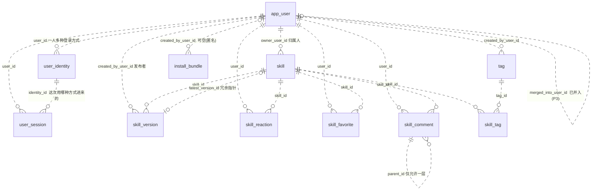
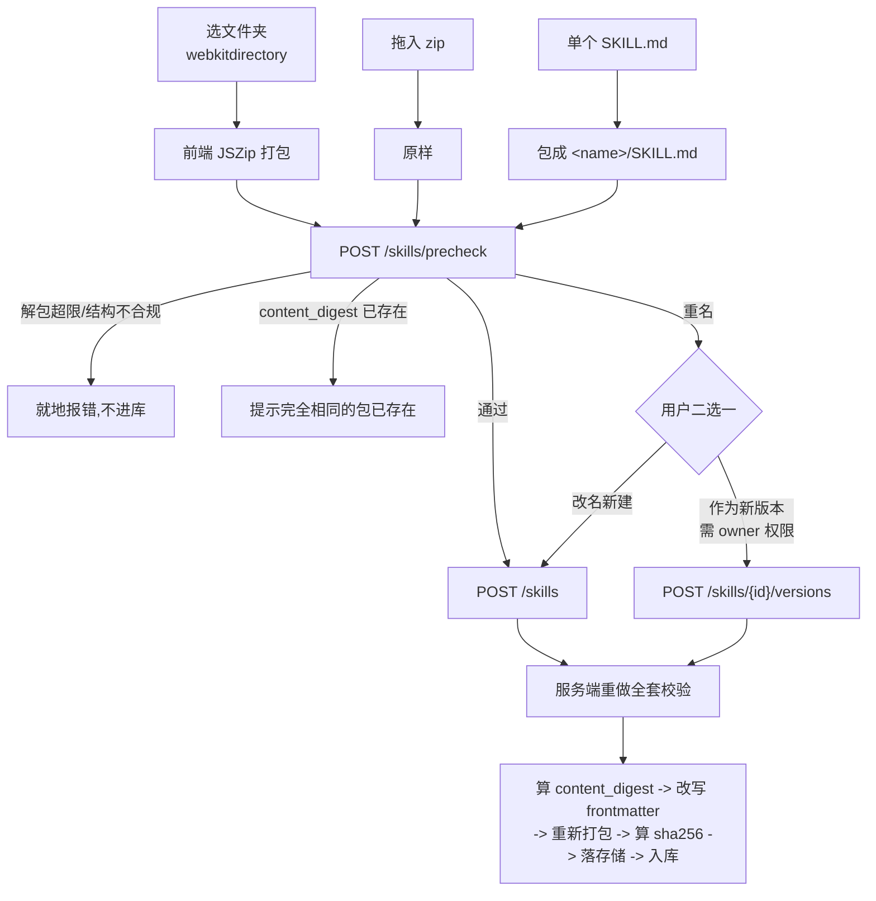

# skill-hub 业务建模与接口契约

本文是 skill-hub **业务侧**的单一事实源。`docs/20260802190036_skill-hub设计方案.md` 定的是"做什么、为什么这么做"的骨架,本文把骨架填成可直接建表、可直接写接口的模型。与设计方案冲突时以本文为准,并回头修订设计方案。

**但本文不得与 `.claude/CLAUDE.md` 和 `backend/CLAUDE.md` 冲突 —— 那两份是工程宪法,优先级高于本文。** 本文若与宪法抵触,是本文的缺陷。

范围:领域模型、表结构、业务规则、接口契约、前端展示约定、OpenAPI。不含实现代码。

---

## 一、结论摘要

十一张表进 P0,一张(`user_merge_log`)推迟到 P3 再加迁移。

| 决定 | 结论 |
| --- | --- |
| 身份 | **人与登录方式彻底分离**。`app_user` 是"人",`user_identity` 是"一种登录方式",一个人可同时持有多个 |
| 首个管理员 | 启动时按配置引导创建;**prod 下未配置密码则拒绝启动**,不静默使用默认密码 |
| 登录方式 | `LOCAL`(账号密码)与 `DINGTALK`(OAuth2 扫码)**完全对称**;新增 provider 只加一行枚举 |
| 摘要 | **两个互不相干的摘要**:`content_digest`(规范化文件树清单,负责短哈希与去重)与 `sha256`(最终 zip,负责安装校验) |
| 来源 | `source` 是 `skill` 上的**单选互斥**枚举列,不参与标签体系 |
| 分类与标签 | **合并成一个 `tag` 表**,`kind` 区分 `CURATED`(导航,每 skill 至多 3 个、可不选)与 `FREE`(自由打,至多 10 个) |
| 认证 | **挂在 `skill_version` 上**,发新版本徽章即失效;**且必须在安装脚本渲染时实时拦截**,否则形同虚设 |
| 版本号 | 由上传方提交,SemVer 格式,**必须严格递增**;唯一索引是仲裁者,不做先查后插 |
| 客户端适配 | `(client, scope) -> 落盘路径` 是**代码里的枚举**,带"是否已实测"标志;未实测组合拒绝生成安装单 |
| 外键 | 全库零外键约束,逻辑关系写进 `COMMENT`,关联列建索引,级联由应用层显式处理 |
| 计数 | **"设置状态"类动作重算,"追加/移除"类动作增量** |
| API 文档 | springdoc-openapi 3.1.0。**注意它会拖进 Jackson 2**,见 8.1 |

匿名可浏览、可搜索、可下载;**一切写操作必须登录**。

---

## 二、领域全景



图里全部用虚线关系,这是刻意的:**库里没有任何一条外键约束**,画的是逻辑关系。`app_user |o..o{ install_bundle` 用 `|o` 而不是 `||`,因为匿名用户也能生成安装单。

| 实体 | 一句话职责 |
| --- | --- |
| `app_user` | **一个人**。业务归属的锚点,不含任何登录方式 |
| `user_identity` | **一种登录方式**。`(provider, external_id)` 全局唯一,LOCAL 与 DINGTALK 完全对称 |
| `user_session` | 一次登录会话。可撤销,可查"我在哪些设备登录着、是用哪种方式进来的" |
| `tag` | 一个词条。`kind=CURATED` 是导航分类,`kind=FREE` 是自由标签 |
| `skill_tag` | skill 与 tag 的多对多关联 |
| `skill` | 一个 skill 的稳定身份与聚合统计,`name` 全局唯一且**不可修改** |
| `skill_version` | 一次发布的不可变快照:制品 + 两个摘要 + 正文全文 + 认证状态 |
| `skill_reaction` | 一人对一个 skill 的一次表态,赞踩互斥 |
| `skill_favorite` | 一人对一个 skill 的收藏。私人书签,同时是跨设备的待安装清单 |
| `skill_comment` | 评论与回复,软删除 |
| `install_bundle` | 一次勾选生成的安装单,带有效期 |
| `user_merge_log` | 账号合并审计。**P3 才建,不进 V0001**,理由见 4.2 |

### 三条承重墙

它们不是描述,是设计约束,后续每个决定都建立在其上。

**一、除了 `user_session`,没有任何表引用 `user_identity`。** 所有业务归属指向 `app_user`。因此换掉一个人的登录方式,业务数据一行不动;把两个人并成一个,只需改 `user_id` 这一列。

**二、认证状态只存在于 `skill_version`,且必须在安装脚本渲染时被读取。** 前者让"骗认证后换恶意版本"从数据结构上不成立;后者让认证在内容真正被执行的路径上生效 —— **只做前者不做后者,认证就只是网页上的装饰。**

**三、`content_digest` 与 `sha256` 是两个互不相干的摘要,职责不可混用。** 前者对内容负责(短哈希、去重),后者对字节负责(安装校验)。混用会立刻产生循环依赖,见 3.7。

---

## 三、关键取舍

### 3.1 身份:人与登录方式彻底分离

设计方案 P0 原本写的是"不做登录"。但需求里的三条 —— 归属人必填、点赞点踩、评论区 —— 都要回答"这是谁"。其中**归属人必填是硬需求**,它单独就要求身份存在,不能靠推迟互动功能绕开。

**核心决定:`app_user` 表里不放任何登录方式。**

```
app_user       一个"人"。业务归属的锚点。没有用户名,没有密码,没有 openId
user_identity  一种"登录方式"。(provider, external_id) 全局唯一
```

`LOCAL` 与 `DINGTALK` 在这张表里**完全对称** —— 没有"主认证方式"与"绑定的第三方"之分,两者都只是 `user_identity` 里的一行。

这个对称性不是审美,是三个具体能力的前提:

1. **一个人可以同时持有两种登录方式。** 平时扫钉钉,钉钉挂了或断网了用密码进。这是内网工具的必需兜底。
2. **账号合并只有一条代码路径。** 合并的动作就是 `UPDATE user_identity SET user_id = 目标` —— 一条语句管所有 provider。如果本地身份内联在 `app_user`、外部身份单独建表,这里会立刻裂开:本地身份怎么"搬"?两个用户名唯一约束怎么处理?合并逻辑要为本地和外部各写一套,而**写了两套的逻辑就一定会漂移**。
3. **加第三种 provider 是加一行枚举,不是改表。**

放弃的方案:

- **纯自填字符串**。点赞只能靠 localStorage 弱去重,换个浏览器就能再刷;将来接身份要写数据迁移把字符串对到人,那个迁移一定有对不上的脏数据。
- **建表但不做认证、前端选人**。任何人都能冒充别人上传和评论。内网不等于可信。

**认证实现:不引 Spring Security 全家桶。**

引 `spring-security-crypto` 单个 jar,只为拿到工业级 BCrypt —— 密码哈希是"自己写一定写错"的典型。已核实:`spring-boot-dependencies:4.1.0` 导入了 `spring-security-bom:7.1.0`,其中托管了 `spring-security-crypto`,**声明时不写版本号**;该 jar 编译期传递依赖为零。

```xml
<dependency>
    <groupId>org.springframework.security</groupId>
    <artifactId>spring-security-crypto</artifactId>
</dependency>
```

会话用**不透明随机 token**,库里只存 `sha256(token)`,明文只在登录响应里出现一次。

不用 JWT:内网工具需要"立刻踢下线"。JWT 要么短过期加刷新(复杂度陡增),要么维护黑名单(那还不如直接用会话表)。

不引整套 Spring Security:它的 filter chain、CSRF、authorization DSL 是为多认证源、多授权模型准备的。这里只有"登录了没有"和"是不是 owner/ADMIN"两个判断,一个拦截器 + 一个注解够了。符合 `backend/CLAUDE.md` 第二节黑名单的判定标准。

**认证抽象放在 domain,实现放在 infrastructure**,与 Repository 同构:

```java
// domain/auth —— 纯 Java,零框架注解,零 HTTP 客户端类型
public interface AuthProvider {
    String providerCode();                                    // LOCAL / DINGTALK
    ResolvedIdentity authenticate(AuthCredential credential);
}
```

P0 只有 `LocalPasswordAuthProvider` 一个实现。**只有一个实现还抽接口,是因为它划的是 `domain` 与 `infrastructure` 的边界(把 HTTP 客户端挡在 domain 外),这条边界迟早要有,现在画比事后重构便宜。** 但配套的 ArchUnit 规则必须同期落地,见 6.4。

### 3.2 首个管理员:引导账号

**这是一个必须显式解决的死锁。** 内置 `system` 账号(id=1)故意没有任何 `user_identity` 行,登不进来;自助注册只产生 `USER`;而建 ADMIN 的接口本身要求 ADMIN。三者合起来是个闭环 —— 没有任何路径能产生第一个可登录的管理员,认证标记、标签治理、用户管理全部无人可做。

**解法:配置驱动的引导账号,应用启动时创建。**

```yaml
skillhub:
  auth:
    local-register-enabled: false          # P0 默认关闭,见下
    bootstrap-admin:
      login: ${BOOTSTRAP_ADMIN_LOGIN:admin}
      password: ${BOOTSTRAP_ADMIN_PASSWORD:}
```

启动逻辑:若 `(LOCAL, <login>)` 的 `user_identity` 不存在,则创建 `app_user(role=ADMIN)` + 对应 `user_identity`,并打一条 **WARN** 级启动日志(`event=bootstrap_admin_created`,带 login,不带密码)。

**prod 下 `password` 为空时拒绝启动,不回落到任何默认值。** 这是刻意的 fail-fast:一个带公开默认密码的 ADMIN 账号比没有管理员危险得多,而"启动失败"是能被立刻发现的,"默认密码"不会。dev 下允许默认值,方便本机开箱即用。

密码走环境变量,与根 CLAUDE.md "连接信息一律走环境变量,不硬编码进 `application-*.yml`" 一致。

放弃的方案:

- **迁移脚本里插一个固定 BCrypt 的 admin**。默认密码进仓库,所有部署实例共用同一个,不接受。
- **第一个注册的用户自动成为 ADMIN**。内网谁先注册谁是管理员,不接受。

**自助注册 P0 默认关闭。** 上一版的理由是"管理员发号是持续的运维负担",但在几十人规模下发号是每人一次、几分钟的事,而开着自助注册意味着:任何能访问内网页面的人都能注册 -> 上传一个结构合规但正文恶意的 skill -> 被任何人装进 Claude Code 执行。P0 阶段认证机制还没上,**没有任何一道防线覆盖内容语义**,这时候敞开注册是把风险叠满。等 P1 认证上线、或接了钉钉之后再评估。

**登录失败限流放 P0,不推迟。** `user_identity` 上的 `failed_login_count` / `locked_until` 两列既然建了,规则也写好了(连续失败 5 次锁 15 分钟),实现成本半小时。留着两列不实现,是典型的"字段在骗人"。

### 3.3 钉钉登录:接,但不替换本地登录

协议是标准 OAuth2 授权码:浏览器跳 `https://login.dingtalk.com/oauth2/auth`(带 `client_id` / `redirect_uri` / `response_type=code` / `prompt=consent` / `scope`)-> 回调拿 `code` -> 后端 `POST https://api.dingtalk.com/v1.0/oauth2/userAccessToken` 换 token -> 取用户通讯录个人信息拿到 `unionId`。`user_identity` 里存 `provider='DINGTALK'`,`external_id=unionId`。

选 `unionId` 而不是 `openId`:`openId` 是应用内唯一,换个应用就变;`unionId` 在同一开发者企业下稳定。**身份的外部标识必须选最稳定的那个**,选错了将来换应用就是全员重新绑定。

四条硬约束:

1. **内网服务器必须能出站访问 `api.dingtalk.com:443`。** 扫码回调是浏览器跳转,钉钉不需要访问我们;但换 token 是后端主动出站。这条不通,整节作废 —— go/no-go 前提,不是实现细节。
2. **本地登录永远保留。** 钉钉不可用时 ADMIN 必须还能进得去。钉钉是加一条路,不是换一条路。
3. **scope 只申请 `openid`,不申请手机号。** 手机号是敏感个人信息,审批更慢,而这个平台不需要它。**能不要的个人信息就不要。**
4. **`state` 与 token 回传都不许走 URL。** 见 5.x 之外的这两条具体规定:
   - `state` 用签名的短时效 Cookie(`HttpOnly` + `SameSite=Lax`,5 分钟),**不建表**。它是一次性的跨请求随机值,为它建一张表是杀鸡用牛刀。
   - 回调签发的 token 用 `302 -> /login/callback` 配 `Set-Cookie(HttpOnly)` 交付,**绝不放进 query string**。放 URL 会让明文 token 进浏览器历史、Referer 头和 access 日志,与 `backend/CLAUDE.md` 6.5"绝不落盘:Authorization 头"直接冲突。

不做钉钉工作台微应用(虽然免登体验更好):使用姿势是"电脑浏览器里选 skill,复制命令粘到终端",钉钉内置浏览器里复制粘贴很别扭。**扫码登录是主路径。**

回调地址必须在钉钉后台注册。官方文档测试阶段示例是 `http://127.0.0.1:8000`,**localhost 可以进白名单**,本地 dev 能正常联调。

接入后拿到工号回填 `app_user.employee_no`,展示为 `@张三(80380486)`。同名同姓在公司规模上是必然事件,**只显示姓名的归属信息等于没有归属信息**。

### 3.4 绑定与合并是两件事

| | 绑定(bind) | 合并(merge) |
| --- | --- | --- |
| 做什么 | 给**已登录**的这个人加一种登录方式 | 把**两个人**变成一个人 |
| 数据动作 | `INSERT user_identity` 一行 | 搬 `user_identity` + 所有业务表的 `user_id` |
| 触发场景 | 张三登录着,点"绑定钉钉" | 张三忘了自己有本地账号,直接扫码建了新号 |
| 谁能做 | 用户自己 | 仅 ADMIN |
| 可逆 | 是(解绑) | **否** |
| 分期 | P1,常规路径 | **P3**,补救手段 |

**绑定是常规路径,合并是补救。** 把绑定做好,合并就很少被用到 —— 但"很少被用到"不等于不用做,因为发生时没有别的解法。

合并**不可逆**:可逆要求记录每一行的原 `user_id`,那是全量快照,成本远超收益。代之以 `user_merge_log` 记录搬了多少行、丢弃了多少行,加上执行前的只读预演与二次确认。

完整算法见 5.17,**标注为 P3 设计草案,不进本轮实现**。

### 3.5 来源是枚举,分类与标签合并成标签

**先把 `source` 摘出去。** "企业内部 / 社区"回答的是这个 skill 从哪来、可信度如何,它是**单选且互斥的** —— 一个 skill 不可能既是内部沉淀又是社区搬运。单选互斥的维度就该是枚举列。这也说明:**不是所有维度都该变成标签,判断标准是能不能同时成立。**

**分类不单选,并且与标签合并成同一张表。** 一个 code-review 的 skill 既是"代码审查"也是"测试"。而分类一旦允许多选,它和标签的结构就完全一样了,**区别只剩"谁能创建"和"在哪展示"**。维护两套结构相同、语义模糊的概念是纯粹的复杂度,外加一个三个月后没人答得上来的问题 —— "这个词该建成分类还是标签?"

| | `CURATED` | `FREE` |
| --- | --- | --- |
| 谁能建 | 仅 ADMIN | 任何登录用户,上传时输入即自动创建 |
| 职责 | **导航**。左侧筛选面板,有序、有描述 | **发现**。详情页展示、参与搜索 |
| 每个 skill | **至少 1 个,至多 3 个** | 可选,至多 10 个 |

**合并换来一个分家做不到的能力:标签提升。** 先让大家自由打标签,观察哪些高频,再把它固化成受控分类 —— 统一模型下这是 `UPDATE tag SET kind` 一条语句。

**"至少 1 个 CURATED"是分类必填的替代品**,保证每个 skill 都能被左侧导航找到。**"至多 3 个"** 是必要的:允许多选的经典代价是用户倾向全选,全选之后筛选就失去意义。

放弃的方案:

- **把"企业内部/社区"做成两个内置标签**。丢掉"同一分类下区分来源"这个最关键的筛选,且把互斥维度塞进多选结构,迟早出现两个都打上的脏数据。
- **分类做成树**。`parent_id` 一加,前端要写树形选择器、后端要防环、删父节点要决定子节点去向。**平铺,等受控标签真的超过 30 个再考虑。**
- **在 `skill` 上保留 `tags TEXT[]` 数组列**。有了 `skill_tag`,数组就是第二份真相。
- **给 tag 加 `slug` 做 URL**。中文生成 slug 要么走拼音(引依赖 + 多音字)要么手填(没人填)。URL 用 `?tagId=3`,标签改名不影响已分享的链接。

### 3.6 认证:挂在版本上,且必须进安装链路

skill-hub 分发的是**会被 Agent 执行的内容**。现有的安全底线全是技术手段 —— zip-slip、摘要校验、路径白名单、体积上限。它们保证"这个包不会在解压时搞破坏",但**没有一条能回答"这个 SKILL.md 里写的指令是不是恶意的"**。一个结构完全合规的包,正文里可以让 Agent 去删文件、把代码传出去。技术手段防不住,只有人审能。

**第一条:认证必须挂在 `skill_version` 上。** 挂在 `skill` 上的话,攻击路径是现成的:先传一个干净版本骗到认证,再发一个恶意新版本,徽章自动继承。

由此推出一个必须在 UI 上解释清楚的行为:**发布新版本后,认证徽章立刻消失**,直到新版本也被认证。对发布者表现为"我发了个新版本,徽章怎么没了",不解释就会被当成 bug。这不是副作用,这正是机制在起作用。

**第二条(上一版漏了,是整个设计里最严重的洞):认证必须在安装脚本渲染时被读取。**

这个平台的设计就是"甩一条命令到群里",真正的安装动作发生在终端里,那里只有渲染好的脚本。一个已生成的 bundle 钉死了版本,即使该版本事后被 `REVOKED`,脚本渲染时不看认证状态,用户装到的仍是被判定有问题的内容,**全程零提示**。

那样的话,"唯一覆盖内容语义的一环"恰好在内容真正被执行的那条路径上失效 —— 等于没有。具体规则见 5.9。

三态而不是布尔:

| 状态 | 含义 | 展示 |
| --- | --- | --- |
| `NONE` | 没审过 | 无徽章 |
| `CERTIFIED` | 审过,通过 | 绿色"平台认证" |
| `REVOKED` | **审过,但事后撤销** | 醒目警示 + 撤销理由;**安装脚本默认中止** |

`REVOKED` 比 `NONE` 是强得多的负面信号 —— "没人看过"和"看过之后发现有问题"是完全不同的决策依据,不能用同一个"没有徽章"表达。

**不做"认证流程",只做认证标记。** 审核流(提交 -> 待审 -> 通过/驳回 -> 通知)排在 P3。P1 就是 ADMIN 看完之后手工打个标记。**先有信号,再有流程** —— 反过来做,流程建好了却没人用。

**允许 ADMIN 认证自己发布的版本。** 存在利益冲突,但禁止它会让单管理员的小团队卡死。取舍是允许但留痕可查。**owner 不能认证自己的东西**(除非他同时是 ADMIN),见权限矩阵。

**`skill` 上不加"最新版本是否已认证"的冗余列。** 列表页本来就要 join `skill_version` 拿版本号,顺手多取一列即可。

### 3.7 两个摘要:`content_digest` 与 `sha256`

**这是上一版的一个硬伤,必须单列一节讲清楚。**

上一版规定"短哈希取重新打包后 sha256 的前 6 位",同时规定"重新打包要把最终 name 写进 frontmatter 和顶层目录名"。这两条构成循环依赖:

```
要算最终 name  ->  需要 sha256
要算 sha256    ->  需要最终制品
要有最终制品   ->  需要最终 name 已写进 frontmatter
```

规则无法实现。而且冲突升位(6 -> 8 -> 10 位)每升一级 name 就变,制品跟着变,sha256 又变,循环再来一轮。

**修法:把摘要拆成两个互不相干的概念。**

| | `content_digest` | `sha256` |
| --- | --- | --- |
| 算什么 | **规范化文件树的清单**,与压缩无关 | **最终落盘 zip 的字节** |
| 何时算 | 校验通过后、改名之前 | 重新打包完成后 |
| 干什么用 | 短哈希、"完全相同的包"检测 | 安装脚本内嵌校验 |
| 跨 JDK 稳定 | **是** | 否 |

`content_digest` 的定义写死,不留解释空间:

```
对规范化后的文件树(已剥垃圾文件、已剥顶层目录),
按相对路径字典序遍历,拼接每个条目的

    <相对路径>\n<该文件内容的 sha256 十六进制>\n

对拼接结果取 sha256,十六进制小写。
```

它只依赖文件路径与文件内容,**与压缩器实现、时间戳、权限位、压缩级别全部无关**。改名只改 `SKILL.md` 内容,所以改名会改变 `content_digest`?**不会 —— `content_digest` 在改名之前算**,这正是循环被打断的地方。

**上一版关于"sha256 可复现"的论证是错的**,三处技术细节都站不住,一并记在这里免得有人再踩:

1. **"固定时间戳为纪元 0"在 ZIP 里无法表达。** ZIP 的 MS-DOS 时间字段最早只到 1980-01-01,`ZipEntry.setTime(0)` 会被折算或夹紧,行为随 JDK 实现而变。
2. **"固定权限"用 `java.util.zip` 根本写不了** —— 它不写 Unix 权限位。要写得换 commons-compress。
3. **"固定压缩级别"不等于固定输出字节。** Deflate 输出取决于具体 zlib/JDK 实现,JDK 升级后同输入同级别不保证逐字节一致。

因此 **`sha256` 不承担可复现职责**,只做"这次下载到的字节和当初存的一致"这一件事。可复现由 `content_digest` 承担,而它压根不经过压缩器。

顺带,上一版还有一个推理错误:"12 位还冲突意味着内容一模一样"。**不成立** —— 用户完全可以直接上传一个名字就叫 `foo-a1b2c3` 的 skill,那种冲突与内容毫无关系。"内容完全相同"只能由 `content_digest` 全量相等来判定。

### 3.8 重名与版本:弹窗二选一

`skill.name` 全局唯一,且**一经创建不可修改**(它直接参与安装路径拼接,是安全边界;改名会让已流传的安装命令行为改变)。

上传时检测到重名,弹窗告诉用户"已存在同名 skill `foo`(归属 张三,最新 v1.2.0)",给两条路:

| 选择 | 条件 | 结果 |
| --- | --- | --- |
| 改名新建 | 任何登录用户 | name 变成 `foo-<短哈希>`,新建一个 skill |
| 作为新版本 | 当前用户是该 skill 的 owner 或 ADMIN | 在原 skill 下新增一条 `skill_version` |

放弃的方案:

- **重名一律新建、发新版本走独立入口**。逻辑分支少,但用户拿着新版本包在上传页会被强行改名,然后困惑"我明明是想更新"。
- **砍掉版本概念**。安装单里内嵌的是摘要,重传覆盖会让在群里流传的旧命令直接校验失败中止 —— 那是安全机制在正常工作,但对用户表现为"命令莫名其妙坏了"。

### 3.9 受众:先研发,再逐步到公司级

P0 的使用者是研发团队,后续逐步扩到全公司。这个演进对架构**不需要任何准备** —— 受控标签本来就是 ADMIN 可增删的。

但它对**预置标签的粒度**有实质影响。错误做法是现在就按未来的组织结构建一个粗粒度的"研发"大类:研发同学进来看到一个塞满所有东西的桶,当下毫无导航价值 —— 而导航价值恰恰是 CURATED 标签存在的唯一理由。

**正确做法:标签粒度匹配当前受众的辨别力。** 现在按研发内部的场景细分,将来扩公司级时加的是**平级的新标签**,不是把现有标签塞进某个父节点。

命名风格同理。公司级平台会用"研发提效""质量保障"这类动宾结构,因为要向非研发解释"这能帮你干什么";现在受众就是研发,直接用"代码审查""调试排障"更精确也更短。**等真的扩到公司级,该改的是命名不是结构。**

---

## 四、表结构

### 4.1 通用约定

1. **只有主键,零外键约束。** 逻辑关联写进 `COMMENT ON COLUMN`,格式固定为 `逻辑外键 -> 表.列`。所有关联列建索引 —— 没有外键就没有自动索引。
2. **级联由应用层显式处理,且必须在同一事务里。** 无外键的代价就在这:删一个标签要把 `skill_tag` 里引用它的行处理干净,漏写数据库不会拦你,留下的孤儿关联行会让那些 skill 在筛选时凭空消失。每一处级联在 5.15 点名列出。
3. 主键统一 `BIGINT GENERATED BY DEFAULT AS IDENTITY`。
4. 时间统一 `TIMESTAMPTZ`,`created_at` 全表必备。**`updated_at` 只给真的会被 UPDATE 的表**,由 `set_updated_at()` 触发器维护。判定标准是"业务规则里有没有一条 UPDATE 语句碰它",不是感觉;**只加列不加触发器等于这个字段在骗人,加了列却没有任何 UPDATE 路径同样是骗人。**
5. **软删除用语义化的 `status` 枚举列,不用 `del_flag`。**
6. 枚举值用 `VARCHAR` + 应用层枚举,不用 PostgreSQL `ENUM` —— PG 的 enum 加值要 `ALTER TYPE`,改值几乎不可能,而业务枚举一定会变。
7. **索引不无脑加,三条判据**:(a) 复合唯一索引的前导列已覆盖的单列查询,**不再单建索引**;(b) 复合索引的列序按"几乎必带的条件在前";(c) 低基数列(枚举且分布极偏)单建索引没有意义,规划器不会选,要建就建部分索引。
8. **冗余计数只在"读频次高 + 明细表大"时才值得。** `skill` 上的五个计数满足;标签下的 skill 数不满足(标签几十条,`GROUP BY` 是毫秒级),所以 `tag` 表上没有 `skill_count`。
9. **计数的维护方式按动作语义分**:"设置状态"类(表态、收藏 —— 可能从无到有、从赞到踩、从有到无)**重算**,"追加/移除"类(评论、下载)**增量**。重算避免了增量算术算错,而它的代价是一次带索引的 `COUNT`,在这个量级可以忽略。

### 4.2 迁移策略

**V0001 只放 DDL,seed 数据单独一个迁移。** `backend/CLAUDE.md` 的 Flyway 规约明写"一个迁移只做一件事,DDL 与数据订正分开"。上一版把 system 账号和 9 个预置标签的 `INSERT` 焊在建表 SQL 里,违反了这一条,而且预置标签是**一定会变**的业务数据 —— 焊死之后想调整只能再写一个数据迁移去改,V0001 里那份永远是历史噪音。

```
V0001__init_schema.sql          纯 DDL + 索引 + COMMENT + 触发器
V0002__seed_system_and_tags.sql system 账号 + 9 个 CURATED 标签
```

V0002 依赖 V0001 已建表,且其中标签的 `created_by_user_id = 1` 依赖 system 账号先插入 —— **这个顺序依赖在脚本里显式注释出来**,不要靠读的人自己发现。

**本次重写 V0001 的唯一判定标准:项目从未部署到任何非本机环境,`V0001` 只在本机 dev 跑过,库里没有真实数据。**

上一版还写了一条理由 —— "打 ALTER 补丁会写出面目全非的迁移" —— 那是审美论证,**已删除**。它会给后来人一个错误先例:"模型改得多就可以重写迁移"。事实是新增表本来就该是新迁移,只有 `skill` 和 `install_bundle` 两张需要 ALTER,那是一个规模正常的 V0002。**决定性的是"从未部署",不是"改得多"。**

**这是最后一次改 `V0001`。** 只要有任何一个非本机环境执行过迁移,就不许再改任何已存在的迁移文件。

**`user_merge_log` 不进 V0001。** 上一版用"十二张表一次建到位避免反复迁移"把它拖了进来,**这个理由是假的** —— Flyway 禁止的是修改已执行的迁移,**从不禁止新增迁移**。P3 时加一个 `V00NN__create_user_merge_log.sql` 零代价。真实代价反而在另一头:一张 P3 才写第一行代码的表出现在"可直接建表、可直接写接口"的文档主干里,下游很容易顺手实现掉。

修正后的原则:**P0/P1 会用到的表一次建全;纯 P3 的表等到 P3 再加迁移。**

本地重建:

```bash
docker compose -f docker/docker-compose.yml --profile dev down -v
docker compose -f docker/docker-compose.yml up -d postgres
```

`down` 带 `--profile` 是硬规矩(根 CLAUDE.md 第十节):不带时 compose 看不见带 profile 的服务,`down` 会静默地什么都没停而返回 0。当前只有 postgres 无 profile,不带也恰好无害 —— 但写进文档的示例命令会教坏人。

### 4.3 app_user

```sql
CREATE TABLE app_user (
    id                  BIGINT GENERATED BY DEFAULT AS IDENTITY PRIMARY KEY,
    display_name        VARCHAR(64)  NOT NULL,
    employee_no         VARCHAR(32),
    email               VARCHAR(128),
    avatar_url          VARCHAR(512),
    role                VARCHAR(16)  NOT NULL DEFAULT 'USER',
    status              VARCHAR(16)  NOT NULL DEFAULT 'ACTIVE',
    merged_into_user_id BIGINT,
    created_at          TIMESTAMPTZ  NOT NULL DEFAULT now(),
    updated_at          TIMESTAMPTZ  NOT NULL DEFAULT now()
);

COMMENT ON TABLE  app_user                     IS '一个人。业务归属的锚点,**不含任何登录方式** —— 登录方式全在 user_identity。id=1 是内置 system 账号';
COMMENT ON COLUMN app_user.display_name        IS '展示名。不唯一(会重名),不是标识';
COMMENT ON COLUMN app_user.employee_no         IS '工号。用于消解重名,展示为 @张三(80380486);接钉钉后回填,LOCAL 建号时可空';
COMMENT ON COLUMN app_user.email               IS '当前生效的邮箱。绑定外部身份时若本列为空则回填';
COMMENT ON COLUMN app_user.avatar_url          IS '头像。绑定钉钉后回填';
COMMENT ON COLUMN app_user.role                IS 'USER / ADMIN。只有两级,不做 RBAC';
COMMENT ON COLUMN app_user.status              IS 'ACTIVE / DISABLED / MERGED。MERGED 由 P3 的账号合并写入';
COMMENT ON COLUMN app_user.merged_into_user_id IS '逻辑外键 -> app_user.id。非空即已被合并;旧引用查到本行时应跳转到目标。P3 前恒为 NULL';

CREATE UNIQUE INDEX uk_app_user_employee_no ON app_user (employee_no) WHERE employee_no IS NOT NULL;
CREATE INDEX idx_app_user_merged_into ON app_user (merged_into_user_id) WHERE merged_into_user_id IS NOT NULL;

CREATE TRIGGER trg_app_user_updated_at
    BEFORE UPDATE ON app_user FOR EACH ROW EXECUTE FUNCTION set_updated_at();
```

这张表被刻意掏空了:**没有用户名,没有密码哈希,没有认证源。** 它只回答"这是谁",不回答"他怎么进来的"。

内置 `system` 账号(在 V0002 插入)是为了让 `owner_user_id` 保持 `NOT NULL`。"除非是系统管理员内置和导入进来的"这条需求,如果做成"归属可空",全链路每个用到归属的地方都要判空;做成一个真实存在的系统账号,业务代码一行特判都不用写。它登不进来的原因是**它在 `user_identity` 里没有任何一行**。

两个索引都是部分索引,但**理由不同,不要混为一谈**:

- `merged_into_user_id` 是**性能理由**:它在 P3 之前恒为 NULL,全列索引纯属浪费。
- `employee_no` **不是正确性理由**。PostgreSQL 的唯一索引默认把 NULL 视为互不相等(`NULLS DISTINCT`),普通唯一索引本来就允许多行 `employee_no IS NULL` 共存,不加 `WHERE` 也不会冲突。写成部分索引只是让索引里不收 NULL 行(LOCAL 建号时工号可空,这类行可能不少)并把"只约束非空工号"的意图写在 DDL 上。**换成普通唯一索引在功能上等价。**

前一版这里写的是"多个 NULL 在普通唯一索引下会冲突",**那是错的**,已订正。这类"记错了某个数据库的默认行为"最容易顺着抄下去,所以留痕。

### 4.4 user_identity

```sql
CREATE TABLE user_identity (
    id                 BIGINT GENERATED BY DEFAULT AS IDENTITY PRIMARY KEY,
    user_id            BIGINT       NOT NULL,
    provider           VARCHAR(16)  NOT NULL,
    external_id        VARCHAR(128) NOT NULL,
    credential         VARCHAR(100),
    display_hint       VARCHAR(64),
    failed_login_count INT          NOT NULL DEFAULT 0,
    locked_until       TIMESTAMPTZ,
    last_login_at      TIMESTAMPTZ,
    status             VARCHAR(16)  NOT NULL DEFAULT 'ACTIVE',
    created_at         TIMESTAMPTZ  NOT NULL DEFAULT now(),
    updated_at         TIMESTAMPTZ  NOT NULL DEFAULT now()
);

COMMENT ON TABLE  user_identity                    IS '一种登录方式。LOCAL 与 DINGTALK 完全对称,不存在主副之分';
COMMENT ON COLUMN user_identity.user_id            IS '逻辑外键 -> app_user.id。P3 合并账号时改的就是这一列';
COMMENT ON COLUMN user_identity.provider           IS 'LOCAL / DINGTALK。加新登录方式只加枚举值,不改表';
COMMENT ON COLUMN user_identity.external_id        IS 'LOCAL 时是登录名;DINGTALK 时是 unionId(不用 openId,后者换应用就变)';
COMMENT ON COLUMN user_identity.credential         IS 'LOCAL 时存 BCrypt 哈希(60 字符,留到 100 是给换 argon2 的余量);外部 provider 恒为 NULL';
COMMENT ON COLUMN user_identity.display_hint       IS '该身份在外部系统的显示名,仅用于「你已绑定 钉钉:张三」这类提示,不作为业务标识';
COMMENT ON COLUMN user_identity.failed_login_count IS '连续失败次数。挂在身份上而非人上 —— 密码被撞不该锁掉他的钉钉登录';
COMMENT ON COLUMN user_identity.locked_until       IS '锁定到期时间,连续失败 5 次锁 15 分钟';
COMMENT ON COLUMN user_identity.status             IS 'ACTIVE / REVOKED。解绑即 REVOKED,不物理删,保留审计线索';

CREATE UNIQUE INDEX uk_user_identity_external ON user_identity (provider, external_id);
CREATE INDEX idx_user_identity_user ON user_identity (user_id);

CREATE TRIGGER trg_user_identity_updated_at
    BEFORE UPDATE ON user_identity FOR EACH ROW EXECUTE FUNCTION set_updated_at();
```

**故意没有 `UNIQUE (user_id, provider)`。** 这条约束看着该有("一个人不该绑两个钉钉号"),但它会在 P3 合并时炸:A 和 B 各有一个 LOCAL 身份,合并后目标就持有两个 LOCAL 身份,直接违反约束。三种绕法都不好:改成 `REVOKED` 会让用户发现"我以前的密码怎么突然不能用了";编个 `LOCAL_MERGED` 的 provider 是纯 hack;让合并挑一个丢弃是替用户做他没授权的决定。

所以不加。真正必须守住的唯一性是 `(provider, external_id)` —— 一个外部账号不能同时属于两个人。

**这个决定的连锁后果必须走完**:一个人可能有两个 LOCAL 身份(登录名 `zhangsan` 和 `zhang.san`),所以"改密码"这个动作必须明确改的是哪一个。规则:**只能改当前会话所用的那个身份的密码**,用 `user_session.identity_id` 定位。相应地 `GET /identities` 必须返回 `external_id`(登录名),否则用户看不出自己有哪几个本地账号。

`failed_login_count` / `locked_until` 挂在身份上而不是人上:密码被撞库不该连带锁死他的钉钉登录,那等于让攻击者用一条低成本路径拒绝服务掉一条高成本路径。

**上一版有 `raw_profile JSONB`(存外部返回的原始 profile),已删除。** 它与 3.3 "能不要的个人信息就不要"自相矛盾:一边论证不申请手机号以减少泄漏面,一边把钉钉返回的原始 profile 原样永久落库。而"便于事后排查"这个理由,`backend/CLAUDE.md` 第六节的 JSONL 日志通道已经承担了,**而且那里有 30 天滚动上限,不会永久沉淀个人信息** —— 那才是留档的正确位置。

### 4.5 user_session

```sql
CREATE TABLE user_session (
    id          BIGINT GENERATED BY DEFAULT AS IDENTITY PRIMARY KEY,
    token_hash  CHAR(64)     NOT NULL,
    user_id     BIGINT       NOT NULL,
    identity_id BIGINT       NOT NULL,
    user_agent  VARCHAR(256),
    client_ip   VARCHAR(64),
    created_at  TIMESTAMPTZ  NOT NULL DEFAULT now(),
    expires_at  TIMESTAMPTZ  NOT NULL,
    revoked_at  TIMESTAMPTZ
);

COMMENT ON TABLE  user_session             IS '登录会话。不透明 token,可服务端撤销';
COMMENT ON COLUMN user_session.token_hash  IS 'sha256(明文 token) 的十六进制。**库里不存明文**,明文只在登录响应里出现一次';
COMMENT ON COLUMN user_session.user_id     IS '逻辑外键 -> app_user.id';
COMMENT ON COLUMN user_session.identity_id IS '逻辑外键 -> user_identity.id。这次用哪种方式进来的;改密码时也靠它定位身份';
COMMENT ON COLUMN user_session.expires_at  IS '过期时间,默认签发后 7 天';
COMMENT ON COLUMN user_session.revoked_at  IS '主动登出、被管理员踢下线、或所属账号被合并的时间,非空即失效';

CREATE UNIQUE INDEX uk_user_session_token ON user_session (token_hash);
CREATE INDEX idx_user_session_user_id     ON user_session (user_id);
CREATE INDEX idx_user_session_identity_id ON user_session (identity_id);
```

存 `sha256(token)` 而非明文,理由与密码哈希完全一致:**数据库被拖走时,拿到的东西不能直接用来冒充身份**。校验是 O(1) 的哈希 + 唯一索引查询。

同时记 `user_id` 与 `identity_id` 是刻意冗余:鉴权只用 `user_id`,而"这个会话是密码登的还是钉钉登的"在安全审计时必须能回答 —— 出了事却答不上来"入侵者走的哪条路",等于没有审计。这也是全库**唯一**引用 `user_identity` 的地方。

**没有 `expires_at` 索引。** 过期清理是"登录时顺手删掉该用户已过期的行",走的是 `idx_user_session_user_id`;没有任何按过期时间全表扫的动作,建了就是空占写放大(通用约定第 7 条)。

### 4.6 tag

```sql
CREATE TABLE tag (
    id                 BIGINT GENERATED BY DEFAULT AS IDENTITY PRIMARY KEY,
    name               VARCHAR(32)  NOT NULL,
    kind               VARCHAR(16)  NOT NULL DEFAULT 'FREE',
    description        VARCHAR(128),
    sort_order         INT          NOT NULL DEFAULT 0,
    created_by_user_id BIGINT       NOT NULL,
    created_at         TIMESTAMPTZ  NOT NULL DEFAULT now(),
    updated_at         TIMESTAMPTZ  NOT NULL DEFAULT now()
);

COMMENT ON TABLE  tag                    IS '一个词条。分类与标签是同一个东西,靠 kind 区分职责';
COMMENT ON COLUMN tag.name               IS '词条名,全局唯一。应用层上限 16 字符;列宽给到 32 是留余量,不是允许 32';
COMMENT ON COLUMN tag.kind               IS 'CURATED(ADMIN 维护,进导航,每 skill 至多 3 个,可不选)/ FREE(用户自由打,至多 10 个)';
COMMENT ON COLUMN tag.description        IS '仅 CURATED 用,展示在筛选面板上;FREE 恒为空';
COMMENT ON COLUMN tag.sort_order         IS '仅 CURATED 用,小的在前;相同则按 name';
COMMENT ON COLUMN tag.created_by_user_id IS '逻辑外键 -> app_user.id。FREE 标签记录是谁第一个打的';

CREATE UNIQUE INDEX uk_tag_name ON tag (name);
CREATE INDEX idx_tag_kind ON tag (kind, sort_order);

CREATE TRIGGER trg_tag_updated_at
    BEFORE UPDATE ON tag FOR EACH ROW EXECUTE FUNCTION set_updated_at();
```

V0002 里预置九个 CURATED 词条,粒度按研发受众定(理由见 3.9):

```sql
INSERT INTO tag (name, kind, description, sort_order, created_by_user_id) VALUES
    ('代码生成',   'CURATED', '脚手架、样板代码、接口实现',    10, 1),
    ('代码审查',   'CURATED', '评审清单、规范检查、重构建议',  20, 1),
    ('测试',       'CURATED', '用例设计、自动化测试、覆盖率',  30, 1),
    ('调试排障',   'CURATED', '日志分析、根因定位、线上问题',  40, 1),
    ('架构设计',   'CURATED', '方案设计、技术选型、拆解',      50, 1),
    ('文档',       'CURATED', '技术写作、注释、总结复盘',      60, 1),
    ('数据与 SQL', 'CURATED', '查询编写、数据分析、报表',      70, 1),
    ('部署运维',   'CURATED', '构建、发布、监控、容量',        80, 1),
    ('通用',       'CURATED', '不属于以上任何一类',            90, 1);
```

**它们和 ADMIN 后建的没有任何区别**,可以改可以删。不设 `builtin` 标志位:一旦有了"不可删"的行,业务代码就要到处特判。

**没有 `skill_count` 冗余计数列**,理由见通用约定第 8 条。

### 4.7 skill_tag

```sql
CREATE TABLE skill_tag (
    id         BIGINT GENERATED BY DEFAULT AS IDENTITY PRIMARY KEY,
    skill_id   BIGINT      NOT NULL,
    tag_id     BIGINT      NOT NULL,
    created_at TIMESTAMPTZ NOT NULL DEFAULT now()
);

COMMENT ON TABLE  skill_tag          IS 'skill 与 tag 的多对多关联。**只增删不修改** —— 换标签是删旧行插新行,不是 UPDATE';
COMMENT ON COLUMN skill_tag.skill_id IS '逻辑外键 -> skill.id';
COMMENT ON COLUMN skill_tag.tag_id   IS '逻辑外键 -> tag.id';

CREATE UNIQUE INDEX uk_skill_tag ON skill_tag (skill_id, tag_id);
CREATE INDEX idx_skill_tag_tag ON skill_tag (tag_id);
```

唯一索引 `(skill_id, tag_id)` 防重复打签。`idx_skill_tag_tag` 是给"按标签筛 skill"这条反向查询用的 —— 唯一索引以 `skill_id` 打头,覆盖不到它。

**这张表只增删不修改**,所以不加 `updated_at`。上一版把它列为"不会被修改"却在级联清单里写了 `UPDATE skill_tag SET tag_id = 目标`(标签迁移),自相矛盾。现在统一成**删旧行 + 插新行**:语义更清楚,也和"改 skill 标签"那条路径的做法一致。

**"至少 1 个 CURATED、至多 3 个 CURATED、至多 10 个 FREE"这三条约束数据库表达不了**,由应用层在同一事务内校验。这是无外键之外的另一类"数据库管不住"的规则,同样必须有测试。

### 4.8 skill

```sql
CREATE TABLE skill (
    id                BIGINT GENERATED BY DEFAULT AS IDENTITY PRIMARY KEY,
    name              VARCHAR(64)  NOT NULL,
    display_name      VARCHAR(128) NOT NULL,
    description       VARCHAR(1024) NOT NULL,
    source            VARCHAR(16)  NOT NULL,
    owner_user_id     BIGINT       NOT NULL,
    latest_version_id BIGINT,
    card_excerpt      VARCHAR(200),
    status            VARCHAR(16)  NOT NULL DEFAULT 'PUBLISHED',
    download_count    BIGINT       NOT NULL DEFAULT 0,
    like_count        INT          NOT NULL DEFAULT 0,
    dislike_count     INT          NOT NULL DEFAULT 0,
    favorite_count    INT          NOT NULL DEFAULT 0,
    comment_count     INT          NOT NULL DEFAULT 0,
    created_at        TIMESTAMPTZ  NOT NULL DEFAULT now(),
    updated_at        TIMESTAMPTZ  NOT NULL DEFAULT now()
);

COMMENT ON TABLE  skill                   IS 'skill 的稳定身份与聚合统计,一个 skill 对应多个版本';
COMMENT ON COLUMN skill.name              IS '全局唯一标识,kebab-case,与制品内 SKILL.md frontmatter 的 name 严格一致;重名时追加短哈希。**一经创建不可修改**(参与安装路径拼接,是安全边界)';
COMMENT ON COLUMN skill.display_name      IS '展示名。卡片主标题显示它,副标题显示 name';
COMMENT ON COLUMN skill.description       IS '一句话描述,来自 frontmatter。上限 1024 字符,与 Agent Skills 官方规范一致;超长在校验阶段拒绝 —— 不能让一段 10KB 的描述进列表页响应';
COMMENT ON COLUMN skill.source            IS 'INTERNAL(企业内部)/ COMMUNITY(社区)。单选互斥,故为枚举列而不是标签';
COMMENT ON COLUMN skill.owner_user_id     IS '逻辑外键 -> app_user.id。归属人,导入的 skill 归 id=1 的 system';
COMMENT ON COLUMN skill.latest_version_id IS '逻辑外键 -> skill_version.id。冗余指针,避免列表页 N+1;更新时带 SemVer 递增条件,见 5.4';
COMMENT ON COLUMN skill.card_excerpt      IS '卡片摘要:最新版本 README(无则 SKILL.md 正文)纯文本化后的前 200 字符。**不含省略号**,省略号由前端加';
COMMENT ON COLUMN skill.status            IS 'PUBLISHED / UNLISTED。下架后不出现在列表,已生成的安装单仍可用但脚本会提示';
COMMENT ON COLUMN skill.download_count    IS '冗余计数,增量维护(追加语义)';
COMMENT ON COLUMN skill.like_count        IS '冗余计数,真相在 skill_reaction。**重算维护**(设置状态语义)';
COMMENT ON COLUMN skill.dislike_count     IS '冗余计数,真相在 skill_reaction。**重算维护**';
COMMENT ON COLUMN skill.favorite_count    IS '冗余计数,真相在 skill_favorite。**重算维护**';
COMMENT ON COLUMN skill.comment_count     IS '冗余计数,真相在 skill_comment(不含已删除)。增量维护(追加语义)';

CREATE UNIQUE INDEX uk_skill_name     ON skill (name);
CREATE INDEX idx_skill_owner_user_id  ON skill (owner_user_id);
CREATE INDEX idx_skill_status_source  ON skill (status, source);
CREATE INDEX idx_skill_download_count ON skill (download_count DESC);

CREATE TRIGGER trg_skill_updated_at
    BEFORE UPDATE ON skill FOR EACH ROW EXECUTE FUNCTION set_updated_at();
```

**没有 `latest_version` 字符串列,只有 `latest_version_id`。** 两个冗余字段维护同一件事必然漂移;要版本号时 join 一次 `skill_version`。**认证状态搭同一趟 join 车**,所以也不需要"最新版本是否已认证"的冗余列。

**`idx_skill_status_source` 的列序是 `(status, source)` 不是 `(source, status)`。** 列表页的主查询几乎必带 `status = 'PUBLISHED'`,而 `source` 是可选筛选项;以 `source` 打头会让"不筛来源"的查询用不上这条索引。

`description` 从 `TEXT` 收紧为 `VARCHAR(1024)` 并在校验阶段拒绝超长 —— 它来自用户提交的 frontmatter,不设上限意味着列表页响应体可以被单个 skill 撑爆。

**1024 这个数取自 Agent Skills 官方规范**(`description` 非空、最多 1024 字符;顺带 `name` 最多 64 字符、不许含 `anthropic` / `claude`),不是我们自己拍的。上一版写的是 512,并且理由写成"与 `skill.description` 列宽一致" —— **那是把存储实现当成了业务规则,方向反了**。实测拖一个真实 skill 进来,description 616 字符,被 512 直接拒收。已由 `V0003__widen_skill_description_to_spec.sql` 放宽,前后端校验同步改到 1024。

规律:**凡是由外部规范决定上限的字段,列宽跟着规范走,不能反过来让规范迁就列宽。** 判断方法很简单 —— 问一句"这个数字是谁定的",答不上来就是拍的。

`card_excerpt` **存 200 字符且不含省略号**。上一版规定"取前 200 字符再补 `...`",203 > 200,PostgreSQL 的 `VARCHAR(200)` 会抛 `value too long` 而不是截断 —— 第一个 README 超 200 字的 skill 上传就 500。而且"要不要加省略号"本来就是展示决策,归前端(前端还要再截到 100 字符,服务端加的省略号也会被截掉)。

`status` 用 `UNLISTED` 而不是 `DELETED`:下架是可逆的软处置,skill 仍可通过直达链接与已生成的安装单访问。

#### 物理删除:已提供,原先的"不提供"已推翻

**上一版写的是"不提供物理删除"**,理由是"skill 一旦被人装过就有了外部引用,物理删除会让已流传的安装命令报出难以理解的错误"。按需求已推翻并实现 `POST /skills/{id}/delete`(owner / ADMIN)。

**但那个理由并没有因此失效,它只是从"拒绝的依据"变成了"必须处理的代价"。** 落地时正面处理的三处:

1. **已流传的安装单不再静默少装。** 渲染安装脚本时对比原始条目与解析结果,缺失的明确打印"本安装单中有 N 个 skill 已从平台删除,将跳过它们",且这行排在确认提示之前 —— 与撤销认证同一条理由:确认必须是知情的确认。
2. **一个都不剩时返回 410 `INSTALL_BUNDLE_ITEMS_GONE`**,而不是渲染一个什么都不装的脚本。之前会掉进 `requireNonEmpty` 的 `IllegalStateException`,最终是 500 加一句"渲染安装脚本时制品列表不能为空" —— 对着一条群里流传的安装命令,那句话什么也解释不了。410 与"安装单已过期"对齐:资源曾经有效、现在不再有效,正确的下一步都是回平台重新生成。
3. **删除前必须先取 `artifact_key` 再删库行**,顺序反了就再也不知道该删哪些制品文件,磁盘会永久残留而且没有任何报错。制品文件在库行删除之后再删,且只做尽力而为:文件删不掉只记 WARN,不抛异常 —— 此刻库行已经删了,再报"删除失败"会让用户以为没删成功。留下的孤儿文件是垃圾,不是数据损坏,这是两个失败方向里明显更轻的那个。

删除范围:`skill` / `skill_version` / `skill_reaction` / `skill_favorite` / `skill_comment` 五张表的行 + 全部版本的制品文件。`skill_tag` 走 `replaceSkillTags(skillId, [])`,以复用 5.7 的孤儿 FREE 标签清理规则,不在删除路径里重写一遍。**新增引用 `skill` 的表时必须回到 `SkillMapper.xml` 补一条删除语句**,漏了不会报错,只会留下永远查不到主体的孤儿行。

**UI 上要求手输 skill 的 `name` 才放行删除。** 用 `name` 而不是 `display_name`:前者全局唯一且不可修改,后者可以重名,拿它做校验等于放行"两个都叫『代码审查』,删错了那个"。二次确认按钮对连续操作的人几乎等于没有,强制打字才真正让人看清选中的是哪一行 —— 那正是误删最常见的成因。

### 4.9 skill_version

```sql
CREATE TABLE skill_version (
    id                   BIGINT GENERATED BY DEFAULT AS IDENTITY PRIMARY KEY,
    skill_id             BIGINT       NOT NULL,
    version              VARCHAR(32)  NOT NULL,
    artifact_key         VARCHAR(255) NOT NULL,
    content_digest       CHAR(64)     NOT NULL,
    sha256               CHAR(64)     NOT NULL,
    size_bytes           BIGINT       NOT NULL,
    file_count           INT          NOT NULL,
    allowed_tools        TEXT[]       NOT NULL DEFAULT '{}',
    skill_md_content     TEXT         NOT NULL,
    readme_content       TEXT,
    changelog            TEXT,
    certification        VARCHAR(16)  NOT NULL DEFAULT 'NONE',
    certified_by_user_id BIGINT,
    certified_at         TIMESTAMPTZ,
    certify_note         VARCHAR(256),
    created_by_user_id   BIGINT       NOT NULL,
    created_at           TIMESTAMPTZ  NOT NULL DEFAULT now(),
    updated_at           TIMESTAMPTZ  NOT NULL DEFAULT now()
);

COMMENT ON TABLE  skill_version                      IS 'skill 的一个已发布版本。制品内容不可变,仅认证四字段可变';
COMMENT ON COLUMN skill_version.skill_id             IS '逻辑外键 -> skill.id';
COMMENT ON COLUMN skill_version.version              IS 'SemVer,由上传方提交并校验;同一 skill 下必须严格递增,见 5.4';
COMMENT ON COLUMN skill_version.artifact_key         IS 'ArtifactStorage 中的制品键,与存储实现解耦';
COMMENT ON COLUMN skill_version.content_digest       IS '**规范化文件树清单的 sha256**,改名之前算,与压缩器实现无关。负责短哈希与"完全相同的包"检测。定义见 3.7';
COMMENT ON COLUMN skill_version.sha256               IS '**最终落盘 zip 字节的 sha256**,只负责安装脚本内嵌校验。**不承担可复现职责**,跨 JDK 不保证一致';
COMMENT ON COLUMN skill_version.file_count           IS '包内文件数。解包时实时限流,本列只是留档';
COMMENT ON COLUMN skill_version.allowed_tools        IS 'SKILL.md 声明的 allowed-tools,安装前展示给使用者';
COMMENT ON COLUMN skill_version.skill_md_content     IS 'SKILL.md 全文(frontmatter 改写后)。冗余存库,详情页不必回源解压';
COMMENT ON COLUMN skill_version.readme_content       IS '包最外层 README.md 全文,无则 NULL。详情页优先展示它';
COMMENT ON COLUMN skill_version.certification        IS 'NONE / CERTIFIED / REVOKED。**认证挂版本不挂 skill**;渲染安装脚本时必须实时读取,见 5.9';
COMMENT ON COLUMN skill_version.certified_by_user_id IS '逻辑外键 -> app_user.id。谁认证或撤销的,留痕可查。**P3 合并账号时不搬**(审计事实)';
COMMENT ON COLUMN skill_version.certified_at         IS '最近一次认证状态变更时间';
COMMENT ON COLUMN skill_version.certify_note         IS '认证意见;撤销时必填理由,并对所有人展示,也进安装脚本的警示文本';
COMMENT ON COLUMN skill_version.created_by_user_id   IS '逻辑外键 -> app_user.id。发布者,可能与 skill.owner_user_id 不同';

CREATE UNIQUE INDEX uk_skill_version      ON skill_version (skill_id, version);
CREATE INDEX idx_skill_version_created_by ON skill_version (created_by_user_id);
CREATE INDEX idx_skill_version_digest     ON skill_version (content_digest);

CREATE TRIGGER trg_skill_version_updated_at
    BEFORE UPDATE ON skill_version FOR EACH ROW EXECUTE FUNCTION set_updated_at();
```

**把 `SKILL.md` 和 `README.md` 全文存进库**是个关键决定。不存的话,详情页每次打开都要去 `ArtifactStorage` 取 zip、解压、读文件 —— 一个纯展示动作被做成了 IO 密集操作。这两个文件通常几 KB,几百个 skill 乘几个版本也就几 MB,PostgreSQL 的 TOAST 会自动压缩。

**没有 `skill_id` 单列索引**:`uk_skill_version (skill_id, version)` 的前导列已经覆盖了所有按 skill 查版本的场景(通用约定第 7 条 a)。

**没有 `certification` 单列索引**:三个枚举值且绝大多数是 `NONE`,规划器不会选它;而 `certifiedOnly` 的筛选实际发生在 `skill join latest_version` 上,单列索引对它也没用。将来真需要,加部分索引 `WHERE certification = 'CERTIFIED'` 才有意义。

`idx_skill_version_digest` 有明确使用者:precheck 阶段判定"完全相同的包已存在"。

### 4.10 skill_reaction

```sql
CREATE TABLE skill_reaction (
    id         BIGINT GENERATED BY DEFAULT AS IDENTITY PRIMARY KEY,
    skill_id   BIGINT      NOT NULL,
    user_id    BIGINT      NOT NULL,
    reaction   VARCHAR(8)  NOT NULL,
    created_at TIMESTAMPTZ NOT NULL DEFAULT now(),
    updated_at TIMESTAMPTZ NOT NULL DEFAULT now()
);

COMMENT ON TABLE  skill_reaction          IS '一人对一个 skill 的一次表态。赞与踩互斥,取消即删行';
COMMENT ON COLUMN skill_reaction.skill_id IS '逻辑外键 -> skill.id';
COMMENT ON COLUMN skill_reaction.user_id  IS '逻辑外键 -> app_user.id';
COMMENT ON COLUMN skill_reaction.reaction IS 'LIKE / DISLIKE';

CREATE UNIQUE INDEX uk_skill_reaction ON skill_reaction (skill_id, user_id);

CREATE TRIGGER trg_skill_reaction_updated_at
    BEFORE UPDATE ON skill_reaction FOR EACH ROW EXECUTE FUNCTION set_updated_at();
```

唯一索引 `(skill_id, user_id)` 是防重复投票的**唯一可靠手段**。应用层的"先查再插"在并发下会漏,数据库约束不会。

**没有任何单列索引。** `user_id` 侧的查询("我点赞过哪些 skill")是 P3 功能;`skill_id` 侧的查询由唯一索引的前导列覆盖 —— 包括 5.10 里的计数重算 `COUNT(*) WHERE skill_id = ?`。

`updated_at` 在这里是**活的**:5.10 的表态算法用 `INSERT ... ON CONFLICT DO UPDATE`,从赞切到踩就是一次真实 UPDATE。上一版用 DELETE + INSERT,那样 `updated_at` 永远不会被触发,恰好落在通用约定第 4 条自己定义的"骗人"里。

### 4.11 skill_favorite

```sql
CREATE TABLE skill_favorite (
    id         BIGINT GENERATED BY DEFAULT AS IDENTITY PRIMARY KEY,
    skill_id   BIGINT      NOT NULL,
    user_id    BIGINT      NOT NULL,
    created_at TIMESTAMPTZ NOT NULL DEFAULT now()
);

COMMENT ON TABLE  skill_favorite          IS '收藏。私人书签,同时是跨设备的待安装清单 —— 从收藏夹勾选可直接生成 install_bundle';
COMMENT ON COLUMN skill_favorite.skill_id IS '逻辑外键 -> skill.id';
COMMENT ON COLUMN skill_favorite.user_id  IS '逻辑外键 -> app_user.id';

CREATE UNIQUE INDEX uk_skill_favorite ON skill_favorite (skill_id, user_id);
CREATE INDEX idx_skill_favorite_user  ON skill_favorite (user_id, created_at DESC);
```

**收藏不能塞进 `skill_reaction`。** 那张表的唯一约束是"一人一 skill 一行",而点赞和收藏可以同时存在 —— 语义也不同:`LIKE` 是"这个好"(公开表态,计入排序),收藏是"我以后要用"(私人书签,不代表评价)。

**收藏的真正价值是它同时解决了另一个问题。** 设计方案里前端用 Zustand 存的"安装购物车"是纯客户端状态,换台机器就没了。收藏夹是服务端持久化的同一个东西。**Zustand 那个购物车在 P2 收藏上线后删除**,不并存 —— 两个都能"攒一批 skill"的机制并存,用户不知道该用哪个。

`idx_skill_favorite_user (user_id, created_at DESC)` 有明确使用者:收藏夹页面按收藏时间倒序,这与 `skill_reaction` 那边的取舍不同 —— 收藏夹是真实存在的页面,不是假想需求。

只增删不修改,不加 `updated_at`。

### 4.12 skill_comment

```sql
CREATE TABLE skill_comment (
    id         BIGINT GENERATED BY DEFAULT AS IDENTITY PRIMARY KEY,
    skill_id   BIGINT      NOT NULL,
    user_id    BIGINT      NOT NULL,
    parent_id  BIGINT,
    content    TEXT        NOT NULL,
    status     VARCHAR(16) NOT NULL DEFAULT 'NORMAL',
    created_at TIMESTAMPTZ NOT NULL DEFAULT now(),
    updated_at TIMESTAMPTZ NOT NULL DEFAULT now()
);

COMMENT ON TABLE  skill_comment           IS '评论。只允许一层回复:parent_id 指向的必须是顶级评论';
COMMENT ON COLUMN skill_comment.skill_id  IS '逻辑外键 -> skill.id';
COMMENT ON COLUMN skill_comment.user_id   IS '逻辑外键 -> app_user.id,评论作者';
COMMENT ON COLUMN skill_comment.parent_id IS '逻辑外键 -> skill_comment.id。NULL 为顶级;非 NULL 时被指向者的 parent_id 必须为 NULL 且 skill_id 相同';
COMMENT ON COLUMN skill_comment.content   IS '正文,纯文本存储,渲染时前端转义。上限 2000 字符,由应用层校验';
COMMENT ON COLUMN skill_comment.status    IS 'NORMAL / DELETED。软删除,保留占位以免子回复悬空';

CREATE INDEX idx_skill_comment_skill  ON skill_comment (skill_id, created_at DESC);
CREATE INDEX idx_skill_comment_parent ON skill_comment (parent_id) WHERE parent_id IS NOT NULL;
CREATE INDEX idx_skill_comment_user   ON skill_comment (user_id);

CREATE TRIGGER trg_skill_comment_updated_at
    BEFORE UPDATE ON skill_comment FOR EACH ROW EXECUTE FUNCTION set_updated_at();
```

**只允许一层回复。** 无限嵌套的代价是:查询要么递归 CTE 要么多次往返,前端要写递归渲染并处理缩进塌陷,而实际讨论深度极少超过两层。

软删除保留行而不是删行:被删的顶级评论如果有回复,物理删会让回复悬空。展示时 `status = 'DELETED'` 的正文替换为"该评论已删除",子回复照常显示。软删除是一次 UPDATE,所以 `updated_at` 是活的。

### 4.13 install_bundle

```sql
CREATE TABLE install_bundle (
    id                 BIGINT GENERATED BY DEFAULT AS IDENTITY PRIMARY KEY,
    token              VARCHAR(32) NOT NULL,
    items              JSONB       NOT NULL,
    client             VARCHAR(32) NOT NULL,
    scope              VARCHAR(16) NOT NULL,
    created_by_user_id BIGINT,
    created_at         TIMESTAMPTZ NOT NULL DEFAULT now(),
    expires_at         TIMESTAMPTZ NOT NULL
);

COMMENT ON TABLE  install_bundle                    IS '安装单:一次勾选生成一个 token,对应一条安装命令';
COMMENT ON COLUMN install_bundle.token              IS '短随机串,出现在安装 URL 中';
COMMENT ON COLUMN install_bundle.items              IS '**只存 [{skillId, versionId}]**。摘要、路径、认证状态一律渲染时 join 取,不在此冗余,理由见下';
COMMENT ON COLUMN install_bundle.client             IS '目标客户端:claude / codex / workbuddy。与 scope 的组合必须在适配表里标记为已实测,见 5.9';
COMMENT ON COLUMN install_bundle.scope              IS '安装级别:global / project';
COMMENT ON COLUMN install_bundle.created_by_user_id IS '逻辑外键 -> app_user.id。可空:匿名用户也能生成安装单';
COMMENT ON COLUMN install_bundle.expires_at         IS '过期时间,防止旧命令长期流传装到过期版本';

CREATE UNIQUE INDEX uk_install_bundle_token ON install_bundle (token);
CREATE INDEX idx_install_bundle_expires_at  ON install_bundle (expires_at);
CREATE INDEX idx_install_bundle_created_by  ON install_bundle (created_by_user_id) WHERE created_by_user_id IS NOT NULL;
```

**`items` 不再内嵌 sha256。** 上一版存了一份,那是第二份真相 —— 而 4.8 刚用同样的理由干掉了 `latest_version` 字符串列,标准不一致。具体风险:哪天真需要修复某个制品(重打包 bug),`skill_version.sha256` 更新了而历史 bundle 里那份不会,渲染出的脚本会带一个永远校验失败的摘要。

**而且渲染时本来就必须 join `skill_version`** —— 3.6 第二条要求实时读取 `certification`。既然 join 已经在了,顺手取 `sha256` / `artifact_key` / `version` 零成本。

`idx_install_bundle_expires_at` 有明确使用者:每次 `POST /bundles` 顺手 `DELETE FROM install_bundle WHERE expires_at < now() - interval '30 days'`。一条带索引的删除,成本可忽略,免得这张表无限增长。

匿名可生成安装单,是为了让"把链接甩群里,同事点开就能装"这条路走得通 —— 加登录墙会显著抬高分享成本,而安装单带有效期、内嵌摘要、渲染时查认证,风险可控。

### 4.14 user_merge_log(P3,不进 V0001)

P3 做账号合并时用一个独立迁移创建。字段与规则见 5.17。**本轮不建表、不写代码。**

---

## 五、关键业务规则

### 5.1 上传三形态归一



三种输入前端一律归一成 zip 再上传,**服务端只认 zip 一种入口**。这样服务端的校验、解包、重新打包只有一条代码路径,不会出现"文件夹上传绕过了某条校验"这种缺口。

`precheck` 与正式上传**执行完全相同的校验逻辑**,前者只是不落库。这不是重复代码 —— 是同一个 `SkillPackageValidator` 被调用两次。

### 5.2 解包上限

上一版只写了"体积/文件数/嵌套深度均有上限"却没给一个数字。TDD 第一步是写红,**没有具体数字就写不出断言**,下游只能自己拍脑袋,两个人拍出来的还不一样。

上限全部走配置(dev / prod 各写一份,遵守"重复是哲学"),默认值:

| 项 | 默认值 | 依据 |
| --- | --- | --- |
| 上传体积(multipart) | 32MB | 已在 `application-*.yml`,不改 |
| 解压后总大小 | 64MB | skill zip 实际是几十 KB 到几 MB,64MB 是两个数量级的余量 |
| 条目数 | 500 | 一个 skill 带满 `references/` `scripts/` `assets/` 也到不了三位数 |
| 单个文件 | 16MB | 超过这个体积的东西不该放进 skill 包 |
| 目录深度 | 8 | `<name>/references/a/b/c/` 已经很深 |
| 单条路径长度 | 255 | 与 `artifact_key` 列宽一致,也避开各平台路径上限 |
| 压缩比 | > 100:1 判定为炸弹 | 正常文本压缩比在 3~10:1 |

**这些限制必须在解压过程中实时生效,不能解压完再查。** 一个 32MB 的包可以解压出几十 GB,等解压完再看 `file_count` 已经晚了 —— 上一版把 `file_count` 注释成"用于事后审计"就是这个误解,现在改成"解包时实时限流,本列只是留档"。

每一条对应一个 `should_reject_when_xxx` 失败测试(`backend/CLAUDE.md` 8.3 要求的安全用例)。

### 5.3 服务端重新打包与两个摘要

四个理由,一个都不能省:

1. **归一三种上传形态的层级。** 文件夹上传的相对路径可能是 `foo/SKILL.md` 也可能是 `SKILL.md`;zip 里可能有一层顶层目录也可能没有。重新打包后统一为 `<skill.name>/...`。
2. **剥掉垃圾。** `__MACOSX/`、`.DS_Store`、`Thumbs.db`、`.git/`、`node_modules/` 一律丢弃 —— 这些在用户机器上被打进包里几乎是必然的。
3. **改写 frontmatter 的 `name`。** 见 5.5。
4. **统一制品形态**,让 `artifact_key` 指向的东西有确定的结构。

**注意第 3 条不再是"让 sha256 可复现"** —— 那个职责已经交给 `content_digest`,理由见 3.7。

严格的执行顺序,不能调换:

```
1.  流式解压,实时执行 5.2 的全部上限
2.  路径安全校验(拒绝 .. / 绝对路径 / 控制字符 / 符号链接)
3.  剥垃圾(__MACOSX/、.DS_Store、Thumbs.db、.git/、node_modules/)
4.  剥顶层包裹目录
5.  结构校验(**只要求顶层有 SKILL.md**,其余文件与目录不限)
6.  解析 frontmatter -> name / description / allowed-tools,校验长度
7.  **算 content_digest**                      <-- 在改名之前
8.  定最终 name(重名则用 content_digest 前 6 位加短哈希,见 5.5)
9.  改写 SKILL.md 的 frontmatter name
10. 按最终 name 打包,顶层目录 = 最终 name
11. **算 sha256**(最终 zip 字节)
12. 落 ArtifactStorage,入库
```

第 7 步和第 11 步之间隔着改名,这正是 3.7 里循环依赖被打断的地方。

**上一版把结构校验排在剥垃圾之前,那个顺序是错的**,已订正。两处后果:

- **macOS 用户的包会被全量硬拒。** Finder 压出来的 zip 顶层必然带 `__MACOSX/`,目录里必然有 `.DS_Store`,而当时结构校验还带着顶层白名单,不认它们。这不是边缘情况,是整整一类用户上传必失败。
- **更根本的是,剥顶层目录之前"顶层"这个词没有确定含义。** 包可能是 `foo/SKILL.md` 也可能是 `SKILL.md`(5.3 第 1 条自己就说了这件事),在剥壳之前去校验"顶层只允许 ...",校验的对象本身还没定下来。

**剥垃圾必须排在剥顶层目录之前,这个先后本身也是承重的**:`foo/SKILL.md` + `__MACOSX/` 在剥垃圾之前看起来是两个顶层条目,壳识别不出来;剥完垃圾才塌缩成单根。

#### 顶层白名单已删除,不要再加回来

第 5 步曾经是"顶层只允许 `SKILL.md` / `README.md` / `references/` / `scripts/` / `assets/`"。**这条规则是我们自己发明的,官方规范里没有**,已删除。触发订正的是一次实测:从 GitHub 拖一个真实 skill 进来,报了 100 多条 `TOP_LEVEL_NOT_ALLOWED` —— `LICENSE`、`README.zh-CN.md`、`docs/`、`templates/`、`examples/`、`.clawscan-allow` 全被拒。包是合规的,拒错了。

两条理由,任何一条单独成立都足以删掉它:

1. **官方规范只要求 `SKILL.md` 存在。** 其余是任意 supporting files。官方文档给的目录示例本身就把 `FORMS.md` / `reference.md` / `examples.md` 直接摆在顶层,而且它的目录叫 `reference/` 而不是我们写的 `references/` —— 连白名单里那几个名字都没抄对。
2. **它挡不住任何攻击,所以从来不是安全边界。** 攻击者把恶意脚本放进 `scripts/` 就能绕过,白名单一个字都不用改。真正的安全边界是路径安全校验(第 2 步)、解压上限(5.2)、符号链接拒绝 —— 那三条与顶层条目叫什么名字完全无关。

它唯一的收益是"包看起来整洁",代价是平台装不了真实世界的 skill。**而流通性是这个平台唯一的价值**,所以这笔交易怎么算都是亏的。

一般化的教训:**给外部格式加约束前,先确认那条约束是规范要求的还是自己想出来的。** 自己想出来的约束会在真实数据面前碎掉,而碎掉的方式是拒收合法输入 —— 这类 bug 不会在自造的测试数据上暴露,因为测试数据也是照着自己的约束造的。

两个上一版没定义、下游只能猜的判据,在这里定死:

**顶层包裹目录的识别**(第 4 步):剥垃圾后,若**所有**条目都在同一个顶层目录下,**且**该目录内直接含 `SKILL.md`,则剥掉这一层;否则不剥。剥完仍不满足结构校验的,在第 5 步报错 —— 不要在第 4 步用"猜哪个是壳"的启发式去抢救。

**目录深度的计算基准**(5.2 的"目录深度 8"):**在剥壳之后的相对路径上算,以路径分隔符个数为准,不含文件名本身**。即 `references/a/b/c.md` 深度为 3。放在剥壳之后是为了让同一个 skill 无论用户压不压那层壳,深度判定结果一致 —— 否则同样的内容换个压法就可能一个过一个不过。

**`allowed-tools` 的标量写法不许按逗号裸切**(第 6 步)。它的值里合法地含逗号:`Bash(git diff:*, git status:*)` 是一条工具声明,不是两条。裸切会把它劈成 `Bash(git diff:*` 和 `git status:*)` 两个残缺项,然后原样存进 `allowed_tools TEXT[]` 并展示给使用者看 —— **而这一列的用途正是"安装前告诉使用者这个 skill 能调用什么",切错了就是在安全提示上撒谎**。规则:YAML 列表形态优先;标量形态**只在括号外的逗号处切分**。前后端各自实现,但用同一套用例(含上面这个字符串)。

### 5.4 版本号规则

上一版对 `version` 只有一句"语义化版本号",既没说它从哪来,也没说能不能重复、要不要递增。而 Agent Skills 的 frontmatter 里**没有 version 这个键**,precheck 也不解析它 —— 这个字段的来源在上一版里是悬空的。

五条写死,每条都能直接转成失败测试:

1. **`version` 由上传方在表单里提交**,不从 frontmatter 读。precheck 响应里也不返回它(它不是从包里解析出来的东西)。
2. **必须匹配 SemVer**:`^(0|[1-9]\d*)\.(0|[1-9]\d*)\.(0|[1-9]\d*)$`。不支持预发布标识与构建元数据 —— 内部平台用不上,支持了就要定义它们的排序规则。格式不合返回 `SKILL_VERSION_INVALID`。
3. **首个版本无约束;后续版本必须严格大于该 skill 现有的最大版本**(按 SemVer 数值序比较,不是字符串序)。否则返回 `SKILL_VERSION_NOT_INCREASING`。不加这条的话,可以在 `1.2.0` 之后发 `0.0.1` 并把 `latest_version_id` 钉到它上面,列表页和安装脚本一起退化到旧版本。
4. **重复版本由唯一索引 `uk_skill_version` 仲裁**,捕获约束违例映射成 `SKILL_VERSION_DUPLICATED`,**不做先查后插**(见 5.14)。
5. **`latest_version_id` 的更新带条件**,只在新版本确实更大时才改。并发发版时后写者不会把旧版本钉成 latest。

在 `domain/model` 建 `SemVer` 值对象,与已有的 `SkillName` 同构。**它满足"值对象只给真正带业务规则的概念做"的判定** —— 解析、比较、递增校验都是真规则,不是给 String 套壳。

### 5.5 重名、短哈希与 frontmatter 改写

短哈希取 **`content_digest` 的前 6 位**(不是 `sha256`,理由见 3.7),得到 `foo-a1b2c3`。仍冲突则取前 8、10、12 位。

**`content_digest` 在改名之前算,所以升位不会改变它** —— 升位只是从同一个字符串里多取几位,循环消失。

**"完全相同的包"的判定改为 `content_digest` 全量相等**,与短哈希冲突无关。上一版说"12 位还冲突意味着内容一模一样"是错的:用户完全可以直接上传一个名字就叫 `foo-a1b2c3` 的 skill。12 位仍冲突时的处理是继续报 `SKILL_NAME_DUPLICATED` 让用户自己改名,不是断言内容相同。

`skill.name` 上限 64 字符(Agent Skills 规范),因此**用户提交的原始 name 上限设 50**,给 `-` 加 12 位后缀留出余量。

**改名时必须同步改写包内 `SKILL.md` 的 frontmatter `name`。** 目录名与 frontmatter 的 `name` 不一致会让客户端加载出现难以排查的问题。这意味着**服务端修改了用户内容**,所以:

- precheck 返回里明确给出最终 name,前端弹窗写清"将以 `foo-a1b2c3` 发布,SKILL.md 里的 name 会同步改写"。
- 只改写 frontmatter 的 `name` 一个键,其余内容一个字节都不动。
- 入库的 `skill_md_content` 存的是**改写后**的内容,与制品保持一致。

### 5.6 README 优先与卡片摘要

详情页:`readme_content` 非空则渲染它,否则渲染 `skill_md_content`。

卡片:显示 `card_excerpt`,前端截断到 100 字符并自行决定是否加省略号。

`card_excerpt` 由服务端在发布时算一次并存库,**只在服务端做,前端不重复实现** —— 这与"校验必须写两遍"不同,校验是安全边界,摘要不是。

纯文本化规则必须定死,否则实现时各写各的:

| 输入 | 处理 |
| --- | --- |
| YAML frontmatter(`---` 包裹) | 整块丢弃 |
| 代码围栏块(``` 包裹) | 整块丢弃 |
| 纯 badge 行(整行只有图片链接) | 整行丢弃 |
| 图片 `` | 丢弃 |
| 链接 `[text](url)` | 保留 `text` |
| 标题前缀 `#` ~ `######` | 去掉前缀 |
| 引用前缀 `>` | 去掉前缀 |
| 列表前缀 `-` `*` `1.` | 去掉前缀 |
| 行内代码 `` `x` `` | 保留 `x` |
| 强调 `**x**` `*x*` `~~x~~` | 保留 `x` |
| HTML 标签 | 去掉标签保留文本 |
| 连续空白与换行 | 折叠成单个空格 |

处理完**取前 200 字符,不加任何后缀**(列宽就是 200,加省略号会溢出)。

不做这一步的后果很具体:卡片上会显示 `# my-skill [](https://...)` 这种噪音,一屏卡片全是这个。

### 5.7 标签规则

- 入库前归一化:去首尾空白、折叠中间连续空白、**长度上限 16 字符**(列宽 32 是余量,不是允许值)。
- 一个 skill:CURATED **0~3 个**,FREE **0~10 个**。三条都在应用层同一事务内校验。

**CURATED 的下限已从 1 放宽到 0,分类不再是上传的必填项。** 上一版要求至少 1 个,理由是"CURATED 是导航分类,没有分类的 skill 不出现在任何分类下"。那个后果是真的,但它**可见、可事后修复** —— 作者随时能补,而且没分类的 skill 仍然出现在默认列表与搜索里(标签筛选是可选条件,不筛时不影响)。

反过来,必选把成本压在了最不合适的时刻:上传的人往往还没想好归到哪一类,却被拦在门外,只能随便挑一个凑数。**随手凑的分类比没有分类更糟** —— 它污染导航,而且没人会回头订正一个"看起来已经填了"的字段。

一般化:**"为了数据质量而设的必填项",要先问它逼出来的是真实信息还是敷衍值。** 逼出敷衍值的必填项不是在提升数据质量,是在把"缺失"伪装成"已填",而后者更难被发现和修复。
- FREE 标签在 `tag` 表里不存在时**自动创建**,并发下靠 `uk_tag_name` 仲裁(见 5.14)。
- CURATED 标签只有 ADMIN 能建。

**`kind` 转换必须守住不变量。** 上一版把"在 CURATED 与 FREE 之间转换"写成一个无约束的运营动作,而三条路径都能静默打穿"每个 skill 至少 1 个 CURATED":

| 动作 | 会发生什么 | 必须做的校验 |
| --- | --- | --- |
| `CURATED -> FREE` | 只挂这一个 CURATED 的 skill 从导航消失 | **下限放宽到 0 后这条不再是硬约束**(0 个分类本来就合法),但转换会静默改变一批 skill 的可发现性,所以仍要返回受影响清单让 ADMIN 知情后确认 —— 从"拒绝"降级为"告知" |
| `FREE -> CURATED` | 已挂满 3 个 CURATED 的 skill 变成 4 个 | 先查该标签下 CURATED 已达 3 的 skill,非空则拒绝 |
| `migrateToTagId` | 把 CURATED 迁到一个 FREE 标签上,同样得到 0 个 | 校验目标存在且 `kind` 与被删标签一致(与下限无关,不受放宽影响) |

数据库一条都拦不住,全部在应用层,全部要有测试。

**孤儿 FREE 标签必须清理。** "整体替换 `skill_tag` 行"之后,原来只被这一个 skill 引用的 FREE 标签就成了零引用孤儿。`tag` 表只增不减的话,`/tags/suggest` 会把死词条推给用户,用户选了它它又活一次 —— 而 suggest 正是防标签爆炸的主力,孤儿标签从内部瓦解它。规则:**替换标签的同一事务内,删除本次操作中失去全部引用的 `FREE` 标签**(`CURATED` 不动,它由 ADMIN 治理)。

**防标签爆炸的主力是输入联想,不是后置清理。** 同义词爆炸(代码审查 / code-review / 代码检查 / codereview)靠事后合并是清不完的,而 `/tags/suggest` 在用户敲第二个字时就把已有词条推到面前,从源头就不产生。归一化和长度上限是兜底。

#### 落地后补记的五条(实现时才浮出来的)

1. **归一化规则做成了 `TagName` 值对象。** 它有两个入口 —— 用户打 FREE 标签、ADMIN 建改 CURATED 词条。两边各写一份 `trim().replaceAll()` 的下场是迟早漂开一个空格的处理差异,而那会让"同一个名字"在 `uk_tag_name` 眼里变成两条,标签开始悄悄分裂 —— 正是本节要防的那件事。**长度按归一化之后算**:先量后修的话,一个前后各带十个空格的两字标签会被判超长,而用户看不出哪里超了。

2. **`CURATED -> FREE` 的"知情后确认"落成了请求体里的 `confirmed` 布尔。** 第一次不带它提交,服务端用 409 + `TAG_KIND_CONVERSION_NEEDS_CONFIRMATION` 把受影响清单送回来;ADMIN 看过后带 `confirmed=true` 再提交一次。**它只对这一个方向有意义** —— `FREE -> CURATED` 的溢出是硬约束,勾什么都不放行,不能让这个字段变成"勾上就什么校验都不做"的万能开关。零引用时也不弹确认框:没有任何人受影响还要人点一下,只是在训练 ADMIN 无脑点确认。

3. **转成 FREE 时必须主动清空 `description` 与 `sort_order`。** 4.6 写死这两个字段"仅 CURATED 用",但那只是一句约定,数据库不管。留着旧值的话,哪天再转回 CURATED 会诈尸出一段没人记得的旧文案。

4. **删除时的引用计数与列表页的 `skillCount` 是两个口径,不要"统一"掉。** 列表页只数 PUBLISHED(与用户点进去能看到的一致);删除前的引用计数含已下架的 —— 按可见数判断会把挂在下架 skill 上的标签静默剥掉,作者重新上架时才发现分类没了。代价是前端**判不准**:一个只被下架 skill 挂着的 CURATED,页面上显示 0、删除按钮可点,提交后被 409 顶回来。**这不是 bug,是两个口径各自正确**,所以页面必须把服务端的错误显示出来,不能只依赖自己的禁用判断。

5. **`POST /tags` 刻意不收 `kind` 参数。** 契约写的就是"新建 CURATED 词条"。给 ADMIN 开一个手工建 FREE 的口子,建出来的当场就是零引用孤儿,下一次有人改标签就被本节的清理规则删掉 —— 一个只会制造困惑的功能。

**迁移一定是"插新行 + 删旧行",不是 `UPDATE`**(4.7 已定,这里补实现细节):一个 skill 同时挂着源与目标时,`UPDATE` 会撞 `uk_skill_tag`;而"插不存在的那部分 + 删旧的",会把这种情况自然退化成净减一行。顺带一个不变量:**迁移永远不会让任何 skill 的同类标签数变多**(两个词条 kind 相同,没挂目标的是一换一,已挂目标的是净减一),所以迁移路径上不需要再查一遍数量上限。

### 5.8 认证规则

- 认证状态在 `skill_version` 上,值域 `NONE` / `CERTIFIED` / `REVOKED`。
- 只有 ADMIN 能变更,每次变更写 `certified_by_user_id` + `certified_at`。
- 转为 `REVOKED` 时 `certify_note` **必填**,并对所有人展示,**同时进安装脚本的警示文本**。
- **发布新版本时,新版本的 `certification` 恒为 `NONE`。** 不继承、不复制。任何"方便起见继承一下"的改动都会让整套机制失效。
- 撤销认证**不自动下架 skill**。两者是不同烈度的处置:撤销是"这个版本有问题,自己判断";下架是"这个 skill 不该再被用"。
- **认证状态变更打 `skillhub.audit` 的 WARN 事件**(`backend/CLAUDE.md` 6.6:安全事件一律 WARN 起步),字段带 `operator` `skillName` `skillVersion` `certification` `note`。

**平台能做的到此为止。** 已经装到别人机器上的 skill,平台召不回来 —— 这是分发型平台的固有边界,不要设计"远程卸载"这类给人虚假安全感的功能。撤销认证能做的是让**后续**安装被拦下来,而那要靠 5.9。

### 5.9 客户端适配表与安装脚本渲染

**这一整节上一版完全没有,而它是 P0 的交付内容。**

#### 适配表是代码里的枚举,不是数据库表

几行数据不值得建表,而且它带"是否已实测"这种代码属性。放 `domain/model/ClientTarget`:

| client | scope | 落盘路径 | 已实测 |
| --- | --- | --- | --- |
| `claude` | `global` | `~/.claude/skills/<name>` | 是 |
| `claude` | `project` | `<当前工作目录>/.claude/skills/<name>` | 是 |
| `codex` | `global` | `~/.codex/skills/<name>` | 是 |
| `codex` | `project` | `<当前工作目录>/.codex/skills/<name>` | 是 |
| `workbuddy` | `global` | `~/.workbuddy/skills/<name>` | 是 |
| `workbuddy` | `project` | **未知** | **否** |

**`POST /bundles` 必须校验 `(client, scope)` 组合已实测**,否则返回 `CLIENT_SCOPE_NOT_SUPPORTED`。上一版把 `client` 和 `scope` 做成两个自由枚举列,数据模型允许写入 `('workbuddy','project')` —— 而那个路径按项目宪法的说法"不许猜"。**建模允许生成一个无法正确渲染的安装单,这是模型的缺陷不是实现的疏忽。**

`GET /clients` 让前端拿到可选项,与 `/auth/providers` 同样的理由:让服务端告诉前端有哪些按钮,而不是前端硬编码一个点了就报错的选项。

#### 渲染时必须实时查认证状态

`GET /i/{token}.ps1` / `.sh` 渲染时,按 `items` 里的 `versionId` join `skill_version`,取 `sha256` / `artifact_key` / `version` / `certification` / `certify_note`,以及 `skill.status`。

| 情况 | 脚本行为 |
| --- | --- |
| `certification = REVOKED` | 顶部打印醒目警示 + `certify_note` 全文;**默认中止**,要求显式 `-Force` / `--force` 才继续 |
| `skill.status = UNLISTED` | 打印一行提示("该 skill 已下架"),继续安装 |
| bundle 已过期 | 直接中止,提示重新生成 |

`REVOKED` 默认中止而 `UNLISTED` 继续,是因为两者烈度不同:下架可能只是作者自己不想维护了,撤销认证是"看过之后发现有问题"。

**命中 `REVOKED` 时打 `skillhub.audit` 的 WARN 事件**,带 `token` `skillName` `skillVersion` `clientIp`。有人正在装一个被撤销认证的包,这件事必须留痕。

#### 脚本本身的执行顺序

打印目标目录 -> 等确认(`-y` 可跳过)-> 逐个下载 -> **校验 sha256** -> 防 zip-slip 解包 -> 落盘 -> 记 `~/.skillhub/installed.json`。同名 skill 已存在时先备份成 `<name>.bak.<时间戳>` 再覆盖。

`.ps1` 与 `.sh` 两份都要写、都要测(`.sh` 必须 LF,CRLF 会报 `bad interpreter: /bin/bash^M`,而那个报错完全看不出是行尾问题)。

### 5.10 点赞点踩与收藏

赞与踩**互斥**、**可取消**。一次表态在一个事务里完成:

```sql
-- 设置表态(LIKE / DISLIKE)
INSERT INTO skill_reaction (skill_id, user_id, reaction) VALUES (?, ?, ?)
ON CONFLICT (skill_id, user_id) DO UPDATE SET reaction = EXCLUDED.reaction;

-- 取消表态
DELETE FROM skill_reaction WHERE skill_id = ? AND user_id = ?;

-- 两种情况都接同一句重算
UPDATE skill SET
    like_count    = (SELECT count(*) FROM skill_reaction r WHERE r.skill_id = ? AND r.reaction = 'LIKE'),
    dislike_count = (SELECT count(*) FROM skill_reaction r WHERE r.skill_id = ? AND r.reaction = 'DISLIKE')
WHERE id = ?;
```

**用重算而不是增量算术**(通用约定第 9 条)。上一版是"DELETE ... RETURNING 拿旧值 -> INSERT -> 按 (旧值,新值) 算增量",那需要一张正确的状态转移表,而且双击会撞唯一索引报错。改成 `ON CONFLICT` + 重算之后:

- 幂等,双击无害;
- 没有增量算术可以算错;
- `COUNT` 走 `uk_skill_reaction` 的前导列,几千行是亚毫秒;
- 顺带让 `skill_reaction.updated_at` 变成活的字段。

收藏同理:`INSERT ... ON CONFLICT DO NOTHING` 或 `DELETE`,然后重算 `favorite_count`。

自己给自己的 skill 点赞或收藏不禁止:加这条限制要多一次查询和一条错误分支,而收益只是防住一个无关痛痒的行为。

### 5.11 评论

- 正文上限 2000 字符,应用层校验。
- 纯文本存储,**不在服务端做 Markdown 渲染**,前端展示时转义 —— 渲染用户内容是 XSS 的主要入口,这个平台本来就在分发会被 Agent 执行的东西,不再增加攻击面。
- 只允许一层回复:`parent_id` 非空时,必须校验被指向的评论 `parent_id IS NULL` 且 `skill_id` 相同。
- 删除权限:作者本人 + ADMIN。软删除,`comment_count` 同步减一(增量维护,追加/移除语义)。

**skill 的 owner 不能删别人在他 skill 下的评论。** 这一条容易被"owner 或 ADMIN"那套写侧权限带偏 —— 但让被评论者能删评论,会把"我的地盘我说了算"变成一种删除异见的手段,而评论区的价值恰恰在于它不受被评论者控制。

**软删除的可见性,落地时收紧了一档:**

| 情况 | 处理 |
| --- | --- |
| 已删除的**回复** | 整条不返回。它下面不可能再挂东西(只允许一层),留占位没有任何人受益 |
| 已删除的**顶级评论**,还有未删除的回复 | 保留占位,`content` 置空、`deleted: true` |
| 已删除的**顶级评论**,没有回复 | 整条不返回 |

第三条是对上一版"一律保留占位"的收紧。软删除存在的**唯一**理由就是不让回复悬空;没有回复可悬空时,一条"该评论已删除"就是纯噪音,而这类噪音只增不减。

**已删除的正文由 SQL 直接置空(`CASE WHEN status='DELETED' THEN NULL`),不是取出来之后再抹掉。** 让它根本不进入进程,比"取出来后记得别用"可靠 —— 后者依赖每一个调用方都记得判 status,而漏判不报错,只会把删掉的内容重新展示出来。同理 API 返回的是 `content: null` + `deleted: true`,而不是"该评论已删除"这句话:占位文案是展示决策(要不要显示、什么语言),归前端,写死在服务端会在做多语言时变成改不动的硬编码。

**分页口径是顶级评论,不是评论行。** 回复随顶级一起返回、不单独分页 —— 一层回复不会多到需要分页,而按行分页会把一段对话切到两页上。`total` 因此是顶级评论数。

### 5.12 下载计数

计入 `skill.download_count` 的动作有两个:直接下载 zip,以及安装脚本拉取制品。

```sql
UPDATE skill SET download_count = download_count + 1 WHERE id = ?
```

数据库原子自增,不读不算。

**但下载是 GET,而 GET 会被自动触发。** 项目宪法规定只用 GET/POST,而浏览器点击和 PowerShell 的 `Invoke-WebRequest` 都只能 GET,所以这个"带副作用的 GET"没得选。没得选不等于可以不管它的后果:浏览器预取、IM 链接预览抓取、企业 EDR 的 URL 扫描、安全设备的沙箱下载,都会静默地把计数刷高 —— 而 `download_count` 直接决定热门榜排序。这还是**唯一一个匿名可触发的写操作**。

两条约束:

1. **计数只在响应实际写出完整制品字节之后 +1。** `HEAD` 请求、Range 请求、传输中断都不计。
2. **同一 `clientIp + versionId` 在 10 分钟内只计一次。** 内存里一个小的时间窗去重就够,**不建表** —— 明细表是 P3。

上一版写的是"P0 不做去重",现在改为"不做**明细级**去重,但做时间窗防抖",两者不冲突。

**版本级下载数不做。** 它只在版本管理成熟后才有意义,现在加是纯粹的维护负担。

### 5.13 搜索

**显式否决 `to_tsvector` 全文检索。** 设计方案第六节写了"搜索用 PostgreSQL 的 `to_tsvector` 全文检索",**那条是错的**,本文推翻它并按开篇约定回头修订设计方案。

理由:PostgreSQL 内建的分词器不做中文分词,`to_tsvector('simple', '代码审查助手')` 对连续 CJK 的切分结果基本不可用。要做中文全文检索必须外挂 `zhparser` 或 `pg_jieba`,而那要往容器里装扩展 —— 与"用官方 postgres 镜像 + 命名卷"的部署方式冲突,还会让 Testcontainers 起不了同样的库。

**P0 的搜索实现锁定为 `ILIKE`**:`keyword` 走 `ILIKE '%kw%'`,覆盖 `name` / `display_name` / `description` / `card_excerpt` 四列。V0001 的注释里已经写了这个判断("skill 量级在几百条,ILIKE 顺序扫描足够快"),这里把它正式化。

**量级过千再评估 `pg_trgm` GIN 索引**(它是 PostgreSQL 自带扩展,`CREATE EXTENSION pg_trgm` 不需要装额外的包,与官方镜像兼容)。不预建,那是三个数量级之后的事。

### 5.14 并发与唯一约束

上一版只在点赞那一处提了并发,其余全空。**统一原则:唯一索引是仲裁者,应用层不做"先查后插",约束违例统一捕获并映射成业务错误码。**

| 场景 | 约束 | 处理 |
| --- | --- | --- |
| 两人同时上传同名 skill(precheck 时都不重名) | `uk_skill_name` | 捕获映射成 `SKILL_NAME_DUPLICATED`,提示重新走重名决策 |
| 两人同时上传内容相同的包,算出同一个短哈希 | `uk_skill_name` | 同上。**短哈希升位不能用先查后写**,要靠捕获后重试下一位 |
| 同一 skill 并发发同一个版本号 | `uk_skill_version` | 捕获映射成 `SKILL_VERSION_DUPLICATED` |
| 同一 skill 并发发不同版本号 | 无 | `latest_version_id` 带 SemVer 递增条件更新(5.4 第 5 条),后写者不会把旧版本钉成 latest |
| 同一人双击点赞 / 收藏 | `uk_skill_reaction` / `uk_skill_favorite` | `ON CONFLICT` 幂等,返回当前状态,不报错 |
| 两人同时打同一个新 FREE 标签 | `uk_tag_name` | 捕获后重查取已有 `tag.id` 继续,对用户无感 |

**每一条配一个并发测试**(Testcontainers 下开两个连接同时提交)。这类 bug 在单线程测试里永远发现不了。

### 5.15 级联清单(无外键的代价都在这里)

每一条都必须在同一事务内完成:

| 动作 | 必须同时做的事 |
| --- | --- |
| 改 skill 标签 | 校验 CURATED 不超 3(可为 0)、FREE 不超 10;删旧 `skill_tag` 行插新行;**删除本次失去全部引用的 FREE 标签** |
| 删 CURATED 标签 | 有引用时必须带 `migrateToTagId`(且目标必须也是 CURATED);删旧关联插新关联(不是 UPDATE),再删 tag |
| 删 FREE 标签 | 删 `skill_tag` 关联再删 tag,不需要迁移 |
| **`CURATED -> FREE` 转换** | 先查"仅靠该标签满足 CURATED 下限"的 skill,非空则拒绝 |
| **`FREE -> CURATED` 转换** | 先查该标签下 CURATED 已达 3 的 skill,非空则拒绝 |
| 发布新版本 | 校验 SemVer 递增;`UPDATE skill SET latest_version_id, card_excerpt, description`(带递增条件);新版本 `certification` 置 `NONE` |
| 表态变更 / 收藏变更 | **重算** `skill` 上对应计数 |
| 新增 / 删除评论 | 增量调整 `skill.comment_count` |
| 认证状态变更 | 写 `certified_by_user_id` / `certified_at` / `certify_note`;打 audit WARN 事件 |
| 禁用用户 | 撤销其全部 `user_session`;skill、评论、收藏保留 |
| 解绑身份 | `user_identity.status = 'REVOKED'`,撤销该 `identity_id` 的全部会话;**必须先校验此人至少还剩一种 ACTIVE 身份**,否则他将永远登不进来 |
| 下架 skill | 只改 `status`,不动版本、评论、表态、收藏 |
| 生成安装单 | 顺手删除 30 天前过期的 `install_bundle` 行 |
| 合并账号(P3) | 见 5.17 |

**这张表就是 ArchUnit 管不住的部分。** 每一条都要有对应的集成测试,漏写数据库不会报错。

### 5.16 权限矩阵

| 动作 | 匿名 | 登录用户 | owner | ADMIN |
| --- | --- | --- | --- | --- |
| 浏览列表 / 搜索 / 详情 | 可 | 可 | 可 | 可 |
| 下载 zip / 生成安装单 | 可 | 可 | 可 | 可 |
| 登录 | 可 | - | - | - |
| 注册 | **受开关控制,P0 默认关闭** | - | - | - |
| 上传新 skill | 否 | 可 | 可 | 可 |
| 打 FREE 标签(不存在则自动创建) | 否 | 可 | 可 | 可 |
| 发布新版本 | 否 | 否 | 可 | 可 |
| 改 skill 元数据(标签、来源、展示名) | 否 | 否 | 可 | 可 |
| **改 `skill.name`** | 否 | 否 | **否** | **否** |
| 下架 / 恢复 skill | 否 | 否 | 可 | 可 |
| **物理删除 skill(不可逆)** | 否 | 否 | 可 | 可 |
| 查看管理视图(含已下架) | 否 | 仅自己的 | 仅自己的 | 全部 |
| 点赞 / 点踩 / 收藏 | 否 | 可 | 可 | 可 |
| 发评论 | 否 | 可 | 可 | 可 |
| 删评论 | 否 | 仅自己的 | 仅自己的 | 全部 |
| **认证 / 撤销认证版本** | 否 | 否 | **否** | 可 |
| 建 / 改 / 删 CURATED 标签、kind 转换 | 否 | 否 | 否 | 可 |
| 建号 / 禁用用户 / 踢下线 / 合并账号 | 否 | 否 | 否 | 可 |
| 绑定 / 解绑自己的登录方式、管理自己的会话 | 否 | 可 | 可 | 可 |

匿名可浏览可下载是刻意的:内网工具的价值取决于流通性,登录墙会显著抬高"甩个链接给同事"的成本。而写操作全部要登录,归属与统计的真实性因此得到保证。

**`skill.name` 那一行所有角色都是"否"** —— 它不是权限问题,是不可变量。name 参与安装路径拼接,改名会让已流传的安装命令行为改变。

**owner 不能认证自己的版本**,否则徽章毫无意义。ADMIN 认证自己发布的版本则允许(见 3.6 的取舍)。

### 5.17 账号合并算法(P3 设计草案)

**本节不进本轮实现,`user_merge_log` 表也不进 V0001。** 保留在这里是因为它约束了前面所有表的设计(承重墙一),删掉的话后来人会不理解为什么业务表只引用 `app_user`。

`user_merge_log` 的字段:`source_user_id` / `target_user_id` / `operator_user_id` / `moved_counts JSONB` / `reason`(必填)/ `created_at`。只增不改,不加 `updated_at`。

```
MERGE(source S -> target T)   全流程一个事务

0. 前置校验(任一不满足就拒绝,不做"尽力而为")
   S != T;S、T 都存在;S.status != 'MERGED';T.status == 'ACTIVE'
   operator.role == 'ADMIN';reason 非空

1. 搬身份
   UPDATE user_identity SET user_id = T WHERE user_id = S
   -- 一条语句管所有 provider,这就是 3.1 对称设计换来的东西

2. 表态与收藏:先去重再搬(两张表的唯一索引都会拦)
   DELETE FROM skill_reaction WHERE user_id = S
     AND skill_id IN (SELECT skill_id FROM skill_reaction WHERE user_id = T)
   DELETE FROM skill_favorite WHERE user_id = S
     AND skill_id IN (SELECT skill_id FROM skill_favorite WHERE user_id = T)
   -- 分别记下删了几行 -> reaction_discarded / favorite_discarded
   UPDATE skill_reaction SET user_id = T WHERE user_id = S
   UPDATE skill_favorite SET user_id = T WHERE user_id = S

3. 重算被步骤 2 影响到的 skill 的计数        <-- 不写这一步就一定错
   复用 5.10 的那句重算,作用于步骤 2 中被删行所属的 skill_id 集合

4. 直接搬(这几张表没有 user 维度的唯一约束)
   UPDATE skill          SET owner_user_id      = T WHERE owner_user_id      = S
   UPDATE skill_version  SET created_by_user_id = T WHERE created_by_user_id = S
   UPDATE skill_comment  SET user_id            = T WHERE user_id            = S
   UPDATE tag            SET created_by_user_id = T WHERE created_by_user_id = S
   UPDATE install_bundle SET created_by_user_id = T WHERE created_by_user_id = S
   -- skill_tag 不用搬:它只关联 skill 与 tag,没有 user 维度
   -- skill_version.certified_by_user_id **不搬**:见下

5. 撤销 S 的全部会话
   UPDATE user_session SET revoked_at = now() WHERE user_id = S AND revoked_at IS NULL

6. 标记 S:status = 'MERGED', merged_into_user_id = T

7. 写 user_merge_log,moved_counts 记录每一步的影响行数
```

**步骤 3 是唯一一个"不写也能跑通、但数据从此永久错掉"的地方。** 步骤 2 去重删掉的行,不重算的话 `like_count` / `favorite_count` 会永远偏高 —— 冗余计数没有任何约束会发现这个偏差。必须有测试:构造 A、B 都给同一 skill 点过赞并收藏过,合并后断言两个计数都等于明细表实际行数。

**审计记录不参与数据迁移。** `skill_version.certified_by_user_id` 不搬,因为认证是历史事实 —— "当时是这个人签的字"。合并账号是身份治理动作,不该改写已经发生的审计记录。这条推广到将来任何新增的审计类表。

其余要点:

- **不做级联合并。** 步骤 0 拒绝 `S.status == 'MERGED'`,防止形成 `A -> B -> C` 链 —— 有链就要递归查询,递归查询会遇到环。
- **`display_name` / `employee_no` 不自动合并**,不去猜"哪个更真"。
- **`role` 不自动提升。** S 是 ADMIN 而 T 是 USER 时,合并后 T 仍是 USER。**权限提升绝不能是某个操作的副作用。**
- **合并不可逆。** 必须先跑只读预演,把将要搬动与丢弃的行数摆给管理员看。

---

## 六、接口契约

### 6.1 通用约定

- 全部挂在 `/skillhub/api/v1` 下(`context-path` 是 `/skillhub`)。
- **只用 GET 与 POST**。查询 GET,一切写操作 POST。更新 `POST /{id}/update`,删除 `POST /{id}/delete`。
- 认证:`Authorization: Bearer <token>`。
- 分页:入参 `page`(从 1)、`size`(默认 20,上限 100);响应 `{ items, total, page, size }`。
- **错误响应体必须带 `traceId`**:

  ```json
  {
    "code": "SKILL_NAME_DUPLICATED",
    "message": "已存在同名 skill",
    "traceId": "8f3c1e2a9b4d",
    "details": { "skillId": 42 }
  }
  ```

  `traceId` 从 MDC 取,**必填**。这是 `backend/CLAUDE.md` 明文要求的(错误响应带 `code` / `message` / `traceId`),上一版漏了 —— 而 `traceId` 是这个项目排障的第一入口,双通道日志全靠它串,用户报障时直接贴它。

  `code` 是稳定的机器可读枚举,前端按它分支;`message` 面向人,可改;`details` 可选。

  现有的 `BusinessException` 只有 `code` + `message`,**需要扩展一个 `details` 承载**。

### 6.2 接口清单

**认证**

| 方法 | 路径 | 说明 | 分期 |
| --- | --- | --- | --- |
| POST | `/auth/login` | 本地登录,返回 token 与过期时间 | P0 |
| POST | `/auth/logout` | 撤销当前会话 | P0 |
| GET | `/auth/me` | 当前登录者 + 其全部已绑定身份 | P0 |
| GET | `/auth/providers` | 本站启用了哪些登录方式 | P0 |
| POST | `/auth/register` | 本地注册,受 `local-register-enabled` 控制,**P0 默认关闭** | P0 |
| GET | `/auth/dingtalk/authorize` | 302 跳转到钉钉授权页,`state` 走签名 Cookie | P1 |
| GET | `/auth/dingtalk/callback` | 钉钉回调。已登录则绑定,未登录则登录或建号;**token 走 Set-Cookie 不走 URL** | P1 |

`/auth/providers` 存在的意义:钉钉是否可用取决于配置与部署环境(内网能不能出网)。**让服务端告诉前端有哪些按钮**,而不是前端硬编码一个点了就报错的钉钉按钮。

**身份与会话**

| 方法 | 路径 | 说明 | 分期 |
| --- | --- | --- | --- |
| GET | `/identities` | 我绑定了哪些登录方式,**含 `external_id`(登录名)** | P0 |
| POST | `/identities/change-password` | 改**当前会话所用身份**的密码(靠 `user_session.identity_id` 定位) | P0 |
| POST | `/identities/{id}/unbind` | 解绑。校验解绑后至少还剩一种 ACTIVE 身份 | P1 |
| GET | `/sessions` | 我在哪些设备登录着,含来源身份 | P1 |
| POST | `/sessions/{id}/revoke` | 踢掉某个会话 | P1 |

`change-password` 路径里不带 identityId,是因为规则定死了"只能改当前会话所用的那个"(4.4)。一个人可能有两个 LOCAL 身份,不定死就有歧义。

**用户管理(ADMIN)**

| 方法 | 路径 | 说明 | 分期 |
| --- | --- | --- | --- |
| GET | `/users` | 用户列表,可按 provider 筛选 | P0 |
| POST | `/users` | 直接建号(P0 的唯一开户途径) | P0 |
| POST | `/users/{id}/disable` | 禁用并踢下线 | P0 |
| POST | `/users/{id}/enable` | 恢复 | P0 |
| GET | `/users/merge/preview` | **只读**预演,返回将搬动与丢弃的行数 | P3 |
| POST | `/users/merge` | 执行合并,必填 `reason`;不可逆 | P3 |

**标签**

| 方法 | 路径 | 说明 | 分期 |
| --- | --- | --- | --- |
| GET | `/tags` | 词条列表,`kind` 可筛,附带各词条下的 skill 数(GROUP BY 实时算) | P0 |
| GET | `/tags/suggest` | 输入联想,**防标签爆炸的主要手段**。参数 `keyword` / `kind` / `limit`,匿名可用 | P1(已实现) |
| POST | `/tags` | 新建 CURATED 词条(ADMIN)。**请求体没有 `kind` 字段**,理由见 5.7 | P1(已实现) |
| POST | `/tags/{id}/update` | 改名 / 描述 / 排序 / kind 转换(ADMIN),转换需过 5.7 的两道校验。`kind` 缺省表示不动它;`confirmed` 只对 `CURATED -> FREE` 有意义 | P1(已实现) |
| POST | `/tags/{id}/delete` | 删除,`migrateToTagId` 在 CURATED 有引用时必填(ADMIN),返回 204 | P1(已实现) |

**skill**

| 方法 | 路径 | 说明 | 分期 |
| --- | --- | --- | --- |
| GET | `/skills` | 列表。筛选 `source` / `tagIds`(多值 AND)/ `certifiedOnly` / `keyword` / `ownerUserId`;排序 `downloads` / `likes` / `latest` | P0 |
| GET | `/skills/{id}` | 详情。含正文、最新版本及其认证状态、当前用户的表态与收藏 | P0 |
| GET | `/skills/{id}/versions` | 版本列表,含各版本认证状态 | P0 |
| POST | `/skills/precheck` | 上传 zip 做校验、去重与重名检测,**不落库** | P0 |
| POST | `/skills` | 发布新 skill(multipart:zip + `version` + 标签 + 来源 + 重名决策) | P0 |
| POST | `/skills/{id}/versions` | 发布新版本,body 带 `version`(owner / ADMIN) | P0 |
| POST | `/skills/{id}/update` | 改标签 / 来源 / 展示名(owner / ADMIN)。**`name` 不可改** | P0 |
| POST | `/skills/{id}/unlist` | 下架(owner / ADMIN) | P0 |
| POST | `/skills/{id}/relist` | 恢复(owner / ADMIN) | P0 |
| POST | `/skills/{id}/delete` | **物理删除,不可逆**(owner / ADMIN),返回 204。见 4.8 | P0 |
| GET | `/skills/manage` | 管理视图列表,**含已下架**(需登录;非 ADMIN 强制只看自己的) | P0 |
| GET | `/skills/{id}/versions/{version}/download` | 下载制品 zip,按 5.12 计数 | P0 |
| POST | `/skills/{id}/versions/{version}/certify` | 认证或撤销,body `{ certification, note }`(ADMIN) | P1 |

`precheck` 的响应是这条链路的关键,必须给足前端做决策的信息:

```json
{
  "valid": true,
  "parsed": { "name": "code-review", "description": "...", "allowedTools": ["Read", "Grep"] },
  "contentDigest": "3f2a...c91d",
  "fileCount": 7,
  "unpackedBytes": 20480,
  "hasReadme": true,
  "identical": { "skillId": 17, "version": "1.0.0" },
  "duplicatedName": true,
  "existing": {
    "skillId": 42,
    "name": "code-review",
    "ownerDisplayName": "张三",
    "ownerEmployeeNo": "80380486",
    "latestVersion": "1.2.0",
    "canPublishNewVersion": false
  },
  "suggestedName": "code-review-3f2a1c",
  "violations": []
}
```

- **`parsed` 里没有 `version`** —— 它不从包里解析,由上传表单提交(5.4)。
- `identical` 非空表示 `content_digest` 命中了已有版本,即"完全相同的包已存在"。
- `canPublishNewVersion` 由服务端算好,前端不自己判断权限 —— 前端的权限判断只是为了不显示无效按钮,**真正的拦截在服务端**。

**互动**

| 方法 | 路径 | 说明 | 分期 |
| --- | --- | --- | --- |
| POST | `/skills/{id}/reaction` | 表态,body `{ "reaction": "LIKE" \| "DISLIKE" \| "NONE" }` | P2 |
| POST | `/skills/{id}/favorite` | 收藏 / 取消,body `{ "favorited": true \| false }` | P2 |
| GET | `/favorites` | 我的收藏夹,按收藏时间倒序,**可直接勾选生成安装单** | P2 |
| GET | `/skills/{id}/comments` | 评论列表,顶级分页,回复随顶级返回。**匿名可用** | P2(已实现) |
| POST | `/skills/{id}/comments` | 发表评论或回复,body `{ parentId?, content }` | P2(已实现) |
| POST | `/comments/{id}/delete` | 软删除(作者本人 / ADMIN),返回 204 | P2(已实现) |

**安装**

| 方法 | 路径 | 说明 | 分期 |
| --- | --- | --- | --- |
| GET | `/clients` | 支持哪些 `(client, scope)` 组合,只返回已实测的 | P0 |
| POST | `/bundles` | 生成安装单;校验 `(client, scope)` 已实测 | P0 |
| GET | `/i/{token}.ps1` | 渲染 PowerShell 安装脚本(不在 `/api/v1` 下),按 5.9 查认证 | P0 |
| GET | `/i/{token}.sh` | 渲染 bash 安装脚本 | P0 |
| GET | `/rankings/hot` | 热门榜,按 `download_count` | P2 |

### 6.3 持久化实现要点

这些不难,但不点名会变成惊喜。**纯 MyBatis 不认识 PostgreSQL 的数组与 JSONB 类型。**

| 项 | 要点 |
| --- | --- |
| `skill_version.allowed_tools TEXT[]` | 手写 `TypeHandler`,走 `java.sql.Array` |
| `install_bundle.items JSONB` | 手写 `TypeHandler`;序列化**用 Jackson 3(`tools.jackson.*`)**,不是 Jackson 2 |
| `tagIds` 多值 AND 筛选 | `... WHERE st.tag_id IN (...) GROUP BY s.id HAVING count(*) = :n`;**分页的 count 语句必须同构**,否则总数对不上 |
| `keyword` 搜索 | `ILIKE '%kw%'`,注意转义 `%` 和 `_` |
| 唯一约束违例 | 捕获 `DuplicateKeyException`,按约束名映射成业务错误码(5.14) |

`backend/CLAUDE.md` 的 MyBatis 规约:注解 SQL 只允许用于单行无条件的简单语句,其余一律走 XML。上面这些全部走 XML。

### 6.4 需要同期落地的 ArchUnit 规则

项目宪法第五节:"新增架构约定时同步加 ArchUnit 规则,否则那条约定三个月后必然失效。"本文引入了三条新约定,对应三条规则:

| 约定 | 规则 |
| --- | --- |
| 全项目只用 Jackson 3 的**处理引擎** | **禁止任何类 import `com.fasterxml.jackson.core..` 与 `com.fasterxml.jackson.databind..`**。现有测试只禁了 domain 层的 `tools.jackson..`,**Jackson 2 的引擎全项目没有任何一条规则拦它**,而 springdoc 会把它拖进来(见 8.1)。**注意不能连 `com.fasterxml.jackson.annotation..` 一起禁**,理由见下 |
| `domain` 不碰 HTTP | 禁止 `..domain..` 依赖 `java.net.http..` 与 `org.springframework.web.client..`。现有规则只禁了 `org.springframework..`,**挡不住 JDK 内建的 `HttpClient`** |
| OpenAPI 注解不进 `domain` | 禁止 `..domain..` 依赖 `io.swagger..` 与 `org.springdoc..` |

**`com.fasterxml.jackson.annotation..` 必须放行 —— Jackson 3 的注解仍然用旧坐标。** 上一版这条写的是"禁止任何类 import `com.fasterxml.jackson..`",照字面实现会把 `@JsonInclude` / `@JsonProperty` / `@JsonIgnore` 一起禁掉,而那些正是 Jackson 3 该用的注解。`mvn dependency:tree` 实测:

```
tools.jackson.core:jackson-databind:3.1.4
  +- com.fasterxml.jackson.core:jackson-annotations:2.21
  \- tools.jackson.core:jackson-core:3.1.4
```

Jackson 3 把 **core 与 databind** 迁到了 `tools.jackson.*`,**annotations 模块刻意留在原坐标**(包名仍是 `com.fasterxml.jackson.annotation.*`),这样一个注解过的 DTO 能同时被 Jackson 2 和 Jackson 3 处理。所以"Jackson 2 的东西"和"包名以 `com.fasterxml.jackson` 开头的东西"**不是同一件事**,规则必须按 `core` / `databind` 两个子包精确写。

第三条的表头上一版写的是"OpenAPI 注解只在 interfaces 层",但规则本身只约束了 `domain`,`application` 与 `infrastructure` 并未被禁 —— 表头与规则覆盖面不一致。**现按规则的实际范围改表头**:注解本来就该只出现在 `interfaces`,但把它做成硬约束的收益不足以再加两条规则,`domain` 那条守住的是"领域模型不被文档框架污染"这个真正重要的边界。

---

## 七、前端展示约定

这一章定的是前后端对"卡片上显示什么"的共识。它不是接口,但漏了会导致列表 API 少返字段、返工一轮。

### 7.1 卡片信息密度

一张 skill 卡片必须包含七个元素,缺一个都会让"该不该装这个"变难判断:

| 位置 | 内容 | 数据来源 |
| --- | --- | --- |
| 左上角 | 首字母色块图标 | `display_name` 首字符,颜色由 `name` 哈希决定(稳定,不随机) |
| 主标题 | 中文展示名 | `skill.display_name` |
| 副标题 | 英文 kebab-case 标识 | `skill.name` |
| 右上角 | 认证徽章 | 最新版本的 `certification` |
| 统计行 | 下载 / 赞 / 收藏 | `download_count` / `like_count` / `favorite_count` |
| 标签行 | 分类与标签 | 见 7.2 |
| 摘要 | 2~3 行描述 | `card_excerpt`,前端截断到 100 字符并自行加省略号 |
| 底部 | `@展示名(工号)` + 更新日期 | `owner` + `skill.updated_at` |

**更新日期必须显示。** "多久没更新了"是选 skill 的关键判据 —— 一个两年没动的 skill 和上周刚更新的,可信度完全不同。列表 API 别忘了吐 `updated_at`。

**工号必须跟在展示名后面。** 同名同姓在公司规模上是必然事件,只显示"@张三"等于没显示归属。工号为空时(P0 的 ADMIN 建号未绑钉钉)只显示展示名。

### 7.2 标签的视觉编码

一行之内同时表达两类词条,靠符号区分:

```
代码审查  #金字塔原理  #内容  +2
└ CURATED └ FREE(带 #)      └ 超出折叠
```

- **CURATED 不带 `#`**,排在最前,按 `sort_order`。它是分类,是导航入口。
- **FREE 带 `#`**,排在其后。
- 超出一行的部分折叠成 `+N`,hover 展开。

这个编码不需要图例就能被理解,是它比"两行分别展示"更好的地方。

### 7.3 认证徽章三态

| `certification` | 展示 |
| --- | --- |
| `NONE` | 无徽章 —— **不显示"未认证"字样** |
| `CERTIFIED` | 绿色"平台认证" |
| `REVOKED` | 醒目警示色 + 图标,详情页展示 `certify_note` 全文 |

`NONE` 不显示任何东西,是因为绝大多数 skill 都是这个状态。给它们全挂灰色"未认证"标记,视觉噪音大而信息量为零,还会把"未认证"污名化成"有问题",反过来打击上传意愿。**徽章的价值在稀缺,不在覆盖。**

### 7.4 主操作是"快速接入",带下拉

卡片 hover 时露出两个按钮:主按钮**"快速接入"带下拉箭头**(下拉选客户端与安装级别,选项来自 `GET /clients`),次按钮"查看详情"。

把选项收在下拉里而不是跳转到详情页再选:**大多数人是照着别人推荐来装的,不需要读详情**。让这条路径少两次点击,直接影响流通性,而流通性是这个平台唯一的价值。

### 7.5 榜单:P2 只做一个

热门榜按 `download_count` 排,单一维度。

**不做分层榜单。** 成熟平台会分"全公司 / 我所在部门 / 业界"三层,那个分层确实聪明。但我们:部门数据要等接钉钉才有;业界数据没有来源;而团队规模下"全公司榜"和"部门榜"大概率是同一批 skill。

等接了钉钉拿到部门、且 skill 量级过百,再加"我所在部门"这一层。业界榜明确不做 —— 没有可信数据源,硬做就是编。

### 7.6 明确不做:语义搜索

不做"用自然语言找 skill"。要么上 embedding + 向量检索,要么每次搜索调一次 LLM,两条路都是持续的运维成本。

而我们的量级是几百条 skill,**"标签筛选 + 关键词"在这个量级下的召回效果不比语义搜索差**,还快得多、可解释、零成本。大厂做得起是因为他们有全公司的量级和现成的模型平台,那是他们的边际成本接近零,不是我们的。

等 skill 上千、且确实观察到"用户找不到想要的东西"时再谈。

---

## 八、OpenAPI 规范化

### 8.1 选型:springdoc-openapi 3.1.0,但它会拖进 Jackson 2

依据不是版本号看着新,而是**它的父 pom 就是 `spring-boot-starter-parent:4.1.0`**,与本项目锁的版本完全一致:

```bash
curl -s https://maven.aliyun.com/repository/public/org/springdoc/springdoc-openapi/3.1.0/springdoc-openapi-3.1.0.pom \
  | grep -A2 '<parent>'
# -> spring-boot-starter-parent 4.1.0
```

这一步是必须做的。踩坑 8.3 记的就是 `mybatis-spring-boot-starter` 版本没跟 Spring Boot 主线对齐导致启动失败 —— **springdoc 2.x 是给 Spring Boot 3 的,不能用**,网上教程绝大多数还是 2.x。

```xml
<dependency>
    <groupId>org.springdoc</groupId>
    <artifactId>springdoc-openapi-starter-webmvc-ui</artifactId>
    <version>3.1.0</version>
</dependency>
```

**副作用:引入它会把 Jackson 2 拉回 classpath。以下是引入后 `mvn dependency:tree` 的实测输出,不再是推断:**

```
[INFO] |  \- tools.jackson.core:jackson-databind:jar:3.1.4:compile
[INFO] |     +- com.fasterxml.jackson.core:jackson-annotations:jar:2.21:compile
[INFO] |     \- tools.jackson.core:jackson-core:jar:3.1.4:compile
[INFO] +- org.springdoc:springdoc-openapi-starter-webmvc-ui:jar:3.1.0:compile
[INFO] |  +- org.springdoc:springdoc-openapi-starter-webmvc-api:jar:3.1.0:compile
[INFO] |  |  \- org.springdoc:springdoc-openapi-starter-common:jar:3.1.0:compile
[INFO] |  |     \- io.swagger.core.v3:swagger-core-jakarta:jar:2.2.52:compile
[INFO] |  |        +- com.fasterxml.jackson.core:jackson-databind:jar:2.21.4:compile
[INFO] |  |        |  \- com.fasterxml.jackson.core:jackson-core:jar:2.21.4:compile
[INFO] |  |        +- com.fasterxml.jackson.dataformat:jackson-dataformat-yaml:jar:2.21.4:compile
[INFO] |  |        \- com.fasterxml.jackson.datatype:jackson-datatype-jsr310:jar:2.21.4:compile
```

**四个 Jackson 2 制品,全是 compile scope。** 而 Spring Boot 4 的基线是 Jackson 3(`tools.jackson.*`)。两个 Jackson 并存、包名不同、都能编译通过、IDE 自动导入会同时提示两个 —— 这正是踩坑 8.1 的形状,而且比它更阴,因为编译期不会报错。

实测同时纠正了上一版的两处:

- **`jackson-annotations:2.21` 不是 springdoc 拖进来的,是 Jackson 3 自己依赖的。** Jackson 3 只把 core 与 databind 迁到 `tools.jackson.*`,annotations 模块刻意留在原坐标。所以它**不该被禁**,详见 6.4。
- **`dataformat-yaml` 与 `datatype-jsr310` 都不在 `core` / `databind` 包下。** 只按这两个子包写规则会放它们过去,而**解析 SKILL.md 的 frontmatter 就是 YAML** —— 谁要找 YAML 解析器,顺手 import `com.fasterxml.jackson.dataformat.yaml.YAMLFactory` 完全合理,那就混进了 Jackson 2。这是本项目里最可能真实发生的一次混用。

三条措施:

1. 引入后跑 `mvn dependency:tree`,把结果记下来 —— **已做,就是上面那段**。这是踩坑 8.2 要求的"任何基础设施接进来后都要有一个能证明它真的跑了的验证动作"。
2. **加 ArchUnit 规则**(见 6.4):禁 `com.fasterxml.jackson..` 全部,**只放行 `annotation` 子包**。用"全禁 + 一个例外"而不是枚举子包,这样将来任何三方库拖进任何新的 Jackson 2 模块都自动被覆盖。
3. 往**根** `.claude/CLAUDE.md` 踩坑点 8.1 补记 —— 已补。上一版写的是"往 `backend/CLAUDE.md` 第九节",那里是收尾自查,踩坑点不住那儿。

配置按"重复是哲学"的规矩,**dev 与 prod 各写各的,不抽公共段**:

| | dev | prod |
| --- | --- | --- |
| `springdoc.api-docs.enabled` | `true` | `${OPENAPI_ENABLED:false}` |
| `springdoc.swagger-ui.enabled` | `true` | `${OPENAPI_ENABLED:false}` |

**prod 默认两个都关**,与 actuator 只开 `health` 是同一判断:多开一个端点就是多一份攻击面。关得起的理由是 8.3 那条导出链路本来就是**开发期**动作,prod 开着不产生任何价值;而 swagger-ui 是个 "try it out" 控制台,管理员带着有效会话打开它,一次误点就是一次真实写操作 —— 这个平台的写操作是往别人机器上分发会被 Agent 执行的内容。

**留环境变量开关而不是写死 `false`**:真要在内网 prod 上排查接口时能临时打开,但那必须是一次有意识的决定(改环境变量重启),不是默认敞着。

### 8.2 注解用量:克制

**不强制每个方法写 `@Operation`。** springdoc 从方法签名、返回类型、Bean Validation 注解已经能推出大部分内容,再逐个手写注解只会产生与代码漂移的第二份真相。

只写两处:

- Controller 类上 `@Tag(name = "...")`,用于在 UI 里分组。
- DTO 字段上 `@Schema(description = "...", example = "...")`,补充签名表达不出的语义。

**注解只许出现在 `interfaces` 层**,对应 6.4 的第三条 ArchUnit 规则。

### 8.3 导出与前端 TS 约束

```
dev 后端运行中
  -> GET /skillhub/v3/api-docs  ->  docs/openapi.json
  -> pnpm gen:api (openapi-typescript)  ->  frontend/src/api/schema.d.ts
```

编排放 `scripts/openapi.mjs`(零第三方依赖,只负责 fetch 与调 pnpm),生成器 `openapi-typescript` 装在 `frontend` 的 devDependencies 里 —— `scripts/` 的零依赖纪律不破。

**这一步是可选的,不进 `check.mjs` 质量闸门。** 它依赖后端处于运行状态,把这种前置条件塞进自查闸门会让"跑个检查"变成"先起服务"。

不强制全量替换手写类型:哪个接口的 DTO 复杂就用生成的,简单的继续手写。**生成的类型是参考答案不是圣旨。**

---

## 九、分期

**排期原则:主链路优先。** 这个平台的全部价值在"选 skill -> 一条命令 -> 装进 skills 目录"这条线上;在它跑通之前,标签治理、认证、互动全部是零价值的库存。

上一版的排期把身份、标签治理、评论、榜单一起塞进 P0,风险的形态很具体:**两三周后有了漂亮的登录页和标签面板,而同事仍然在群里互相发压缩包 —— 那正是这个项目要消灭的东西。** 一旦到这个状态,项目会被判定为"还没做出来"。

### P0 —— 让 skill 真的流通起来

- **最小身份**:引导管理员(3.2)、ADMIN 建号、本地登录、会话、登录失败限流。**不开自助注册。**
- skill 列表 / 搜索(ILIKE)/ 详情
- 上传三形态归一、解包上限、precheck、重名与去重决策
- 服务端重新打包、`content_digest` / `sha256`、版本号规则
- 打标签可用(用 V0002 预置的 9 个 CURATED),**不做标签治理界面**
- 客户端适配表、`install_bundle`、Claude Code 的 `.ps1` / `.sh`
- 下载计数

**为什么身份不能省到 P1**:归属人必填是明确需求,而"谁上传的"这个信息不做身份就是假的。但 P0 的身份只做到"能登录、能记归属",不做注册、绑定、会话管理页。

### P1 —— 信任与多客户端

- 认证标记三态 + **安装脚本渲染时的 REVOKED 拦截**(5.9)
- 钉钉登录、身份绑定、工号回填、会话管理页
- ~~标签治理:建/改/删 CURATED、kind 转换、suggest、孤儿清理~~ **已实现**(孤儿清理在 P0 随"整体替换 skill_tag"一起落地,其余在本期;实现时浮出来的五条补记见 5.7)
- Codex 适配
- zip 下载与图文说明页

**为什么认证不排 P0**:它依赖有人能当 ADMIN(P0 的引导管理员解决了),但它的价值要等平台上有一定量的 skill 才体现。而**它一旦做,必须连 5.9 的渲染拦截一起做** —— 只做徽章不做拦截,等于给了一个虚假的安全感。

**为什么钉钉排 P1**:它的关键路径不在代码,在企业管理员审批建应用、配回调白名单、批权限,那段时间不可控。**用不可控的外部依赖卡住主链路是排期错误。** 表结构现在建全,P1 接上时零迁移。

### P2 —— 互动与版本

- 收藏与收藏夹(上线后**删掉前端的 Zustand 购物车**,不并存)
- 点赞点踩
- 评论区
- 热门榜
- 版本管理界面(发布新版本、版本对比)
- WorkBuddy 适配(待路径实测,见待验证项 1)

### P3 —— 规模化与治理

- 账号合并(`user_merge_log` 在这一期才加迁移)
- 审核流(把 P1 的手工标记升级成提交/待审/通过/驳回)
- 对象存储切换
- 安装明细表与统计、按部门分层榜单
- 计数重算入口

### 原始痛点的兑现情况

设计方案列了三个痛点,这里显式对账,免得三个月后有人以为漏了:

| 痛点 | 兑现 |
| --- | --- |
| 找不到 / 不知道有 | P0 全部解决(列表、搜索、标签导航、详情) |
| 装起来麻烦 | P0 全部解决(一条命令) |
| **版本失控** | **只解决一半。** P0 有版本可查、有摘要可校验;但"**谁手上是哪个版本**"要等 P3 的安装明细,"**作者改了没人知道**"要等订阅/通知机制(收藏夹目前只是书签,不承担关注语义) |

---

## 十、待验证项

1. **WorkBuddy 的项目级 skills 目录。** 已确认全局是 `~/.workbuddy/skills/`,项目级路径未证实,适配表里标为"未实测"且拒绝生成该组合的安装单。验证方法:本地装 WorkBuddy,在项目目录建 `.workbuddy/skills/<name>/SKILL.md` 看能否识别。**在此之前不许猜路径。**

2. **内网服务器能否出站访问 `api.dingtalk.com:443`。** 钉钉登录的 go/no-go 前提 —— 不通则 3.3 整节作废,`user_identity` 里永远只有 `LOCAL`。验证方法:在目标服务器上 `curl -sv https://api.dingtalk.com/v1.0/oauth2/userAccessToken` 看能否建立 TLS 连接。**验证时机:P1 排期之前,不是开工之后。**

3. **钉钉获取用户信息的确切接口。** 官方文档只写到"通过获取用户通讯录个人信息接口拿到用户的 ID、头像",没写明地址、请求头名与返回字段。常见写法是 `GET https://api.dingtalk.com/v1.0/contact/users/me` 配 `x-acs-dingtalk-access-token` 请求头,**但这条本文未经核实,实现时必须以当时的官方文档为准。**

4. **`unionId` 在本公司钉钉环境下的稳定性。** 公司如果有多个组织、或将来迁移应用归属,行为需要实测。踩到就是全员重新绑定级别的事故。验证方法:P1 联调时用两个账号分别登录两次,确认 `unionId` 不变。

5. **`content_digest` 的跨环境稳定性。** 验证方法:**用两个不同的 JDK 小版本各打一次包**,断言 `content_digest` 完全相同、允许 `sha256` 不同。上一版的验证方法是"同一次测试里打两次包比对 sha256",**那个测试永远会绿,验不到真正的风险**(跨版本、跨机器)。

6. ~~**springdoc 引入后的 Jackson 依赖实况。**~~ **已验证,结论进了 8.1。** 实测四个 Jackson 2 制品全是 compile scope,并纠正了两处推断错误:`jackson-annotations` 是 Jackson 3 自己的依赖不该禁;`dataformat-yaml` / `datatype-jsr310` 不在 `core`/`databind` 子包下,枚举式规则会漏掉它们。ArchUnit 规则已按"全禁 + 放行 annotation"改写并跑绿。

7. **`SKILL.md` 里 `allowed-tools` 的官方书写格式。** 5.3 已定死"标量形态只在括号外逗号处切分"这条解析规则,但**这个字段在 Anthropic Agent Skills 规范里到底允许哪几种写法(YAML 列表 / 标量 / 是否允许省略),本文未经核实**。验证方法:核对当时的官方规范。**注意本仓库 `.claude/skills/playwright/SKILL.md` 帮不上忙 —— 它的 frontmatter 只有 `name` 与 `description`,压根没有 `allowed-tools` 字段**,这本身也说明该字段是可选的,解析器必须允许它缺席。要看真实写法得另找样本。**验证时机:实现上传管线之前** —— 解析错会直接体现在"安装前展示给使用者的工具清单"上,那是安全提示,不能凭猜。

8. **`openapi-typescript` 对 OpenAPI 3.1 的支持。部分验证,卡住的部分说明如下。**
   - **已验证**:springdoc 3.1.0 确实输出 `"openapi":"3.1"`,端点可访问、全局 `Info` 与安全方案都按 `OpenApiConfig` 生效。这三条已固化成 `OpenApiDocumentIntegrationTest` 的常驻断言,不是跑一次 curl —— 一次性验证只能证明"当时是好的",而真正会出问题的时刻是将来某次升级之后,那时没人会想起来再 curl 一遍。
   - **验不了的部分**:`nullable` / `oneOf` / `const` 这三处产出是否正确,**必须等第一个带真实 DTO 的 Controller 落地**。现在项目里一个生产 Controller 都没有,导出的 `paths` 与 `components.schemas` 基本是空的,拿它跑生成器等于什么都没测。**刻意没有为了填满文档去造一个假 Controller** —— 那种验证只会给出虚假的绿。
   - **验证时机**:第一批 skill 读侧接口(`GET /skills` / `GET /skills/{id}`)落地之后立刻做,那时 `SkillDetail` 里就有可空字段与枚举了。
