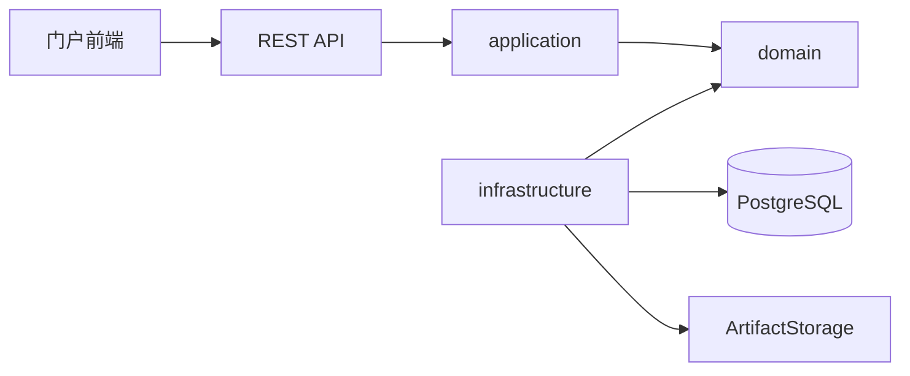
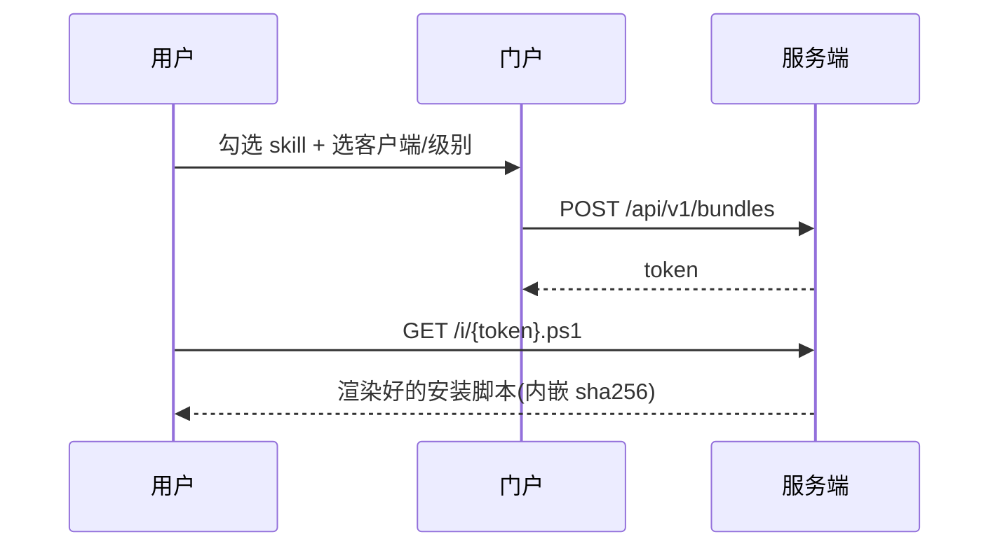
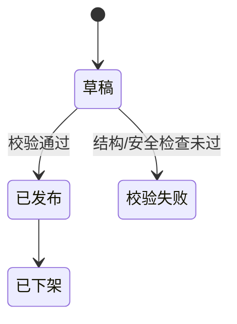

# docs/ 归集规范(单一事实源)

根 `.claude/CLAUDE.md` 与全部 agent 都引用本文件。文档组织只认这一份规则,别的地方写的不算。

中文,禁 emoji:状态 `[PASS]/[FAIL]/[WARN]/[SKIP]/[INFO]`,箭头 `->`。

## 一、两种文档,两种放法

**单篇文档** —— 技术决策记录、调研、复盘、方案说明:

```
docs/YYYYMMDDHHMMSS_文档标题.md
```

**流水线任务** —— 走 `需求 -> 架构 -> [后端|前端] -> 测试` 的成规模工作:

```
docs/YYYYMMDDHHMMSS-任务名/
├── 需求/     requirements-analyst 产出
├── 架构/     architect 产出
├── 后端/     backend-engineer 产出
├── 前端/     frontend-engineer 产出
└── 测试/     test-engineer 产出
```

任务目录由**主会话**用 `date +%Y%m%d%H%M%S` 建好后传给各 agent,agent 不自行造名(它们大多没有 Bash)。同一个任务的所有 agent **复用同一个目录**,不许各建各的。

## 二、什么时候必须留档

必须:

- 走了流水线的任务
- 技术选型或架构决策(为什么选 A 不选 B,放弃了什么)
- 踩坑到值得后人绕开的程度(同时往根 CLAUDE.md 第八节补一条)

不必须:

- 琐碎改动、单文件 bugfix
- 代码本身能说清楚的事

**不要为了留档而留档。** 判断标准:三个月后有人问"当时为什么这么做",文档里有没有答案。有就写,没有就别写。

## 三、必配图

成规模工作至少配一张图,统一用 **Mermaid**(GitHub 可渲染、可 diff、可被 Agent 读懂,不要贴截图或二进制图片)。

架构图:

````

````

时序图(跨组件流程用这个,比文字强十倍):

````

````

状态流转:

````

````

## 四、写作要求

- 结论先行。读者先看到"决定是什么",再看理由。
- 决策类文档必须写清:**背景 -> 备选方案 -> 取舍理由 -> 放弃了什么**。只写结论不写取舍的文档三个月后没人敢改。
- 不写"TBD""待补充"就提交。写不出来说明还没想清楚,想清楚再写。
- 代码片段用围栏并标语言。
